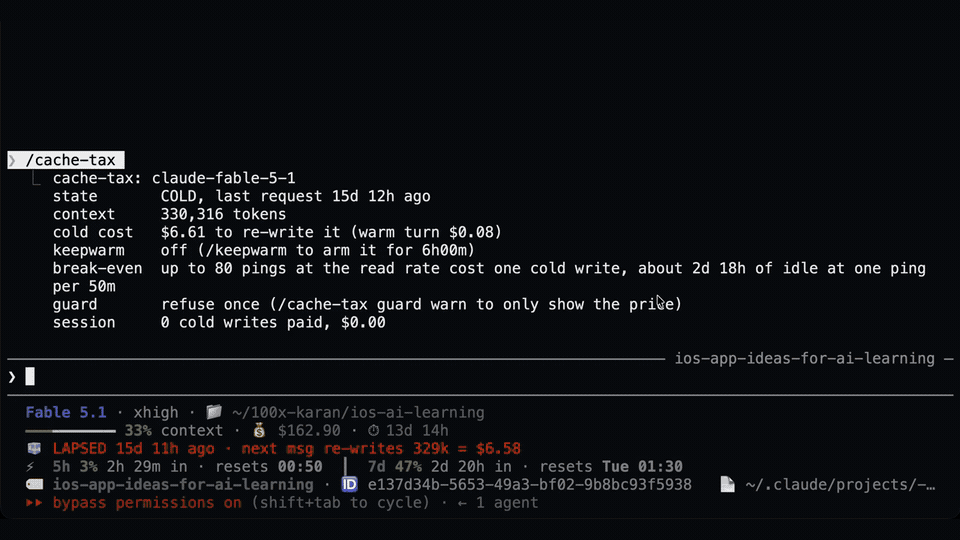

<picture>
  <source media="(prefers-color-scheme: dark)" srcset="site/assets/cache-tax-dark.svg">
  
</picture>

# Cache Tax pour Claude Code

**Gardez le cache de prompts de Claude Code chaud pendant les pauses.**

Cache Tax est un mod Claude Code qui recharge votre cache de prompts pendant que vous vous éloignez et affiche le coût estimé de réécriture avant un envoi à froid. Exécutez `/keepwarm 90m` avant une pause. Les pulsations consomment des jetons ; choisissez une fenêtre dans laquelle vous pensez revenir.

**[Installer](#installer)** · [Site web](https://cachetax.aidojo.si/) · [Comment ça marche](#comment-ça-marche) · [Coûts et limites](#coût-et-la-question-des-limites-du-forfait) · [Commandes](#commandes)



Un récapitulatif de deux lignes dans une session de 330k jetons a déclenché une **estimation de 6,61 $**. Après nouvel envoi, l'écriture de cache signalée était de **6,28 $**. Enregistré sur 2.1.1 ; la formulation actuelle indique « jusqu'à » le nombre estimé de jetons. Ce sont des coûts équivalents API, pas des frais supplémentaires d'abonnement.

## Installer

Nécessite [Claude Code 2.1.287 ou ultérieur](https://code.claude.com/docs/en/plugins/mods/overview#turn-mods-on-or-off), un cache d'une heure et Claude Code laissé en cours d'exécution. Les mods sont actifs par défaut. Les pulsations consomment des jetons, y compris une sortie non plafonnée.

```sh
claude plugin marketplace add karanb192/claude-code-mods
claude plugin install cache-tax@claude-code-mods
```

Redémarrez Claude Code ou exécutez `/reload-plugins` dans une session ouverte. Aucun indicateur d'accès anticipé n'est nécessaire. Si vous aviez défini `CLAUDE_CODE_ENABLE_FUNCTION_HOOKS` auparavant, retirez-le ; le Claude Code actuel l'ignore.

Dans une session chaude, exécutez `/keepwarm` pour armer six heures. Utilisez `/keepwarm 90m` pour une fenêtre plus courte, ou `/keepwarm off` pour arrêter.

**Vérifiez la durée de vie du cache principal.** L'utilisation incluse dans l'abonnement dure par défaut une heure. Les sessions avec clé API, crédits d'utilisation ou fournisseurs cloud durent par défaut cinq minutes : définissez alors [`promptCacheTtl`](https://code.claude.com/docs/en/prompt-caching#choose-the-ttl-yourself) sur `"1h"` pour ces modes de facturation. Un minuteur de 50 minutes ne peut pas protéger un cache principal de cinq minutes. Voir [Limites](#limites) pour les preuves issues de forks.

**Vous préférez un hook de réglages ?** La [version hook](https://github.com/karanb192/claude-code-hooks/tree/main/plugins/cache-tax) avertit par défaut, refuse une fois avec `CACHE_TAX_BLOCK=1`, et fournit un compte à rebours autonome dans la ligne d'état. Le maintien au chaud fait partie de ce mod.

Réalisé par [Karan Bansal](https://karanbansal.in/). Lisez [l'histoire de Cache Tax et les coûts de cache relevés](https://karanbansal.in/blog/cache-tax/).

## Options

Dans `/config`, sous cache-tax :

    Auto keepwarm:    on | off
    Display:          band | status
    Ping floor:       2 (un nombre, 0 ou plus)
    Headless prompts: guard | send

`on` (par défaut) conserve le comportement actuel : après avoir payé une écriture de cache à froid, keepwarm s'arme pour trois heures. `off` laisse keepwarm tranquille jusqu'à ce que vous l'armiez avec `/keepwarm` ; la formulation du garde indique alors que keepwarm reste désactivé, ou nomme le temps restant sur une fenêtre que vous avez armée. `/keepwarm always` l'active quand même dans les deux cas.

Le plancher de pulsation divise le coût estimé de réécriture à froid en budget de pause inactive : 2 autorise des dépenses de pulsation estimées en dessous de la moitié d'une réécriture ; 0 désactive la limite. Avant une pulsation, la dépense déjà observée dans cette pause plus l'estimation de la pulsation suivante doivent rester sous ce budget. L'estimation utilise la moins chère des cinq reçus chauds les plus récents, revalorisée pour le modèle et le contexte actuels, y compris leur palier de prompt. Un nouveau tour principal remet la dépense à zéro ; prolonger ou arrêter puis réarmer une fenêtre ne le fait pas. Une pulsation ignorée laisse le cache devenir froid. Le journal et le statut en indiquent la raison, et `$.cacheTax.status()` expose `pingSkipped` et `idlePingUsd`.

La première pulsation n'a aucun reçu, donc elle part. Une réponse ultérieure peut coûter plus que prévu : c'est une limite fondée sur une estimation, pas un plafond garanti. Sans prix de modèle, contexte ni reçus tarifés, aucune comparaison n'est possible. Les reçus et dépenses sont en mémoire : un redémarrage ou une nouvelle conversation les efface. Les pulsations peuvent s'arrêter avant la fenêtre de maintien demandée.

Display choisit où l'état s'affiche lorsque keepwarm est armé. `band` (par défaut) est la ligne au-dessus du prompt, avec une icône textuelle dans les terminaux et le cube sur Desktop. `status` place le même texte dans l'entrée de statut sous le prompt et ne dessine aucune ligne : utilisez-le lorsqu'un autre mod occupe l'espace au-dessus du prompt. Aucun réglage ne le masque : les pulsations coûtent des jetons, donc l'écran indique toujours quand elles s'exécutent.

## Comment ça marche

**Avant une pause :** `/keepwarm` arme une fenêtre bornée. Après 50 minutes d'inactivité, un minuteur dans Claude Code envoie un fork sans outil sur la transcription de la session. Il lit l'utilisation après chaque pulsation et s'arrête si les lectures sont nulles ou si les écritures atteignent 10 % des lectures. La limite de dépense inactive peut ignorer des pulsations ultérieures avant la fin de la fenêtre. Il n'y a aucune boucle d'interrogation de la transcription en arrière-plan.

**À votre retour, à froid :** pour un contexte d'au moins 50 000 jetons, le garde demande avant l'envoi de votre message ordinaire si son horloge d'une heure indique froid. La question montre le coût de réécriture estimé et des conseils de maintien. **Envoyer quand même** envoie ce message ; **Ne pas envoyer** le supprime. Si la boîte de dialogue est fermée ou si l'hôte ne peut pas y répondre, le garde refuse une fois et le nouvel envoi passe. Les hôtes SDK qui peuvent répondre conservent ce choix. `/cache-tax guard refuse 5` demande à partir de 5 $, y compris pour un modèle sans ligne de prix ; les envois moins chers journalisent leur prix et passent.

`Headless prompts: send` fait envoyer immédiatement les prompts non interactifs d'origine `sdk` au réglage de garde par défaut. Claude Code utilise ces mêmes champs pour les tours `claude -p` et les tours Agent SDK, donc l'option couvre les deux ; elle ne peut pas distinguer le CLI d'un hôte SDK. Le réglage par défaut, `guard`, continue de demander, ou refuse une fois lorsque personne ne peut répondre. Un `/cache-tax guard refuse` explicite, avec ou sans plancher en dollars, s'applique toujours avec `send` ; `/cache-tax guard default` efface cette préférence explicite. Les messages humains distants (origines `composer`, `bridge`, `unclassified` et canal) gardent le garde, même dans un hôte non interactif. Les notifications en arrière-plan et les prompts planifiés sont envoyés avec le prix journalisé, car personne ne peut les renvoyer.

Un refus headless renvoie sa raison et la journalise dans la transcription ou le journal de débogage. Utilisez `--debug-file` de Claude Code pour diagnostiquer un script. L'API des mods ne peut pas définir le code de sortie du processus ni écrire un refus sur stderr ; un refus ne produit pas nécessairement une sortie non nulle ni une raison sur stdout. Une exécution ayant choisi `send` et atteignant un plancher en dollars doit tout de même être retentée volontairement.

Par défaut, une écriture à froid détectée arme automatiquement au moins trois heures de keepwarm, la fenêtre always (six heures sauf autre réglage) avec `always` actif, et affiche son coût ; l'option Auto keepwarm désactive la partie automatique. `/cache-tax` montre l'estimation actuelle du cache, la fenêtre de maintien et le total des écritures à froid de cette session.

Le total suit les reçus de cache. Pour chaque requête, il estime l'ancien contexte réécrit comme le plus petit entre l'écriture signalée et le contexte précédent moins la lecture signalée. Une queue manquante inférieure à 10 % de la lecture est traitée comme un succès de cache. Nouveau contenu lors d'un succès n'est pas compté et n'arme pas keepwarm ; une réécriture partielle substantielle le peut. Chaque réécriture utilise le modèle et le palier de prix de cette requête.

Si l'hôte ne signale que l'utilisation cumulée des tours, l'estimation peut manquer une réécriture masquée par des lectures de cache ultérieures, et un tour compacté reste sans évaluation sans reçus par requête.

Lorsqu'un envoi autorisé par le garde ne montre aucune réécriture, une note finale explique qu'aucune fenêtre automatique d'écriture à froid n'a été ouverte, ou nomme l'état de maintien existant. Cela ne confirme pas l'état du cache côté serveur à partir d'une utilisation cumulée. Une écriture à froid interrompue par `/clear` ne peut pas ouvrir sa fenêtre automatique dans la conversation de remplacement.

Préparer ou ignorer une compaction laisse le maintien inchangé. Une compaction appliquée le suspend jusqu'à ce qu'une requête principale lise ou écrive le nouveau préfixe. Une fenêtre armée peut alors reprendre les pulsations pendant que le tour attend un outil ou une réponse humaine. Les écritures de résumé restent hors du total ; une réécriture payée avant compaction conserve son contexte et son prix d'origine.

Les fenêtres appartiennent à des sessions distinctes. Une session déjà froide attend votre prochain tour avant de pulsér, et une fenêtre restaurée après redémarrage de Claude Code aussi, jusqu'à ce que le nouveau processus ait un tour à dupliquer. Si une pulsation ne trouve rien à dupliquer, une note d'une ligne l'indique une fois, et les pulsations commencent après votre prochain message. Une pulsation refusée par une API occupée (429, 529, 5xx) est retentée après 1, 2 et 4 minutes tant qu'elle peut encore arriver avant que le cache ne devienne froid. Avec `always` actif, chacun de vos tours qui atteint le cache laisse au moins la fenêtre always (six heures par défaut) à la période par défaut, sous réserve de la limite de dépense inactive et d'une relecture chaude réussie. `/keepwarm always 24h` porte ce plancher à 24 heures pour toutes les sessions (1 h à 168 h ; un `/keepwarm always` nu revient à six). Le même tour ramène une fenêtre arrêtée, étend une fenêtre plus courte à la fenêtre always et réinitialise une période d'essai ; une fenêtre plus longue que vous avez définie reste. `/keepwarm off` dans une session arrête toutes les sessions à partir de leur prochain tour. Une fenêtre se termine à son échéance ; `/keepwarm off` l'annule aussi et efface le réglage always.

### Une pulsation de maintien enregistrée


Sonnet 5, 16 septembre 2026 : le statut indiquait **75k jetons lus à 0,02 $**. Rien n'est apparu dans la conversation pendant l'exécution réelle. Cette capture utilisait l'intervalle d'essai d'une minute sur 2.0.0 ; l'estimation de réécriture de 0,45 $ de sa carte utilisait une ancienne ligne de prix Sonnet, contre 0,30 $ pour le même contexte avec la ligne actuelle. La pulsation à deux cents est un reçu pour cette session, pas un prix fixe.

## Pourquoi un court message peut coûter si cher

Lorsque le préfixe mis en cache expire, même « fais-moi un récapitulatif » peut déclencher une réécriture de l'ancien contexte avant la réponse. La ligne de prix Fable 5.1 de Cache Tax compare une écriture d'une heure à 20 $ avec une lecture de cache à 0,25 $ par million de jetons : 80× par jeton, et non 80× d'économie totale. Voir les [hypothèses de prix](#coût-et-la-question-des-limites-du-forfait) et le [tableau des prix d'Anthropic](https://platform.claude.com/docs/en/about-claude/pricing).

[Regarder la présentation de 23 secondes](docs/assets/cache-cost-explainer.mp4). Ses scènes conçues indiquent les prix publics de Fable 5.1 ; chaque pixel de terminal et de ligne d'état provient de l'enregistrement réel du refus et du reçu de maintien ci-dessus. Le refus a été enregistré sur 2.1.1 et le recadrage du maintien sur 2.0.0.

Vous débutez avec le cache ? [Anthropic explique comment Claude Code l'utilise](https://code.claude.com/docs/en/prompt-caching).

## Commandes

    /keepwarm               maintenir au chaud pendant six heures
    /keepwarm 90m           maintenir pendant une fenêtre de votre choix, 1m à 168h (aussi 2h30m, 6h)
    /keepwarm always        garder chaque session chaude jusqu'à six heures après son dernier tour, mémorisé entre les sessions
    /keepwarm always 24h    idem, jusqu'à 24 heures après le dernier tour (1h à 168h)
    /keepwarm 6h every 2m   pulsation toutes les deux minutes ; réglage d'essai, 1m à 59m, oublié après cette fenêtre (avec always actif, à votre prochain tour)
    /keepwarm status        la fenêtre de maintien, la prochaine pulsation et le dernier reçu
    /keepwarm off           arrêter, oublier la fenêtre et désactiver always
    /cache-tax              la carte
    /keepwarm 90m (etc.)
    /cache-tax guard warn   montrer le prix et envoyer (valeur par défaut du hook)
    /cache-tax guard default
                            restaurer le garde par défaut et laisser Headless prompts contrôler les envois SDK non interactifs
    /cache-tax guard refuse demander avant un envoi à froid, outrepassant Headless prompts: send
    /cache-tax guard refuse 5
                            ne demander qu'à partir de 5 $ ; en dessous, afficher le prix et envoyer
    /cache-tax guard test   demander une fois au prochain prompt que vous envoyez comme si le cache était froid, tarifé selon le contexte de cette session ; le test ne comptabilise rien, un envoi dans un cache réellement froid est compté comme d'habitude

`/keepwarm` rejette les mots superflus, les durées invalides et les fenêtres hors limites sans modifier la fenêtre de maintien actuelle. Il écarte aussi au démarrage les échéances stockées invalides ou trop longues. Une fenêtre qui se termine avant sa première pulsation le dit dans sa réponse.

La question, mot pour mot, avec **Envoyer quand même (4,01 $)** et **Ne pas envoyer** en dessous :

    cache-tax: the prompt cache went cold 2h00m ago. Sending this re-writes up to 200,502 tokens at $20/MTok = $4.01 (a warm turn would have cost $0.05). Don't send saves $4.01; after Send anyway, keepwarm is armed for up to 3h00m. The cache read alone is about $0.05 per ping. Pings may stop sooner at the idle spending limit, leaving the cache to go cold. Send it anyway?

Lorsque la question est fermée ou qu'une exécution headless gardée ne peut pas l'afficher, le refus apparaît à la place et le nouvel envoi passe :

    cache-tax: the prompt cache went cold 2h00m ago. Sending this re-writes up to 200,502 tokens at $20/MTok = $4.01 (a warm turn would have cost $0.05). Send it again to pay it, and keepwarm will be armed for up to 3h00m, but may stop sooner at the idle spending limit. Or /clear and start from a note.

Le chiffre est une borne supérieure. Le nombre de contexte que le moteur signale pour une session reprise additionne l'entrée, la lecture de cache, l'écriture de cache et la sortie de la dernière réponse, et la charge de reprise ne comporte pas de compte de sortie séparé à déduire ; sur une session vieille de 15 jours, le garde indiquait 330 316 jetons et 6,61 $, et l'écriture qui a suivi portait sur 314k jetons, 6,28 $.

Tant que keepwarm est armé, le terminal et l'onglet Code de Desktop affichent une ligne au-dessus du prompt, sauf si Display est `status`. Les terminaux utilisent une icône textuelle `[>]` en gras avec la couleur d'état. Desktop montre le cube Cache Tax, avec un couvercle vert pour chaud, orange pour froid, et gris avant le premier tour ou après compaction. Le libellé d'état en gras correspond ; le minuteur et le reçu sont en graisse normale. Un `NO_COLOR` non vide sélectionne une icône textuelle en gras sur les deux surfaces et retire la couleur d'état. Les deux affichages indiquent `warm`, `cold` ou `unknown`, donc la couleur n'est jamais le seul signal. Ces états utilisent la même horloge d'une heure que `/cache-tax` ; ce sont des estimations, pas une vérification en direct du cache serveur.

La ligne et le repli en texte brut se rafraîchissent une fois par minute tant que keepwarm est armé, y compris à l'arrêt. Le rafraîchissement ne met à jour que l'affichage ; il n'envoie aucune requête au modèle.

La ligne comprend la fenêtre de maintien, la prochaine pulsation et la dernière relecture. Une boucle arrêtée montre un symbole neutre et sa raison. `/keepwarm off` ou une fenêtre expirée retire la ligne. Les enquêtes prennent temporairement la priorité, et le contenu des autres mods reste dans la bande. L'affichage `status` montre le même texte étiqueté dans l'entrée de statut ; les surfaces sans bande gardent le texte brut quand Display reste `band`.

Le cube Desktop et la couleur d'état froid du terminal suivent le thème clair ou sombre de Claude. Les SVG intégrés proviennent des ressources officielles du site ; les mainteneurs peuvent les régénérer avec `python3 tools/generate-status-icons.py`. Aucun fichier image n'est lu ou récupéré à l'exécution.

Le mod lit le thème et `NO_COLOR` une fois au démarrage de la session. Les changements de thème acceptés mettent l'icône à jour immédiatement ; les redessins ordinaires ne relisent aucun des deux réglages. Définissez `NO_COLOR` avant de démarrer la session.

## Les deux formes installées

Le hook et le mod partagent un nom et un rôle, donc les avoir tous deux signifie deux gardes sur chaque envoi à froid. Le mod vérifie au démarrage de session si la commande `/cache-tax:status` du hook existe et le dit une fois. N'en gardez qu'un. Le hook reste une option pour ceux qui préfèrent les hooks de réglages. Avant de le désinstaller, vérifiez votre ligne d'état : la ligne 🧊 reliée à `cache-tax.js` vient des fichiers du hook. Ce mod dessine au-dessus du prompt lorsque keepwarm est armé ; il ne remplace pas votre ligne d'état shell.

## Ce qu'il peut atteindre

Validé sur Claude Code 2.1.312 :

    ❯ ./register.ts hooks: config.set{key=theme}, ui.render{component=AbovePrompt}, session.start, session.end, classic.SessionStart, command.run{command=keepwarm}, command.run{command=cache-tax}, prompt.submit, turn.step, turn.complete, session.compact
    ❯ ./register.ts calls: $.clock.after (via arm, ping), $.clock.every (via updateStatus), $.clock.now, $.command.list, $.command.register, $.config.list, $.env.get, $.model.fork (via ping), $.session.id (via reseat, seat), $.session.model, $.session.usage, $.store.delete, $.store.get, $.store.set, $.ui.ask (via ask), $.ui.invalidate, $.ui.log, $.ui.resolve, $.ui.status
    ❯ ./register.ts env reads: NO_COLOR

Atteint le niveau L2, pilote Claude. Voit chaque prompt que vous tapez, le moment de chaque requête de modèle et le nombre de jetons de chaque réponse.

Le même relevé figure sur [la page de cache-tax dans Awesome Claude Code Mods](https://mods.aidojo.si/mods/karanb192--cache-tax--cache-tax/), qui consigne ce que des milliers d'autres mods peuvent atteindre.

    Modèle de menace pour cache-tax (atteint L2, pilote Claude)
    1. Lectures :    de chaque prompt, s'il commence par un slash et ne contient rien d'autre (le texte est transmis tel quel, jamais conservé, jamais journalisé) ; l'heure ; les comptes de jetons et l'identifiant du modèle que le moteur détient déjà sur turn.complete et sur la réponse du fork ; les champs de reprise que Claude Code calcule pour les hooks de réglages ; la liste des commandes ; l'identifiant de la session, le modèle de la session ainsi que le chiffre de contexte propre au moteur et l'heure de début, une fois par conversation exécutée par le processus, et à nouveau le modèle avant de tarifer un envoi à froid et avant chaque pulsation ; la raison et l'identifiant d'une conversation qui se termine sous /clear ou par une reprise dans le même processus ; le nombre de messages de chaque requête principale ; depuis son propre $.store, l'échéance du keepwarm et la période de pulsation indexées par identifiant de session, plus l'interrupteur global always (et sa fenêtre) et le mode de garde avec son plancher en dollars ; au chargement, ses options Auto keepwarm, Display, Ping floor et Headless prompts ; si la session démarre en interactif
    2. Exécutions :  un $.model.fork par période d'inactivité dans une fenêtre keepwarm, un par période de pulsation (50 minutes sauf réglage d'essai, plancher d'une minute), jamais hors de la fenêtre, jamais sur un cache que le mod sait déjà froid, jamais après une relecture qui n'a rien lu ou écrit au moins un dixième de ce qu'elle a lu, quand les prix et les reçus sont connus, seulement tant que la dépense inactive observée plus la prochaine pulsation estimée restent sous le coût de réécriture divisé par Ping floor (0 désactive la limite) ; une question dans la boîte de dialogue propre de Claude Code avant qu'un envoi à froid parte, ou au prochain prompt après /cache-tax guard test
    3. Envois :      rien ne quitte la machine, à part le fork, une requête API sur la transcription propre de la session avec un prompt fixe d'une ligne
    4. Persistance : dans $.store, l'échéance du keepwarm et la période de pulsation sous l'identifiant de cette session (réécrites après chaque tour quand always est actif), ainsi que l'interrupteur always (true, ou sa fenêtre en millisecondes) et le mode de garde (un plancher en dollars est stocké à sa place) pour toutes les sessions ; après un refus, l'heure de la dernière réponse sous l'identifiant de cette session, pour qu'un renvoi depuis un nouveau processus (claude -p en démarre un par tour) passe, supprimée par ce renvoi ou par /clear ; une fenêtre terminée est supprimée à l'arrêt et au prochain démarrage de cette session, avec les clés nues d'un store 2.1.0 ; les clés d'une autre session ne sont jamais supprimées ici, car une lecture suivie d'une suppression ne peut pas être rendue atomique face au renouvellement de sa fenêtre par cette session, donc une session qui a armé keepwarm et n'est jamais revenue laisse deux petites clés ; le compte des écritures à froid de la session, jusqu'à cinq reçus de pulsation chaude et la dépense des pulsations inactives vivent en mémoire et meurent avec le processus
    5. Entrée hostile : le seul texte qu'il analyse est l'argument de ses deux commandes, comparé à une regex de durée, un montant en dollars et quelques littéraux ; la réponse de la boîte de dialogue n'est comparée qu'à ses deux propres libellés ; du texte du prompt, seul le premier caractère non blanc est examiné, pour un slash ; les résultats d'outils et les fichiers n'atteignent jamais une branche ; le prompt du fork est une constante, donc rien de fabriqué ne peut être envoyé par son intermédiaire ; le garde ne supprime jamais que le message de l'utilisateur lui-même : après « Ne pas envoyer » le renvoi est demandé à nouveau, et après une question écartée ou sans réponse le renvoi est inconditionnel ; si un hook lève une exception, le moteur l'ignore et le message entre sans garde, avec une ligne atténuée

## Coût et la question des limites du forfait

Les prix sont ceux du tableau public, où Fable 5.1 lit à 0,25 $, écrit le palier 1 h à 20 $ et répond à 50 $ par million de jetons ; Fable 5.2 (0,20 $, 16 $, 40 $) et Sonnet 5 (0,20 $, 4 $, 10 $) ont leurs propres lignes. Seules les versions listées sont tarifées : un modèle plus récent que le tableau affiche `n/a` pour les dollars et une ligne indiquant qu'il n'a pas encore de ligne de prix, et il n'emprunte jamais le tarif d'un ancien modèle. Avec une clé API, l'arithmétique est simple. Une pulsation facture la lecture du cache, ses quelques jetons non mis en cache au tarif de base et ce que le modèle répond au tarif de sortie ; le coût de pulsation affiché compte tout, car un fork n'a pas de plafond de sortie et un modèle à effort élevé peut réfléchir avant de dire « chaud ». Un retour après l'expiration est une écriture. La carte affiche la borne supérieure en lecture seule pour votre modèle, 80 pulsations sur Fable 5.1, avec l'inactivité que cela couvre au rythme actuel ; une pulsation réelle coûte un peu plus qu'une lecture, donc le véritable seuil de rentabilité est en dessous. Sur un abonnement, les dollars sont une unité de mesure, pas la facture, et la façon dont une lecture de cache pèse sur les limites de 5 heures et hebdomadaires n'est documentée nulle part à ma connaissance. Surveillez la ligne de limitation de débit de votre ligne d'état pendant la première fenêtre.

## Limites

- Les mods exigent Claude Code 2.1.287+. Ils sont actifs par défaut, mais les réglages locaux, le mode sécurisé ou la politique de l'organisation peuvent empêcher leur chargement. Voir [contrôles des mods](https://code.claude.com/docs/en/plugins/mods/overview#turn-mods-on-or-off).
- La planification à 50 minutes exige un cache principal d'une heure. L'utilisation incluse dans l'abonnement l'a par défaut. Les autres modes de facturation doivent définir [`promptCacheTtl`](https://code.claude.com/docs/en/prompt-caching#choose-the-ttl-yourself) sur `"1h"`.
- Un retour vérifié par transcription au rythme par défaut, Fable 5.1 sur abonnement, 19 septembre 2026 : `/keepwarm` armé à la 42e minute d'une pause, pulsation à la 50e minute ayant lu 157k, et message envoyé à la 62e minute ayant lu 156 886 jetons depuis le cache et écrit 2 255. Le compte à rebours propre de Claude Code s'est réinitialisé à 58 minutes après la pulsation, donc le fork portait le TTL d'une heure. Une exécution, une configuration : cela montre que la pulsation a gardé ce cache en vie au-delà de l'heure, pas une économie nette pour toute configuration. Claude Code documente les forks dans son compartiment de requêtes non principales, normalement cinq minutes. Lors de cette exécution, le fork a tout de même lu le préfixe de session d'une heure et réinitialisé le compte à rebours natif. C'est un comportement observé dans une configuration, pas la preuve que tous les fournisseurs gèrent les compartiments de la même façon.
- Une pulsation qui lit à chaud prouve que le cache était chaud alors. Les changements de préfixe peuvent invalider le cache quel que soit le temps écoulé. L'effet exact dépend du modèle et du moment où Claude Code applique le changement ; voir [comportement du cache de Claude Code](https://code.claude.com/docs/en/prompt-caching).
- Les champs de reprise permettent au garde de vérifier le premier envoi ordinaire après reprise. S'ils sont absents, le premier tour amorce son horloge et son contexte.
- Sur les comptes Team et Enterprise, un plugin géré installé au-dessus de ce mod gère les événements classiques et la compaction et continue en dessous de lui, donc ils n'atteignent jamais le mod. Il apprend alors un `/clear` depuis la fin de session, donc keepwarm s'arrête et la nouvelle conversation a sa propre fenêtre ; le contexte d'une transcription reprise depuis les chiffres du moteur, sans heure de sa dernière réponse, donc à partir d'une heure après le premier lancement de cette transcription le premier message journalise ce que coûterait un envoi à froid au lieu de refuser ; et une compaction depuis une requête portant sur moins de la moitié des messages de la précédente (un retour en arrière en retire quelques-uns, un résumé en remplace des dizaines), donc une pulsation ou un envoi entre la compaction et cette requête voit encore l'ancien contexte. Le résumé écrit après une compaction n'est jamais compté comme écriture à froid ; une écriture à froid payée plus tôt dans le même tour l'est, lorsque l'hôte signale l'utilisation par requête. Une fenêtre traversée par une reprise en cours est déplacée vers les clés de la nouvelle session.
- Le compte de jetons du garde est une borne supérieure : c'est le contexte que le moteur signale pour la dernière réponse, qui sur une reprise inclut la sortie de cette réponse, et le mod n'a pas de compte de sortie séparé à soustraire.
- Le total des écritures à froid est par session et en mémoire ; `/clear` le vide.
- La taille du contexte est le chiffre de fenêtre en direct du moteur. L'utilisation propre d'un tour est la somme de ses réponses, donc sur un tour de dix étapes ce sont dix lectures du contexte ; ce n'est donc qu'un repli lorsque l'hôte ne signale aucun chiffre en direct.

## Développement local

Depuis un checkout local, chargez-le pour une session :

    claude --plugin-dir .

Pour le garder installé, utilisez les [commandes de marketplace](#installer).

Vous envoyez une modification ? [CONTRIBUTING.md](CONTRIBUTING.md) indique quelles preuves une PR doit apporter.

## Vérifiez sur votre propre session

Les tests à horloge simulée prouvent le minuteur, le garde et la comptabilisation, pas qu'un fork atteint le cache principal. Une pulsation le prouve, et coûte une lecture de cache plus la réponse. Dans toute session chaude :

    > Reply with one word: ready
    > /keepwarm 1h every 1m

Regardez la ligne au-dessus du prompt après une minute, ou l'entrée de statut si Display est `status` ou si la surface n'a pas de bande. `last ping read 20k $0.01` indique la relecture du fork. `keepwarm stopped: the ping read ... and wrote ...` signifie que la relecture n'a pas atteint le seuil chaud ; la boucle s'est arrêtée. `API busy, ping retry 1 of 3` signifie qu'un 429, 529 ou 5xx est retenté ; la boucle s'arrête si l'API est encore occupée après trois tentatives ou une minute avant que le cache ne devienne froid. `nothing to fork yet` signifie que le processus n'a aucune conversation à dupliquer, comme après un redémarrage ; la fenêtre attend votre prochain message. Toute autre erreur API, interruption ou réponse vide arrête la boucle avec une raison. Les moteurs plus anciens qui renvoient null affichent un message combiné d'instantané froid ou d'échec API. Terminez avec `/keepwarm off`. Cette courte vérification établit une lecture de cache, pas la rétention sur l'intervalle par défaut de 50 minutes.

## Tests et vérification des types

À exécuter depuis la racine du dépôt :

```sh
claude plugin validate .claude-plugin/plugin.json
claude plugin test .
```

Les [366 tests](tests/register.test.ts) utilisent une horloge et un moteur simulés. Ils couvrent :

- **Option Auto keepwarm :** désactivée, elle comptabilise une écriture à froid payée sans armer keepwarm et le dit dans le refus et la question ; une fenêtre armée à la main est promise jusqu'à son échéance et continue de pulsér ; always renouvelle toujours six heures.
- **Option Ping floor :** la dépense cumulée arrête une longue pause, un tour principal la remet à zéro, réarmer ne la remet pas à zéro, un reçu récent bon marché survit à une valeur aberrante chère, un changement de modèle est tarifé avant la pulsation suivante, et une commande off pendant la lecture du modèle annule cette pulsation. Une pulsation facturée à travers un arrêt compte encore, une qui se termine après un tour non, et un tour en erreur garde l'ignorance. Les couvertures existantes d'ignorance, compaction, effacement, contexte inconnu et limite désactivée restent.
- **Option Headless prompts :** adhésion pour les prompts SDK non interactifs, réponses SDK à la boîte de dialogue, gardes SDK interactifs et humains distants, refus explicite et planchers en dollars, retour au réglage par défaut, et un prompt arrivant pendant que les préférences stockées se chargent encore.
- **Garde :** la question Envoyer quand même / Ne pas envoyer, son repli lorsqu'elle est fermée et le test du garde, refus unique et nouvel envoi, y compris depuis un nouveau processus et après une erreur API sans réponse, mode avertissement, plancher en dollars (en dessous, dessus, modèle sans prix, modèle changé depuis le dernier tour), commandes slash, petits contextes, prompts non tapés, amorçage sur reprise et comptabilisation des écritures à froid.
- **Maintien :** valeurs par défaut des commandes et fenêtres/périodes refusées, always/off, always avec sa propre fenêtre et les fenêtres qu'il refuse, always après `/clear`, always roulé depuis le dernier tour, remises à zéro d'inactivité, arrêt fondé sur l'utilisation, expiration de fenêtre froide et minuteurs retardés après veille.
- **État de session :** clés de stockage isolées, fenêtres restaurées, nettoyage des anciennes clés, réinitialisations clear/compaction et isolement des sous-agents. Un effacement pendant l'horloge ou l'attente de stockage d'une fenêtre automatique ne peut pas armer la conversation suivante ni effacer sa fenêtre manuelle.
- **Préparation à la compaction :** préparer ou ignorer un résumé laisse le maintien inchangé. Après une compaction appliquée, une réponse principale qui lit ou écrit du cache permet au maintien de reprendre pendant que le tour attend des outils ou une réponse humaine. Les écritures de résumé restent hors du total des écritures à froid ; requêtes en échec et réponses périmées après un effacement, un arrêt ou une compaction plus récente ne peuvent pas relancer les pulsations.
- **Plugins gérés au-dessus du mod :** `/clear`, reprise, fenêtre restaurée et compaction avec les événements classiques et de compaction poursuivis sous le niveau utilisateur, les mêmes événements livrés deux fois ou dans le désordre sans deuxième fenêtre, avertissement ou réinitialisation, une fenêtre et un changement de modèle traversés par une reprise en cours, une transcription devenue assez ancienne pour être froide après sa reprise, un retour en arrière distingué d'une compaction, une écriture de résumé qui n'est pas une écriture à froid à côté d'une qui l'est (un envoi gardé compacté avant sa première requête, deux compactions dans un tour), une fin d'ancienne conversation qui chevauche ou dure plus longtemps que la reprise classique, et un `/keepwarm` exécuté avant que l'hôte ne signale l'identifiant de la conversation suivante.
- **Prix et affichage :** une ligne pour chaque modèle listé dans ses orthographes datées, par fournisseur et nom d'affichage, aucune ligne empruntée pour une version absente du tableau, une écriture à froid sans ligne de prix comptée à part du total en dollars, le palier de long prompt de Haiku 5.5 tarifé par requête, un long tour chaud dont les requêtes écrivent ensemble la moitié du contexte compté à part d'une écriture à froid, succès de cache gardés et grands collages non évalués, réécritures partielles séparées du nouveau contenu, lectures ultérieures ne pouvant masquer un manque par requête, anciens reçus écartés sur une requête maintenue ou une lecture de contexte pendant un effacement, Opus 4 et 4.1 distincts d'Opus 4.5, coûts de sortie et d'entrée non mise en cache, comptages de contexte, formatage des durées et chiffre de seuil de rentabilité en lecture seule.
- **Indicateur :** icônes textuelles de terminal sans éléments image, SVG Desktop, choix de thème, transitions chaud/froid, reprise, compaction, effacement, expiration, enquêtes, contenu d'autres mods et repli `NO_COLOR`.
- **Option d'affichage :** `band` dessine la ligne ; `status` déplace le texte, y compris son étiquette cache-tax et son état, vers l'entrée de statut sur terminal et Desktop sans ligne. Toute autre valeur, comme un ancien `off`, revient à la ligne.
- **Préférences :** une lecture par session, mises à jour immédiates du thème, changements refusés et thème effectif renvoyé par l'écrivain de réglages.
- **Échecs du fork :** une API occupée est retentée tant que le cache est chaud, une tentative qui se réveille trop tard est abandonnée, rien à dupliquer attend le tour suivant, une seule pulsation à la fois, une réponse arrivant après une requête, un `/clear` ou une compaction est écartée, et les autres échecs ainsi que le résultat null renvoyé par les anciennes versions s'arrêtent sans nouvelle tentative.

Les tests de rendu vérifient l'arbre d'éléments, pas les pixels natifs du terminal ou du Desktop. Ils ne valident pas la rétention du cache côté serveur. Voir [la vérification en direct](#vérifiez-sur-votre-propre-session).

### Vérification des types

Chargez ce checkout avec `claude --plugin-dir .` pour générer les déclarations à côté du plugin. Puis, depuis la racine du dépôt :

```sh
npx -p typescript tsc -p .
```

Les déclarations générées se trouvent dans `.claude-plugin/types/`. Gardez-les non suivies.

## Lire l'état depuis un autre mod

cache-tax ajoute un `$.cacheTax.status()` en lecture seule à l'API des mods, pour qu'une bande de statut puisse afficher keepwarm sans analyser `/cache-tax`. C'est expérimental jusqu'à 3.0 : les champs peuvent changer en version mineure. `cold` est la même estimation d'une heure que montre `/cache-tax`, pas une vérification du cache serveur. Il renvoie `{ keepwarm: 'on' | 'off' | 'stopped', leftMs, always, alwaysMs, autoWarm, guard, guardFloorUsd, cold, stopped, coldWrites, pingSkipped, idlePingUsd }` ; les types sont dans `types/index.d.ts`. Lorsque cache-tax n'est pas installé, il n'y a pas de `$.cacheTax`, donc l'appelant encadre l'appel dans `try`/`catch`.

## Plus de mods Claude Code

cache-tax est l'un des [mods de cache de prompts pour Claude Code](https://mods.aidojo.si/topics/prompt-cache/) listés dans [Awesome Claude Code Mods](https://github.com/karanb192/awesome-claude-code-mods). Parcourez le catalogue complet sur [mods.aidojo.si](https://mods.aidojo.si/) pour trouver un mod par tâche et voir ce auquel il peut accéder avant de l'installer.
