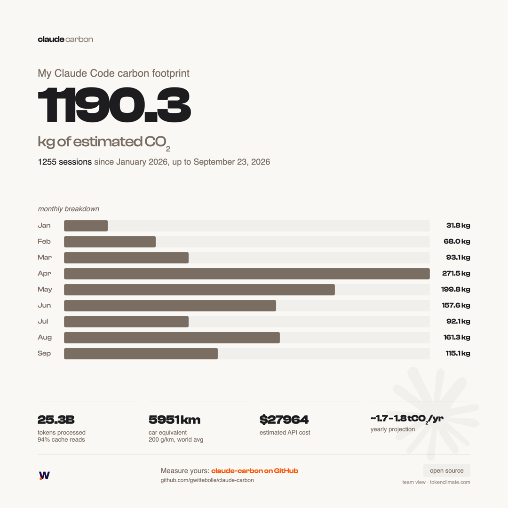
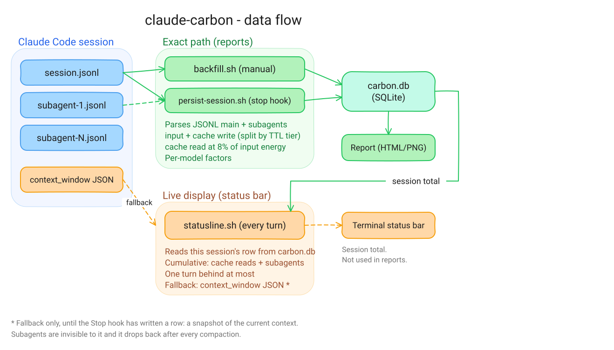

<p></p>

[](https://github.com/gwittebolle/claude-carbon/stargazers)
[](LICENSE)
[](https://github.com/gwittebolle/claude-carbon/releases)
[](https://www.npmjs.com/package/claude-carbon)
[](https://github.com/gwittebolle/claude-carbon/actions/workflows/ci.yml)

claude-carbon est un plugin open source pour Claude Code qui suit l'empreinte carbone de vos sessions : une estimation de CO2 en direct, calculée localement à partir de votre utilisation de jetons, dans la ligne d'état du terminal et dans l'onglet Code l'application Claude Desktop, à côté du coût équivalent API de la session. Dans l'application Desktop, `/carbon-panel` ouvre un volet avec une molécule de pixels colorée selon le CO2 de cette session par rapport à la médiane de vos sessions passées, votre utilisation sur la période choisie, ses bandes de réchauffement, et un bouton pour votre carte annuelle.

<p align="center"></p>

## Ce que fait claude-carbon

- `/carbon-panel` : un volet dans l'application Claude Desktop avec la molécule de CO2, votre utilisation et les bandes de réchauffement de vos sessions (dans un terminal, la session dans la bande au-dessus du prompt). Voir [le mod](#le-mod-carbon-panel-et-le-co2-de-chaque-réponse)
- Ajoute une estimation de CO2 en direct à la ligne d'état de Claude Code, et le CO2 de la session sous le prompt dans l'application Desktop, chacun à côté du coût équivalent API de la session
- Persiste chaque session dans une base SQLite locale, pour que l'historique survive à la purge des transcriptions de 30 jours
- Récupère les données historiques depuis les transcriptions `~/.claude` existantes
- Commandes slash : `/carbon-report` (texte), `/carbon-card` (PNG), `/carbon-pr` (empreinte d'une pull request)
- Un badge README avec votre total toutes périodes, et une méthodologie publique avec chaque facteur sourcé

> **À propos du chiffre `$`.** C'est un équivalent API : ce que votre session coûterait aux prix publics pay-as-you-go d'Anthropic. Sur un abonnement Pro, Max ou Ultra vous ne le payez pas ; il montre la valeur de ce que vous avez utilisé, à côté de son CO2. Voir [Comment ça marche](#comment-ça-marche).

## Installer

Dans Claude Code, tapez :

```text
/plugin install claude-carbon --marketplace gwittebolle/claude-carbon
```

Claude Code vous demande confirmer le marketplace, montre ce que le plugin installe, puis demande où l'installer : choisissez **Installer pour vous**. La même ligne fonctionne sur macOS, Linux et Windows. Dans l'onglet **Code** de l'application Claude Desktop, si la ligne n'est pas prise, collez plutôt ce message et acceptez quand Claude le demande :

```text
Install the claude-carbon plugin for me: claude plugin install claude-carbon --marketplace gwittebolle/claude-carbon
```

Puis quittez Claude Code complètement, rouvrez-le et démarrez une nouvelle session. Votre CO2 s'affiche maintenant à côté du coût de la session :

- dans un terminal, dans la ligne d'état : `$0.50 · 65gCO₂`
- dans l'application Desktop, sous le prompt : `Cette session : 3.6 gCO₂ · $0.12`

Le plugin définit cette ligne d'état une fois, au premier démarrage de session, et seulement si vous n'en avez pas : la ligne d'état d'un autre outil est laissée telle quelle (pour y ajouter le CO2, voir [ccstatusline](#utilisation-avec-ccstatusline)). `/carbon-report` donne vos totaux, et `/carbon-panel` ouvre le volet dans l'application Desktop. Le `$` est un coût équivalent API, pas ce que facture votre abonnement. Pour mettre à jour plus tard, exécutez `/carbon-update`.

<p align="center"></p>

<details>
<summary><b>Si l'installation s'arrête</b></summary>

- **macOS ouvre une fenêtre à propos des « outils de développement en ligne de commande ».** C'est `git`, dont Claude Code a besoin pour récupérer le plugin, et qu'un Mac sans outils de développement n'a pas encore. Cliquez sur **Installer**, attendez la fin (quelques minutes), puis réessayez l'installation.
- **« jq is not installed » ou « sqlite3 is not installed ».** Dites à Claude : « Installe ce qui manque. », puis redémarrez Claude Code. Tous les Mac ont `sqlite3`, et macOS 15 ou plus récent a aussi `jq`. Sur un Mac plus ancien, Claude peut installer `jq` avec Homebrew, ou le programme d'installation (voir Autres façons d'installer) récupère lui-même le `jq` officiel, vérifié avec sa somme de contrôle publiée. Sur Windows, `/carbon-panel` nomme le paquet manquant et Claude peut l'installer avec `winget`. Si `winget` répond « Access is denied », un logiciel de sécurité du PC le bloque : autorisez `winget` dans ce logiciel, puis réessayez.
- **Windows indique que Git Bash manque.** Installez [Git for Windows](https://git-scm.com/downloads/win) (Claude Code en a besoin sur Windows de toute façon), quittez complètement l'application, rouvrez-la, puis réessayez l'installation dans une nouvelle session. Claude Code cherche Git Bash au démarrage d'une session : une session ouverte pendant l'installation de Git fonctionne encore sans lui.
- **Installé depuis le marketplace communautaire d'Anthropic et le plugin ne se charge pas ?** L'entrée `co2-tracker@claude-community` est épinglée à une version d'août 2026 que les versions actuelles de Claude Code refusent (« Duplicate hooks file detected »). Exécutez `/plugin uninstall co2-tracker@claude-community`, puis installez comme ci-dessus.

</details>

<details>
<summary><b>Autres façons d'installer</b></summary>

- **Le programme d'installation**, un script qui clone ce dépôt et branche tout lui-même dans `~/.claude/settings.json`. Collez ce message dans Claude Code, ou exécutez vous-même la commande après le deux-points dans un terminal :

  ```text
  Install claude-carbon for me by running this command:
  curl -fsSL https://raw.githubusercontent.com/gwittebolle/claude-carbon/main/install.sh | bash
  ```

  Sur Windows, dans PowerShell (il faut d'abord [Git for Windows](https://git-scm.com/downloads/win) et deux paquets, voir [Windows](#windows)) :

  ```text
  Install claude-carbon for me by running this command in PowerShell:
  irm https://raw.githubusercontent.com/gwittebolle/claude-carbon/main/install.ps1 | iex
  ```

  Si le sélecteur de mode sous le prompt affiche **Auto**, choisissez d'abord **Manual** : le mode auto bloque une commande qui télécharge un script et l'exécute. Vous pouvez lire [install.sh](install.sh) avant de l'exécuter.
- **Avec Node.js :** `npx claude-carbon` lance le même programme d'installation.

N'utilisez qu'une seule méthode : plugin et programme d'installation ensemble exécuteraient chaque hook deux fois. Déjà installé avec le programme ? Rien ne change, `/carbon-update` le maintient à jour.

</details>

Non couverts : les onglets chat et Cowork et l'application web (claude.ai/code). Leurs sessions s'exécutent sur les serveurs d'Anthropic : rien n'atteint votre machine pour être compté.

## Exemple de rapport

<p align="center">
  
</p>

Générez la vôtre avec `/carbon-card` dans Claude Code. Le résumé et les PNG détaillés arrivent dans
`~/Downloads/claude-carbon/` (le dossier Téléchargements de Windows suit le réglage système, donc un
dossier redirigé vers OneDrive est respecté) et le dossier s'ouvre dans votre gestionnaire de fichiers, avec la
carte sélectionnée sur macOS. `CLAUDE_CARBON_EXPORT_DIR` choisit un autre dossier ;
`CLAUDE_CARBON_NO_OPEN=1` évite l'ouverture.

Sans Playwright ni Chromium, il n'y a pas de PNG et la commande se termine quand même : la
carte résumé est enregistrée comme page HTML dans le même dossier et s'ouvre dans votre navigateur,
à l'échelle de la fenêtre, et une capture d'écran fait l'affaire.
Le nombre de jetons sur la carte est tous les jetons traités par Claude, lectures de cache comprises, tels que `ccusage` les compte ; la ligne grise en dessous indique la part des lectures de cache. Le pied de la carte indique où trouver l'outil, `claude-carbon sur GitHub` / `claude-carbon on GitHub`, avec l'adresse en dessous.

Du 1er au 10 de chaque mois, la ligne d'état se termine par `📊 September: 84.2kgCO₂ · /carbon-card` :
le total du mois qui vient de se terminer, la barre que la carte lui dessine, dans le même format que
le chiffre de la session. Il est lu une fois par jour dans carbon.db tant que le rappel s'affiche, et conservé dans
`~/.claude/claude-carbon/last-month-total`. Un mois avec moins de 7 jours de sessions ne donne pas de
rappel, pour ne pas pousser une toute nouvelle installation à partager une carte presque vide. Générer une carte
efface le rappel pour le mois ; il se tait de lui-même après le 10. En décembre, il donne plutôt l'année
en cours, `📊 2026: 1444.4kgCO₂ · /carbon-card`, et reste tout le mois, la carte couvrant
l'année civile. Du 1er au 10 janvier, il donne l'année qui vient de se terminer, et pendant ces
jours `/carbon-card` couvre cette année entière, sauf si vous passez une période ou si cette année n'a aucune session (la
carte garde ces dix jours même quand le rappel est désactivé). `CLAUDE_CARBON_CARD_NUDGE_UNTIL_DAY`
déplace la date limite (0 supprime le rappel, décembre compris), `CLAUDE_CARBON_NO_CARD_NUDGE=1` supprime le rappel. Rien n'est publié nulle part :
le partage reste une décision humaine.

<details>
<summary>Options avancées (CLI)</summary>

```bash
# Depuis une date précise
bash ~/code/claude-carbon/scripts/generate-report.sh --since 2026-03-01

# Toutes les périodes
bash ~/code/claude-carbon/scripts/generate-report.sh --all

# Une période close (--until est une borne supérieure exclusive : celle-ci s'arrête au 30 juin)
bash ~/code/claude-carbon/scripts/generate-report.sh --since 2026-01-01 --until 2026-07-01
```

</details>

<details>
<summary>Répertoire d'installation personnalisé</summary>

```bash
curl -fsSL https://raw.githubusercontent.com/gwittebolle/claude-carbon/main/install.sh | CLAUDE_CARBON_DIR=~/my-path/claude-carbon bash
```

La variable d'environnement doit être du côté `bash` du pipe, pas du côté `curl`, sinon le programme d'installation ne la voit jamais.

</details>

<details>
<summary>Un second environnement Claude (CLAUDE_CONFIG_DIR)</summary>

Si vous utilisez un second environnement Claude Code avec son propre dossier de configuration, par exemple

```bash
alias claude-work="CLAUDE_CONFIG_DIR=~/.claude-work claude"
```

installez claude-carbon dans ce même dossier en passant `CLAUDE_CONFIG_DIR` au programme d'installation :

```bash
curl -fsSL https://raw.githubusercontent.com/gwittebolle/claude-carbon/main/install.sh | CLAUDE_CONFIG_DIR=~/.claude-work bash
```

La ligne d'état, les hooks, la base de données et les commandes `/carbon-*` vivent tous sous ce dossier de configuration : chaque environnement suit ses sessions de façon indépendante. Quand `CLAUDE_CONFIG_DIR` n'est pas défini, tout retombe sur `~/.claude` comme avant.

</details>

<details>
<summary>Installation manuelle</summary>

```bash
git clone https://github.com/gwittebolle/claude-carbon.git ~/code/claude-carbon
bash ~/code/claude-carbon/scripts/setup.sh
bash ~/code/claude-carbon/scripts/configure-settings.sh
```

Le second script fusionne le bloc ci-dessous dans `~/.claude/settings.json` (de façon additive : une ligne d'état ou des hooks tiers existants sont laissés seuls) et crée des liens symboliques vers les commandes `/carbon-*`. Pour brancher tout cela à la main, sautez-le et ajoutez :

```json
{
  "statusLine": {
    "type": "command",
    "command": "~/code/claude-carbon/scripts/statusline.sh"
  },
  "hooks": {
    "Stop": [
      {
        "matcher": "",
        "hooks": [
          {
            "type": "command",
            "command": "~/code/claude-carbon/scripts/persist-session.sh"
          }
        ]
      }
    ],
    "SessionEnd": [
      {
        "matcher": "",
        "hooks": [
          {
            "type": "command",
            "command": "~/code/claude-carbon/scripts/persist-on-exit.sh"
          }
        ]
      }
    ],
    "SessionStart": [
      {
        "matcher": "",
        "hooks": [
          {
            "type": "command",
            "command": "~/code/claude-carbon/scripts/safety-rescan.sh"
          }
        ]
      }
    ],
    "SubagentStop": [
      {
        "matcher": ".+",
        "hooks": [
          {
            "type": "command",
            "command": "~/code/claude-carbon/scripts/agent-stop.sh"
          }
        ]
      }
    ]
  }
}
```

Le hook `Stop` enregistre la session après chaque tour, et `SessionEnd` l'enregistre une dernière fois à la fermeture, donc un dernier tour interrompu avant `Stop` est quand même compté. Celui de `SessionStart` recherches les sessions manquées (crash, arrêt brutal) et pilote la vérification quotidienne de nouvelle version que lit la ligne d'état ; sans lui, vous ne serez jamais prévenu de l'existence d'une nouvelle version. `SubagentStop` enregistre la branche sur laquelle un agent a travaillé, pour `/carbon-pr`.

Redémarrez Claude Code.

</details>

## Pour les équipes

claude-carbon mesure les sessions d'un développeur, localement. Si la question vient de votre CTO, d'un appel d'offres client ou d'un comité RSE, la même méthodologie existe sous forme d'une couleur hébergée :

- [Calculateur gratuit](https://tokenclimate.com/en/calculator?ref=github) et [fiches de facteurs par modèle](https://tokenclimate.com/en/models?ref=github) — les facteurs exacts et versionnés de ce dépôt, consultables.
- [TokenClimate](https://tokenclimate.com/en?ref=github) — tableaux de bord d'équipe hébergés. Les deux côtés partagent les vecteurs de référence de ce dépôt, vérifiés chaque semaine en CI.

L'OSS y renvoie depuis cinq endroits : un pied d'une ligne dans `/carbon-report`, un petit crédit sur les PNG de `/carbon-card`, la dernière ligne d'un commentaire `/carbon-pr`, le bas du volet `/carbon-panel` et le champ `url` de `CITATION.cff`. Aucune pub dans la ligne d'état, aucune collecte d'e-mail : rien ne quitte votre machine.

### Empreinte de développement d'une PR (/carbon-pr)

Le chiffre que les relecteurs voient rarement est ce que la PR a coûté à développer : vos sessions Claude Code locales pendant la construction de la branche. `/carbon-pr` (ou `scripts/generate-pr-report.sh`) additionne les sessions enregistrées de la branche courante et publie un commentaire épinglé sur sa PR ouverte, avec votre propre authentification `gh`. Lancez-le après votre push ; le relancer met le même commentaire à jour sur place.

```
**Claude Code carbon report** · developing this PR

| CO2e | Cost* | Tokens (in + cache write + out) | Cache reads | Sessions |
|---|---|---|---|---|
| **124 g** | $3.00 | 180k | 1.5M | 2 |
```

Sous le tableau viennent l'équivalent voiture, un détail des jetons par modèle repliable et un pied d'une ligne.

Comment les sessions sont attribuées : le hook `Stop` stocke la branche git de chaque session (lue dans la transcription), et le rapport sélectionne `projet + branche`. Les sessions enregistrées avant l'existence de cette colonne n'ont pas de branche ; `scripts/backfill.sh` les répare tant que leurs transcriptions sont encore sur le disque (environ 30 jours). Une session dont le dernier dossier est un sous-dossier du dépôt est enregistrée sous le nom du sous-dossier et reste hors du total. Une session qui se termine sur une branche différente de celle où elle a commencé est attribuée à celle où elle finit.

Comment ses agents sont attribués : un agent compte avec sa session, sauf s'il a travaillé sur sa propre branche. Une session sur `main` qui envoie des agents construire une PR dans un worktree place leur part sur la branche de la PR, et le commentaire indique alors combien de sessions enregistrées ailleurs il inclut. Un hook `SubagentStop` (`agent-stop.sh`) lit la branche à la fin de chaque agent, tant que son worktree existe encore :

- un agent exécuté dans son propre worktree (agents isolés et agents de workflow de Claude Code) compte sur la branche qu'a alors ce worktree, sauf si Claude Code l'a nommée (`worktree-agent-*`, `worktree-wf_*`) ou si elle est détachée ;
- un agent exécuté dans le dossier de la session compte sur le worktree que ses appels d'outil nomment dans au moins la moitié de ceux qui donnent un lieu (une commande, un chemin de fichier), et aucun autre aussi souvent : chemins absolus, `~/`, `../` depuis le dossier du dépôt quand le worktree est à côté, `./` quand il est à l'intérieur. Jamais le dossier principal du dépôt, ni celui de la session. Celle-ci est une déduction à partir des commandes de l'agent.

Le hook stocke les jetons, le CO2 et le coût de cet agent, par modèle, dans une table `agent_usage`, avec le dépôt et le dossier du worktree ; la ligne propre de la session ne change pas. Le rapport retire ces agents de la branche de leur session et les ajoute à la leur, à condition que la ligne de la session contienne tous ses agents (`agents_collected = 2` : le hook `Stop` ou la réanalyse a lu toutes les transcriptions d'agents), qu'elle ait été écrite après la fin de l'agent (à la seconde suivante) et qu'elle ait été enregistrée avec la méthode actuelle (pas une ligne v1). Un agent qui a travaillé dans un autre dépôt que sa session n'est pas enregistré, et celui enregistré avant le déplacement de son dépôt reste avec sa session. Les forks sont exclus (ils rejouent les messages de leur parent), ainsi que le travail que la session fait elle-même dans un worktree. Seuls les agents qui se terminent avec cette version installée sont attribués : rien n'est reconstruit pour les sessions passées.

Le hook demande Claude Code 2.1.69 ou plus récent, le premier à fournir à `SubagentStop` le type de l'agent (son identifiant et sa transcription sont arrivés en 2.0.42) ; avec une version plus ancienne, il n'enregistre rien. Les agents propres de Claude Code (suggestions de prompt, `/btw`) sont exclus. Dans une session lancée sans `--agent`, leur type est vide : le matcher du hook les ignore depuis 2.1.275, le script lui-même avant cela. Avec `--agent`, ils portent le nom de cet agent et passent le matcher ; le script les ignore parce que leur transcription n'est pas une de celles que lit la ligne de la session.

Le hook s'exécute de façon synchrone, avant que le résultat de l'agent n'atteigne la session : sur un Mac, environ 0,1 à 0,3 s pour la plupart des agents, jusqu'à 1 à 2 s pour celui dont la transcription dépasse 100 Mo, puisqu'il la lit entièrement. Claude Code écrit les transcriptions de façon asynchrone : quand le message final de l'agent n'y est pas encore, le hook la relit toutes les 0,2 s, pendant 1 s au maximum, puis compte ce qui s'y trouve. Une base occupée plus de 10 s environ (une longue lecture ailleurs) perd l'enregistrement, et l'agent compte avec sa session.

#### Pour chaque PR d'un dépôt

Un dépôt peut demander le rapport sur ses pull requests. Ses mainteneurs commitent ceci dans `.claude/settings.json`, un changement que l'équipe relit comme un autre :

```json
{ "env": { "CLAUDE_CARBON_PR": "1" } }
```

Rien n'est publié uniquement avec cela. La première fois qu'un développeur ayant le plugin ouvre une pull request là avec Claude Code (`gh pr create`), Claude lui demande une fois s'il faut publier le rapport de ses propres sessions sous son propre compte GitHub. Sa réponse reste sur sa machine, par dépôt (`pr-consent.tsv` dans le dossier de données) :

- **oui** : le commentaire est publié quand la réponse se termine, puis mis à jour sur place après chaque `git push` ou `gh pr create` que Claude exécute là, une fois que la réponse ayant poussé est enregistrée et tant que la branche poussée est encore celle extraite. Un push que vous tapez vous-même dans un terminal ne déclenche rien. Un commentaire par PR, et jamais par lui-même sur une PR dont la branche vit dans un fork.
- **non**, ou pas de réponse : rien n'est publié et la question ne revient pas. `/carbon-pr` fonctionne toujours quand on le lance.

Changez votre réponse depuis le dépôt avec `scripts/generate-pr-report.sh --consent yes` ou `--consent never` (après un oui tapé dans un terminal, le premier commentaire vient avec votre prochain push ou `gh pr create` dans Claude Code) ; un oui n'est accepté qu'une fois la question vous ayant été posée là, ce qui couvre aussi une question jamais affichée parce que le tour a été interrompu. La réponse est conservée sous l'URL `origin` du dépôt (sans identifiants) : renommez le remote et la question revient une fois. Un dépôt ne peut pas répondre à votre place : les réponses ne sont jamais lues depuis un dossier de configuration ou une base placée dans le dépôt, et publié par lui-même le commentaire ne va qu'au dépôt nommé par `origin`, quoi que dise `GH_REPO`. `CLAUDE_CARBON_NO_PR_AUTO=1` dans votre propre environnement désactive la question et la publication partout. Pour l'arrêter pour le dépôt, retirez la ligne `CLAUDE_CARBON_PR`. Cela demande les hooks du plugin (installation depuis marketplace) : un clone issu du programme d'installation n'est pas interrogé et ne publie rien par lui-même. C'est prévu pour le dépôt d'une équipe ; sur un projet public, des contributeurs extérieurs verraient des commentaires qu'ils n'ont pas demandés.

#### Le total du dépôt

`scripts/generate-pr-report.sh --summary` relit, via `gh`, les rapports déjà publiés sur les pull requests fusionnées du dépôt et les additionne par mois de fusion et par auteur. `--since 2026-10-01` limite la période. Cela n'imprime que dans votre terminal, ne publie rien et ne lit pas votre base : les chiffres sont ceux que chaque auteur a publiés.

```
Month merged             PRs  Sessions       CO2e       Cost
2026-09                    2         4     1.8 kg     $57.26
2026-10                    1         1       69 g      $1.92

Author                   PRs  Sessions       CO2e       Cost
alice                      2         2      644 g     $19.18
bob-dev                    1         3     1.2 kg     $40.00

Total: 3 PRs, 5 sessions, 1.8 kg CO2e, $59.18 at API list price.
```

Un commentaire au format ancien d'une ligne, ou modifié à la main, est compté comme illisible et exclu. Cela couvre les pull requests qui portent un rapport, pas l'empreinte entière du dépôt, et en lit au maximum 100 à la fois.

En dehors d'un tel dépôt, c'est désactivé par défaut : rien n'est publié sauf si vous le lancez. `--dry-run` prévisualise le commentaire, `--pr <numéro>` vise une PR précise du dépôt (une ouverte depuis un fork est refusée : lancez la commandepuis le clone du fork), et supprimer le commentaire sur GitHub est le nettoyage complet. Une fois les agents du dépôt enregistrés, le rapport compte, depuis n'importe quel dossier, les sessions du dossier principal du dépôt, du worktree où la branche est extraite et des worktrees où ses agents ont travaillé, même supprimés depuis. Une branche extraite nulle part dont le nom est aussi porté par des sessions d'autres dossiers est refusée : rien n'est publié plutôt qu'un chiffre pouvant les omettre.

## Comment ça marche



**Trois chemins de données, deux niveaux de précision :**

| Script               | Déclencheur                 | Source de données     | Sous-agents  | Lectures de cache      | Précision       |
| -------------------- | --------------------------- | --------------------- | ------------ | ---------------------- | --------------- |
| `backfill.sh`        | Manuel / configuration      | Fichiers JSONL        | Inclus       | Comptées (8 % énergie) | Meilleure estimation |
| `persist-session.sh` | Hooks Stop + SessionEnd     | Fichiers JSONL        | Inclus       | Comptées (8 % énergie) | Meilleure estimation |
| `statusline.sh`      | Chaque tour (en direct)     | Ligne de `carbon.db`  | Inclus       | Comptées (8 % énergie) | Un tour de retard |

**backfill** et **persist-session** analysent les transcriptions JSONL brutes (session principale, fichiers des sous-agents et transcriptions des agents lancés par un workflow), en appliquant les facteurs d'émission par modèle. Ils dédupliquent les messages de l'assistant par `(message.id, requestId)`, pour ne pas compter deux fois les sessions reprises et compactées (cela correspond à `ccusage` ; sans cela, la somme des jetons gonfle d'environ 3 fois). Chaque session stocke sa répartition brute de jetons (entrée, écriture cache, lecture cache, sortie), qui alimente la base SQLite utilisée par les rapports.

La transcription d'un agent cesse de changer une fois celui-ci terminé, donc ses totaux sont conservés dans `~/.claude/claude-carbon/usage-cache/` (un petit fichier par session, supprimé par la réanalyse quotidienne 45 jours après sa dernière écriture) et relus seulement quand la taille, la modification, la date de changement ou l'inode du fichier change (le fichier vers lequel pointe un lien symbolique). Un agent dont une ligne n'est pas encore analysable, coupée par une écriture en cours, n'est jamais conservé. La transcription principale est toujours lue entièrement. `CLAUDE_CARBON_NO_USAGE_CACHE=1` lit tout à chaque fois et n'écrit pas de cache.

**Le coût** est la valeur théorique du tarif API public (pay-as-you-go), pas le prix de votre abonnement : entrée, sortie, écriture cache et lecture cache (0,1× entrée) aux tarifs actuels d'Anthropic, définis dans `data/prices.json`. Les écritures de cache sont facturées par palier de TTL, 1,25× l'entrée pour le palier 5 minutes et 2× pour celui d'une heure ; la répartition de chaque session est lue dans sa transcription plutôt que supposée (Claude Code écrit au palier d'une heure). Sur des données dédupliquées, cela correspond à `ccusage`.

**statusline** lit la ligne de cette session dans `carbon.db` à chaque tour, donc le CO2 affiché est le total de la session sur la même base que les rapports, avec au plus un tour de retard. Avant que cette ligne existe (premier tour, ou pas encore de base), il retombe sur une estimation à partir de `context_window.total_input_tokens`, qui est la taille du contexte courant plutôt qu'un total cumulé : les sous-agents lui sont invisibles et chaque compaction le fait redescendre. Dans tous les cas, la ligne d'état affiche, elle n'alimente jamais les rapports.

### La ligne d'état

Segments, de gauche à droite : projet + branche git, modèle + % de fenêtre de contexte, coût équivalent API de la session + CO2, % de quota d'abonnement + heure de réinitialisation. Le quota est la fenêtre de 5 heures, ou la fenêtre hebdomadaire quand aucune fenêtre de 5 heures n'est ouverte (toujours, sur un compte Ultra vérifié ; sur Pro et Max, entre la réinitialisation d'une fenêtre de 5 heures et votre prochaine requête) : `Use 41% 7d ↻Thu`, la réinitialisation étant indiquée par un jour de la semaine quand elle est à plus d'un jour. Un préfixe 🔥 apparaît quand le rythme de consommation soutenu dépasserait 100 % de la limite avant la fin de la fenêtre (une fois l'utilisation à 15 %, après un délai de grâce de 15 min pour la fenêtre de 5 heures et d'un jour pour l'hebdomadaire).

> **Où le CO2 s'affiche.** La ligne d'état est une fonctionnalité de l'interface terminal de Claude Code. Elle n'est affichée que lorsque vous lancez `claude` dans un terminal, y compris le terminal intégré de VS Code ou JetBrains. Le panneau de discussion des extensions IDE n'a pas de ligne d'état : rien ne s'y affiche, même si les hooks s'exécutent et vos sessions sont enregistrées : `/carbon-report` les couvre. Si vous utilisez le panneau VS Code et voulez le CO2 en direct, ouvrez un terminal dans VS Code (`` Ctrl+` ``) et lancez `claude` depuis celui-ci. L'application web (claude.ai/code) n'exécute ni la ligne d'état ni les hooks : rien ne s'y affiche ni ne s'y enregistre. L'application Desktop n'affiche pas non plus la ligne d'état ; le [mod](#le-mod-carbon-panel-et-le-co2-de-chaque-réponse) du plugin dessine le CO2 dans son onglet Code.

**Source du quota.** Le pourcentage vient d'Anthropic lui-même, des mêmes données que Claude Code affiche dans `/usage`. Aucune heuristique, aucun fichier de limite de jetons à initialiser. Deux sources, dans l'ordre :

1. **stdin** (préféré) : les `rate_limits` que Claude Code transmet dans le JSON de la ligne d'état, `five_hour` d'abord, sinon `seven_day`. Quand `rate_limits` est présent, une fenêtre qu'il omet n'existe pas, et rien d'autre n'est demandé.
2. **Repli API OAuth**, seulement quand stdin n'a pas de `rate_limits` (avant la première réponse de la session, ou avec un Claude Code plus ancien) : `GET https://api.anthropic.com/api/oauth/usage` avec le jeton bearer du trousseau macOS, `CLAUDE_CODE_OAUTH_TOKEN`, ou `~/.claude/.credentials.json`, au plus une fois par minute, réponse ou non. La réponse est mise en cache dans `~/.claude/claude-carbon/oauth-usage.json` ; une fenêtre sans heure de réinitialisation, ou dont la réinitialisation est passée, est exclue.

Précis sur Pro, Max et Ultra.

### Survivre à la purge des transcriptions de 30 jours

Claude Code supprime les transcriptions JSONL après environ 30 jours, donc la base SQLite est l'enregistrement durable. Les hooks `Stop` et `SessionEnd` capturent chaque session avant que sa transcription ne vieillisse, et une réanalyse quotidienne en arrière-plan (hook `SessionStart`, `safety-rescan.sh`) récupère toute session qu'ils ont manquée tant que sa transcription existe encore, y compris celle dont la transcription a continué de grandir après que sa ligne a été écrite. Comme chaque ligne stocke les comptes bruts de jetons, `recompute.sh` régénère coût et CO2 depuis `data/factors.json` + `data/prices.json` à tout moment, sans transcription. Quand Anthropic change un prix ou qu'un facteur est révisé, modifiez la configuration et exécutez :

```bash
bash scripts/recompute.sh
```

Les sessions enregistrées depuis septembre 2026 sont recalculées modèle par modèle, exactement. Les sessions plus anciennes sans répartition par modèle gardent leurs valeurs stockées ; `--include-unsplit` les recalcule avec leur modèle dominant, approximativement (voir METHODOLOGY.md, « Surviving the 30-day transcript purge »).

## Commandes

| Commande          | Ce qu'elle fait                                      |
| ----------------- | ---------------------------------------------------- |
| `/carbon-report`  | Rapport texte avec totaux, équivalent voiture, part d'un budget de 2 t, meilleures sessions |
| `/carbon-card`    | Génère des cartes de rapport PNG partageables         |
| `/carbon-badge`   | Badge shields.io de votre empreinte totale pour vos README |
| `/carbon-pr`      | Publie l'empreinte de développement de la branche courante sur sa PR |
| `/carbon-update`  | Met à jour vers la dernière version, quelle que soit la méthode d'installation |

<details>
<summary>Scripts (exécutés automatiquement, rarement nécessaires à la main)</summary>

| Script               | Ce qu'il fait                                                                              |
| -------------------- | ----------------------------------------------------------------------------------------- |
| `setup.sh`           | Initialise la base, récupère les sessions historiques, affiche le total                   |
| `statusline.sh`      | Script de la ligne d'état (appelé automatiquement par Claude Code)                        |
| `persist-session.sh` | Hook Stop (enregistre les données de la session après chaque tour)                        |
| `persist-on-exit.sh` | Hook SessionEnd (enregistre une dernière fois la session à sa fermeture, en arrière-plan)  |
| `safety-rescan.sh`   | Hook SessionStart (réanalyse en arrière-plan cadencée, récupère les sessions manquées)     |
| `agent-stop.sh`      | Hook SubagentStop (la branche sur laquelle un agent a travaillé, pour `/carbon-pr`)        |
| `backfill.sh`        | Réanalyse toutes les transcriptions JSONL historiques (sous-agents compris)                |
| `recompute.sh`       | Recalcule coût/CO2 depuis les jetons stockés après un changement de prix/facteur (sans transcriptions) |
| `generate-report.sh` | Exporte les cartes PNG (CLI, avec `--since` / `--until` / `--all`)                          |
| `generate-badge.sh`  | Affiche le markdown + l'URL du badge shields.io (CLI)                                      |
| `generate-pr-report.sh` | Publie l'empreinte de développement de la branche sur sa PR (CLI, `--dry-run` / `--pr`)  |

Note : backfill dérive maintenant les noms de projet du `cwd` de la transcription (comme le hook en direct). Les sessions récupérées avant ce changement gardent leurs anciens noms, parfois tronqués ; supprimez ces lignes et relancez `backfill.sh` pour les normaliser.

</details>

## Badge

`/carbon-badge` affiche un badge shields.io prêt à coller avec votre empreinte totale mesurée toutes périodes et le mois de la mesure, cliquable vers la méthodologie :

[](https://github.com/gwittebolle/claude-carbon/blob/main/METHODOLOGY.md)

<sub>Ce badge est réel, pas une maquette : le total de l'auteur, 1 208 sessions mesurées entre le 15 janvier 2026 et le 16 septembre 2026. C'est l'empreinte d'un développeur, pas celle du projet.</sub>

```markdown
[](https://github.com/gwittebolle/claude-carbon/blob/main/METHODOLOGY.md)
```

Le badge est une image statique construite depuis votre base locale, donc le chiffre est mesuré, pas estimé à la volée, et rien n'est envoyé nulle part. Le mois dans le message indique l'ancienneté du chiffre ; relancez `/carbon-badge` quand vous voulez rafraîchir les deux.

C'est le total d'un développeur : il a sa place dans le README de votre profil ou un projet personnel. Dans le dépôt d'une équipe ou d'une organisation, les relecteurs demanderont ce qui a produit le chiffre et pourquoi il renvoie hors de l'organisation, et ils auront raison.

Les nombres suivent langue du rapport (`fr` affiche `12,4 kg`, `us` et le réglage mondial affichent `12.4 kg`) ; `CLAUDE_CARBON_LOCALE` force un choix.

## Le mod : /carbon-panel et le CO2 de chaque réponse

Le plugin claude-carbon contient aussi un [mod Claude Code](https://code.claude.com/docs/en/plugins/mods/overview) qui affiche le CO2 de chaque réponse quand elle se termine, calculé localement avec la même formule et les mêmes facteurs que la ligne d'état, ainsi que le total de la session avec son coût au tarif API.

- **Terminal**, y compris le terminal intégré d'un éditeur et le plugin JetBrains : à l'extrémité droite de la ligne qui clôt chaque réponse, `✻ Worked for 38s · done 10:32 PM          16 gCO₂`. Une ligne garde le chiffre de sa propre réponse quand elle est redessinée (redimensionnement, défilement, ctrl+o) ; une ligne dessinée pour la première fois plus tard, comme une que seul ctrl+o montre, n'a pas de chiffre.
- **Application Desktop, onglet Code** : une ligne sous la réponse, seulement pour une réponse inhabituelle.
- **Une réponse inhabituelle** montre le ratio, et la part des sous-agents quand ils ont pesé dessus : `230 gCO₂ · 14× votre médiane`. Une réponse est inhabituelle quand elle dépasse le 97e percentile de vos 200 dernières réponses, plus de 3× leur médiane et au moins 10 g, soit environ une réponse sur 27 ; rien n'est signalé avant 50 réponses enregistrées.
- **Le total de la session** est épinglé sous le prompt, CO2 et coût au tarif API : `This session: 142 gCO₂ · $3.41`, en français `Cette session : 142 gCO₂ · 3,41 $`. Il s'affiche sauf si la ligne d'état claude-carbon le donne déjà ou si l'option `showSessionTotal` est désactivée (les deux seulement dans un terminal, voir [ccstatusline](#utilisation-avec-ccstatusline)). Le coût est le prix public pay-as-you-go de l'API pour les mêmes requêtes que le CO2, issu de `data/prices.json` avec la formule de `/carbon-report`, écritures de cache au palier d'une heure utilisé par Claude Code ; en dessous d'un centime, il indique `< 0,01 $`, et il est omis quand la liste de prix ne peut pas être lue, puis jusqu'à ce que le total recommence, pour que le coût ne couvre jamais une partie seulement des requêtes. C'est ce que coûterait l'utilisation sur l'API, pas ce que facture un abonnement. Sur un abonnement, l'entrée se termine par le quota tel que le montre la ligne d'état, `Use 23% ↻14:00` (`Usage 23 % ↻14:00`) : la part de la fenêtre de 5 heures utilisée et l'heure locale de réinitialisation, ou sans fenêtre de 5 heures la fenêtre hebdomadaire, `Use 41% 7d ↻Sat` (`Usage 41 % 7j ↻sam.`), lue directement dans Claude Code après chaque réponse, sans appel réseau. Viennent ensuite les deux indices de la ligne d'état : `⬆ 1.18.0 /carbon-update` quand une version plus récente existe, et du 1er au 10 du mois le mois qui vient de se terminer avec son total, `📊 September: 84.2 kgCO₂ · /carbon-card`, jusqu'à ce que vous fassiez la carte. Les sous-agents en arrière-plan, qui est la façon dont Claude Code en lance la plupart, comptent seulement dans le total de la session : jamais dans une réponse, ni dans votre médiane. Un sous-agent au premier plan compte dans la réponse qui l'a lancé, pas dans la suivante.
- **`/carbon-panel` ouvre un volet** avec la mascotte, une molécule de CO2 en pixels. Sa couleur compare cette session à la médiane de vos sessions passées, du bleu foncé (moins d'un huitième de celle-ci) au rouge foncé (plus de huit fois celle-ci). Avant 10 sessions enregistrées, il compare avec une référence de départ de 0,5 kgCO₂, pour avoir une couleur dès la première réponse. Elle saute d'un pixel de haut en bas pendant que Claude travaille, plus vite à mesure qu'elle rougit, et fait des expressions : elle regarde autour elle avant la première réponse, cligne de l'œil et jette un coup d'œil sur le côté pendant le travail, sourit pendant une session légère et transpire pendant une lourde, réagit à chaque réponse, cligne de l'œil au repos et s'endort après cinq minutes sans tour.

  <p align="center"></p>

  - **Dans l'application Desktop** le volet s'ouvre à droite, son onglet intitulé « claude-carbon », en deux blocs. Sous la molécule, l'échelle de couleurs, les huit couleurs du bleu au rouge, avec un repère sous celle de cette session. *Cette session* : son CO2, ses réponses, ses sous-agents et son modèle, le remplissage de sa fenêtre de contexte et sa valeur au tarif API, ainsi qu'une petite molécule par sous-agent, colorée selon son propre CO2. *Mon utilisation* : la période choisie (7 ou 30 derniers jours, 12 mois, tout, ou deux dates saisies, `01/05/2026`), ses chiffres en tuiles (CO2 tel que les rapports l’additionnent, variation par rapport à la même durée précédente, sessions, valeur au tarif API, équivalent voiture), puis les bandes de réchauffement de cette période, un jour, une semaine ou un mois par bande selon sa longueur, chacune colorée par rapport à la médiane des périodes affichées. La bande sous le pointeur s'illumine et sa date, son total et ses sessions s'affichent sous les bandes. Une tuile avec un (i) montre sa note au clic sur le (i), et la cache au second clic : la valeur au tarif API est ce que cette utilisation coûterait facturée via l'API, et un abonnement Pro, Max ou Ultra couvre une partie ou la totalité de ce montant (la facturation de chaque session n'est pas enregistrée, donc le volet ne dit jamais ce que vous avez payé). Un engrenage à côté de « Mon utilisation » active ou désactive la variation, la valeur au tarif API, la voiture, la répartition par projet (désactivée jusqu'à activation, chaque dossier avec sa part et ses kgCO2) et le détail ; le volet garde vos choix pour la session suivante. Le détail (désactivé jusqu'à activation) répartit la période par type de jeton, entrée non mise en cache, écritures de cache, lectures de cache et sortie : deux barres colorées donnent la part de chaque type dans les jetons et dans le CO2 (la partie sous le pointeur s'illumine et ses chiffres s'affichent sous la barre), puis une ligne par type avec ses jetons, son énergie et son CO2 avec leurs parts. Le CO2 de chaque session est celui stocké, réparti avec les poids que les facteurs donnent à chaque type (lectures de cache 0,08 d'un jeton d'entrée, sortie environ 21 fois un jeton d'entrée), donc les parts s'additionnent à ce qui a été stocké ; une session enregistrée avec d'anciens facteurs (avant juillet 2026), dont le CO2 ne correspond plus à ses jetons, est exclue et le bloc indique sur combien de sessions il répartit ; l'énergie est celle de départ des facteurs (énergie par jeton, PUE compris, convertie en CO2 avec le réseau AWS us-east à 287 gCO2/kWh), retrouvée en divisant ce CO2 par la même intensité. Cela demande les jetons par type dans `sessions-history.tsv`, que les hooks écrivent depuis cette version : après une mise à jour, le détail s'affiche à partir de la réponse suivante. Un bouton « Obtenir ma carte 2026 » place `/carbon-card` dans une saisie vide pour que vous l'envoyiez (la carte couvre l'année civile en cours, quelle que soit la période affichée dans le volet) ; il ne l'envoie jamais et laisse un brouillon que vous avez commencé tranquille. Quelques courtes lignes en bas renvoient à ce dépôt, au profil LinkedIn de l'auteur et à TokenClimate, la version entreprise.
  - **Dans le terminal** `/carbon-panel` saisi au prompt montre cette session dans la bande juste au-dessus, dans le rendu classique comme en plein écran (envoyé depuis l'application Desktop ou un téléphone vers une session dans un terminal, via Remote Control, il ouvre plutôt le volet latéral là-bas) : une petite molécule de 13 colonnes sur 4 lignes en demi-blocs, et à côté le CO2 de la session, ses réponses, ses sous-agents (un point chacun, dans sa couleur), son modèle, sa fenêtre de contexte et sa valeur au tarif API. La période et les bandes vivent dans l'application Desktop.
  - Relancez `/carbon-panel` pour fermer le volet ou effacer la bande. La commande est aussi une compétence du plugin, donc l'application Desktop la liste ; là où le mod ne s'exécute pas (panneau de discussion VS Code, session cloud), il indique seulement où le volet s'ouvre.
- **L'historique des bandes** est `sessions-history.tsv`, que le hook Stop écrit à côté de `carbon.db` après chaque réponse, en lecture seule sur la base. Chaque session enregistrée s'y trouve, les anciennes lignes telles qu'elles ont été stockées (elles gardent les facteurs de leur époque et ne sont jamais recalculées), donc les bandes, la médiane et les totaux comptent ce que compte `/carbon-report`. Une autre session en cours d'exécution compte avec son total actuel. Sans base encore (avant le premier démarrage de session d'un plugin installé seul, ou si `jq` ou `sqlite3` manque), le volet montre la molécule et dit ce que l'historique attend.

Claude Code ne dessine les mods que dans le terminal et dans l'onglet Code l'application Desktop : rien n'apparaît dans le panneau de discussion de l'extension VS Code, dans les sessions cloud ni avec `claude -p`. Les mods demandent Claude Code 2.1.287 ou plus récent (2.1.286 dans l'application Desktop).

Le mod vient avec le plugin. Déjà installé depuis le marketplace : exécutez `/plugin marketplace update claude-carbon` et `/plugin update claude-carbon@claude-carbon`, puis redémarrez Claude Code.

Le plugin seul enregistre vos sessions et définit la ligne d'état du terminal si vous n'en avez pas (voir [Installer](#installer)) :

```
/plugin install claude-carbon --marketplace gwittebolle/claude-carbon
```

Au premier démarrage de session après l'installation, le plugin crée sa base dans `~/.claude/claude-carbon/` et la remplit avec les sessions dont les transcriptions sont encore sur le disque (environ 30 derniers jours, tous projets), puis enregistre chaque session au fur et à mesure. Un message unique le dit à l'un des démarrages suivants. Il lui faut `jq` et `sqlite3` : si l'un manque, rien n'est créé et `/carbon-panel` le nomme. Cela n'arrive qu'une fois : une base que vous supprimez n'est pas recréée (supprimez le fichier `auto-setup` à côté pour en demander une nouvelle), un chemin de base défini avec `CLAUDE_CARBON_DB` n'est jamais créé pour vous, et `CLAUDE_CARBON_NO_AUTOSETUP=1` désactive tout cela. À partir de là, la vérification quotidienne en arrière-plan d'une nouvelle version s'exécute comme pour le programme d'installation (`CLAUDE_CARBON_NO_UPDATE_NOTIFIER=1` pour s'en désister).

#### Dans un dépôt d'équipe

Pour proposer le plugin à tous ceux qui travaillent dans un dépôt, committez ceci dans son `.claude/settings.json` :

```json
{
  "extraKnownMarketplaces": {
    "claude-carbon": { "source": { "source": "github", "repo": "gwittebolle/claude-carbon" } }
  },
  "enabledPlugins": { "claude-carbon@claude-carbon": true }
}
```

L'activer dans le dépôt ne le télécharge sur aucune machine, puisqu'il vient d'un marketplace distant : chaque collaborateur exécute une fois `claude plugin install claude-carbon@claude-carbon --scope project` dans son clone, après avoir fait confiance au dossier. Celui qui ne le veut pas met `"claude-carbon@claude-carbon": false` sous `enabledPlugins` dans son propre `.claude/settings.local.json`. Les chiffres de chacun restent sur sa machine.

Les programmes d'installation curl, PowerShell et npm configurent la ligne d'état, la base et les hooks, et copient le mod seul dans `~/.claude/skills/claude-carbon/`, que Claude Code charge comme `claude-carbon@skills-dir`. `/carbon-update` garde cette copie à jour. La copie ne contient aucun hook, donc rien ne s'exécute deux fois. Redémarrez Claude Code après l'installation ; le mod se charge une fois le dossier ouvert approuvé. Sa médiane démarre de zéro : les réponses enregistrées par une autre installation du mod ne sont pas reprises. Avec cette copie, le mod s'affiche dans le terminal, dans le terminal intégré de l'éditeur et dans l'onglet Code l'application Desktop.

Pour le désactiver, exécutez `claude plugin disable claude-carbon@skills-dir`. Pour le retirer, lancez le programme d'installation avec `CLAUDE_CARBON_NO_MOD=1` du côté `bash` (`curl … | CLAUDE_CARBON_NO_MOD=1 bash`) ; gardez la variable définie, dans votre shell ou dans le bloc `env` de `settings.json`, sinon le prochain `/carbon-update` remet la copie. Le programme laisse intact un dossier `skills/claude-carbon/` qu'il n'a pas créé, et saute la copie tant que le plugin claude-carbon est activé. Choisissez l'une des deux méthodes : un plugin ajouté par-dessus un programme d'installation exécute les hooks deux fois.

Désactivez le chiffre par réponse avec l'option `showPerTurn` dans `/config`. Le mod n'écrit aucune base, ne lance aucun processus, ne fait aucun appel réseau et ne change jamais ce que fait Claude ; en dehors de ses propres fichiers de données, il lit seulement `sessions-history.tsv`, les deux indicateurs de version de la vérification quotidienne (`plugin-update-check.json`, `update-check.json`), `last-card-month`, et les deux fichiers que le hook SessionStart laisse quand il ne trouve pas de base (`setup-needed`, `auto-setup`). Les textes sont en français quand le premier de `CLAUDE_CARBON_LOCALE`, `LC_ALL`, `LC_MESSAGES` et `LANG` qui est défini commence par `fr`, et en anglais sinon. Quand aucun n'est défini, comme dans l'application Desktop et souvent sur Windows, le réglage `language` décide (`Français`, `English`), puis le français.

Les tests du mod s'exécutent avec `bash tests/run-mod-kit.sh`, sous `claude plugin test`, qui simule le moteur : aucun login nécessaire. La CI les lance à chaque push avec Claude Code 2.1.296.

## Utilisation avec ccstatusline

Claude Code accepte une seule commande `statusLine` : la ligne d'état complète de claude-carbon et [ccstatusline](https://github.com/sirmalloc/ccstatusline) ne peuvent pas cohabiter. Si ccstatusline pilote votre ligne d'état, intégrez plutôt le segment CO2 : dans l'interface TUI de ccstatusline, ajoutez un widget `Custom Command` pointant vers

```
~/code/claude-carbon/scripts/statusline.sh --segment
```

(ajustez le chemin si vous avez installé avec `CLAUDE_CARBON_DIR`). Le widget reçoit le même JSON d'état sur stdin et n'affiche que le couple coût + CO2, par exemple `$0.68 · 35gCO₂`. Le mode segment ne touche jamais au réseau. L'enregistrement dans la base locale n'est affecté dans aucun cas : la persistance vient des hooks, pas de la ligne d'état.

Avec le segment dans ccstatusline, l'entrée de session du [mod](#le-mod-carbon-panel-et-le-co2-de-chaque-réponse) sous le prompt montre le total une seconde fois. Désactivez-la avec l'option `showSessionTotal` dans `/config` ; l'application Desktop, qui n'a pas de ligne d'état, la garde.

## Facteurs d'émission

Facteurs issus de [Jegham et al. 2025](https://arxiv.org/abs/2505.09598), une prépublication arXiv qui estime la consommation d'énergie de l'inférence LLM sur l'infrastructure AWS à partir de données publiques de performance d'API (latence, débit) sur des configurations matérielles déduites.

| Modèle | Première lecture (entrée, écriture cache) | Re-lecture (lecture cache) | Écriture (sortie) | Base |
| ------ | ----------------------------------------- | -------------------------- | ----------------- | ---- |
| Fable  | 156                                       | 12.5                       | 3304              | Extrapolé (2× Opus) |
| Opus   | 78                                        | 6.2                        | 1652              | Extrapolé (2× Sonnet) |
| Sonnet | 39                                        | 3.1                        | 826               | Ajustement sur 3 points (Jegham v6) |
| Haiku  | 10                                        | 0.8                        | 207               | Extrapolé (0,25× Sonnet) |

En gCO2e par million de jetons. Dans une session Claude Code, environ 98 % des jetons sont du contexte que Claude relit à chaque étape. Chacun pèse peu, mais ensemble ils font environ 60 % du CO2 ; le texte que Claude écrit représente moins de 1 % des jetons et environ 30 % du CO2 (30 jours de sessions de l'auteur, octobre 2026).

**Important : ce sont des estimations à l'ordre de grandeur, pas des mesures précises.**

- Les facteurs Sonnet sont un ajustement aux moindres carrés sur trois points des énergies par requête de Claude 3.7 Sonnet estimées dans Jegham et al. v6 (0,950 / 2,989 / 5,671 Wh), donnant un ratio sortie:entrée d'environ 21:1 ; des estimations publiques indépendantes tombent dans le même ordre de grandeur. Fable, Opus et Haiku sont extrapolés (Anthropic ne publie pas de consommation d'énergie par modèle) : Opus = 2× Sonnet (bande honnête 2×-5×), Haiku = 0,25×, Fable = 2× Opus. Voir [METHODOLOGY.md](METHODOLOGY.md).
- Les sessions exécutées sur des modèles non-Anthropic (par exemple des modèles locaux derrière `ANTHROPIC_BASE_URL`) sont enregistrées avec leurs jetons bruts mais coût/CO2 nuls et exclues des rapports - un facteur de centre de données ne s'applique pas à elles. Ajoutez des motifs à `exclude_models` dans `data/factors.json` pour exclure d'autres modèles par nom.
- Les jetons de lecture de cache sont comptés avec un facteur réduit (0,08 d'un jeton d'entrée par défaut, défini dans `data/factors.json`). Un jeton mis en cache évite la majeure partie du calcul de préremplissage ; le facteur est le résidu. C'est une estimation d'ingénierie tirée de la littérature, pas le ratio de facturation 0,1× d'Anthropic. La relecture du cache pendant le décodage croît avec la longueur du contexte × les jetons générés et n'est pas encore modélisée ; chaque session stocke ce produit (`output_context_sum`) pour qu'un terme calibré puisse être appliqué plus tard à l'historique. Voir [METHODOLOGY.md](METHODOLOGY.md).
- Vérifié par rapport à la littérature d'avril à septembre 2026 (articles de mesure, déclarations des fournisseurs, cadre Watershed) avec une analyse de sensibilité sur 30 jours de transcriptions réelles : aucun facteur n'a bougé, le chiffre affiché est plus probablement bas qu'élevé, prochaine vérification mars 2027. Voir [Où en est l'estimation](METHODOLOGY.md#where-the-estimate-stands-september-2026).
- L'intensité carbone utilise le réseau de la région AWS (basée sur la localisation, 0,287 kgCO2e/kWh), pas les données de réseau en temps réel. Cela se situe au bas de la plage « basée sur la localisation » ; la moyenne nationale américaine est d'environ 380 g/kWh.
- Anthropic ne publie pas ses émissions de portée 1, 2 ou 3. Ces estimations sont indépendantes et reposent sur la recherche académique, pas sur des données des fournisseurs.

L'équivalent voiture dans les rapports et les cartes suit votre langue, puisqu'un kilomètre en voiture émet jusqu'à 1,7× plus dans un pays que dans un autre : les 142 gCO2e/km de l'ADEME pour une langue française ou non détectée, les 393 gCO2e/mile de l'EPA pour une langue américaine, une moyenne mondiale de 200 gCO2/km sinon. Forcez un choix avec `CLAUDE_CARBON_LOCALE` (`fr`, `us`, `world`, ou toute chaîne de langue). Les facteurs sont dans `data/factors.json` sous `equivalences`.

`/carbon-report` donne aussi le total de l'année civile en cours en part de 2 tCO2e, l'objectif 2050 par personne pour une empreinte entière (ADEME, [Nos Gestes Climat](https://nosgestesclimat.fr/blog/environnement/reduire-empreinte-carbone-objectif-deux-tonnes), d'après les scénarios 1,5 °C du GIEC ; aussi Carbone 4, *Faire sa part ?*, 2019). C'est là pour donner une échelle : les 2 t couvrent tout ce qu'une personne émet en une année, IA comprise. Sources et réserves : [METHODOLOGY.md](METHODOLOGY.md#annual-budget-line).

Les facteurs sont modifiables dans `data/factors.json`. Voir [METHODOLOGY.md](METHODOLOGY.md) pour la base scientifique complète, la formule et les équivalences.

### Vecteurs de référence

La méthodologie est épinglée par des vecteurs de test de référence dans [`tests/methodology-vectors.json`](tests/methodology-vectors.json) : valeurs CO2/coût attendues calculées à la main pour des répartitions de jetons connues, rejouées par `bash tests/run-vectors.sh` en CI à chaque push. Les consommateurs en aval (comme TokenClimate) gardent une copie de ce fichier et vérifient chaque semaine que leur implémentation produit les mêmes nombres. Si vous modifiez `data/factors.json` ou `data/prices.json`, mettez à jour les vecteurs dans le même commit, sinon la CI échoue.

## Mise à jour

Quand une version plus récente est disponible, la ligne d'état affiche un discret `⬆ /carbon-update`. La vérification s'exécute en arrière-plan (au plus une fois par jour, jamais sur le chemin critique de la ligne d'état) ; désactivez-la avec `CLAUDE_CARBON_NO_UPDATE_NOTIFIER=1`.

- **Dans un terminal avec une installation par clone git**, cet indice apparaît à la fin de la ligne d'état, en nommant la nouvelle version.
- **Partout où le mod s'exécute** (application Desktop, et terminal sans ligne d'état claude-carbon), le même indice termine l'entrée de session sous le prompt, et le volet `/carbon-panel` nomme la version en haut de son pied. Pour une installation par plugin, la même vérification quotidienne ne demande à GitHub que les étiquettes de version et ne touche jamais au cache de plugins de Claude Code.
- **Installé avant l'été 2026** (version 1.0, sans aucun indice) ? Relancez l'installation, depuis l'application ou le terminal, comme dans [Installer](#installer).

Pour mettre à jour, exécutez `/carbon-update` dans Claude Code, quelle que soit la méthode d'installation : pour le plugin, il lance `claude plugin marketplace update claude-carbon` et `claude plugin update claude-carbon@claude-carbon`, pour le clone du programme d'installation son propre script de mise à jour. Redémarrez Claude Code ensuite. Avec les deux installations, comme quand la ligne d'état s'exécute depuis un clone, seul le plugin est mis à jour et la commande donne le `git pull` pour le clone. Vous pouvez aussi relancer le programme d'installation :

```bash
curl -fsSL https://raw.githubusercontent.com/gwittebolle/claude-carbon/main/install.sh | bash
```

- Mettre à jour le clone d'un programme d'installation recalcule automatiquement votre historique stocké avec les nouveaux facteurs (CO2 seulement ; les chiffres de coût sont laissés intacts) ; mettre à jour le plugin ne le fait pas. Lancez `scripts/recompute.sh --with-cost` vous-même seulement après un changement de prix.
- Si vous avez modifié `data/factors.json` ou `data/prices.json` localement, la mise à jour garde vos changements ; en cas de conflit avec l'amont, elle sauvegarde les vôtres dans `*.local.bak` et vous le dit.
- La mise à jour rafraîchit aussi la copie du [mod](#le-mod-carbon-panel-et-le-co2-de-chaque-réponse). Quand elle demande un redémarrage (sur Windows, une copie en cours d'utilisation ne peut pas être remplacée), redémarrez Claude Code et relancez-la ; jusque-là l'ancienne copie reste.
- Installé depuis le marketplace de plugins, vous pouvez aussi laisser Claude Code le mettre à jour tout seul : dans `/plugin`, onglet **Marketplaces**, sélectionnez `claude-carbon`, puis **Enable auto-update**. La nouvelle version se charge à la session suivante.

## Désinstallation

Pour une installation faite par le programme curl, PowerShell ou npm :

```bash
bash ~/code/claude-carbon/scripts/configure-settings.sh --remove
```

(ajustez le chemin si vous avez installé avec `CLAUDE_CARBON_DIR`). Cela retire de `~/.claude` la ligne d'état, les hooks, les commandes `/carbon-*` et la copie du mod, et rien qui appartienne à un autre outil : une ligne d'état qui appelle `statusline.sh --segment` reste, ainsi que tout autre hook d'un groupe partagé. Votre historique reste dans `~/.claude/claude-carbon/`. Pour tout supprimer, effacez ce dossier puis le clone.

Pour le plugin : `claude plugin uninstall claude-carbon@claude-carbon`, puis retirez de `~/.claude/settings.json` l'entrée `statusLine` qui nomme `claude-carbon/statusline.sh` : le plugin ne peut pas le faire en partant, et une fois parti cette ligne d'état n'affiche rien. Un plugin désactivé plutôt que désinstallé continue de la dessiner, jusqu'à ce que vous retiriez l'entrée. `CLAUDE_CARBON_NO_STATUSLINE=1` empêche le plugin de définir une ligne d'état du tout. Le plugin ne la définit qu'une fois : pour la faire remettre après l'avoir retirée, supprimez `~/.claude/claude-carbon/statusline-set`.

Installer une seconde copie par-dessus une première (autre dossier, ou programme d'installation après le clone du plugin) exécuterait chaque hook deux fois. Le programme s'arrête s'il trouve une autre installation branchée dans `settings.json`, la nomme et donne la commande qui la remplace (`configure-settings.sh --replace`). Les hooks laissés par une installation dont le dossier a été supprimé sont remplacés sans demande.

## Dépendances

- `jq` - analyse JSON
- `sqlite3` - base locale
- `git` - détection de branche dans la ligne d'état (facultatif)
- `curl` - quota d'abonnement via le point d'accès `/api/oauth/usage` d'Anthropic quand Claude Code ne le transmet pas (facultatif, au plus une fois par minute)
- `node` + Google Chrome, Microsoft Edge, Chromium ou Brave (ou `playwright-core` et son Chromium) - export PNG pour `/carbon-card` (facultatif)

`sqlite3` est préinstallé sur tous les Mac, et `jq` depuis macOS 15 (Sequoia). Sur un Mac plus ancien sans `jq`, le programme d'installation télécharge le binaire officiel jq 1.8.1 pour le processeur du Mac, le vérifie avec le SHA-256 publié par le projet jq, et le place dans `~/.claude/claude-carbon/bin/`, où les scripts et les commandes slash le trouvent ; un `jq` installé plus tard (Homebrew, par exemple) prend le dessus. Sur Linux : `apt install jq sqlite3`. Sur Windows, voir ci-dessous.

`/carbon-card` dessine ses PNG avec un navigateur de la famille Chromium exécuté sans interface, dans un profil jetable. Il utilise le Chromium de Playwright quand `playwright-core` est installé (cherché dans la résolution propre de node, la racine npm globale, `~/node_modules` et les modules node Homebrew), sinon le premier navigateur trouvé à son emplacement habituel : Google Chrome, Microsoft Edge, Chromium ou Brave sur macOS, Chrome ou Edge sur Windows, et sur Linux le premier d'entre eux sur le `PATH`. `CLAUDE_CARBON_BROWSER` en nomme un autre, par chemin ou par commande, ou `none` pour sauter la recherche. Un navigateur qui n'a rien dessiné après 60 secondes est arrêté et pas réessayé. Sans navigateur du tout, la carte s'ouvre dans votre navigateur par défaut comme page, et une capture d'écran fait office de carte.

## Windows

claude-carbon est en bash, et reste en bash sur Windows. C'est délibéré plutôt qu'un raccourci : sur Windows natif, Claude Code exécute la ligne d'état et les hooks via le bash fourni avec [Git for Windows](https://git-scm.com/downloads/win), avec repli sur PowerShell seulement quand Git Bash est absent ([doc de la ligne d'état](https://code.claude.com/docs/en/statusline#windows-configuration), [doc des hooks](https://code.claude.com/docs/en/hooks)). Le plugin parle le shell que son hôte lance déjà.

**Windows natif.** Installez d'abord Git for Windows, puis redémarrez Claude Code pour qu'il trouve Git Bash :

```powershell
winget install Git.Git --source winget
```

Ensuite, dans le même terminal, installez `jq` et `sqlite3`, les deux commandes que Git for Windows ne fournit pas, puis lancez le programme d'installation :

```powershell
winget install jqlang.jq --source winget
winget install SQLite.SQLite --source winget
irm https://raw.githubusercontent.com/gwittebolle/claude-carbon/main/install.ps1 | iex
```

Le programme vérifie la présence des deux et affiche la commande `winget` pour ceux qui manquent encore ; il ne lance pas `winget` lui-même.

Tout le reste dont le plugin a besoin - `bash`, `awk`, `sed`, `grep`, `date`, `curl`, `git`, `cygpath` - vient avec Git for Windows.

**WSL 2.** Rien de spécial : lancez le programme `curl | bash` dans votre distribution. Claude Code, ses transcriptions et claude-carbon vivent tous du côté Linux. C'est la voie à choisir si vos projets sont déjà dans WSL. VS Code l'atteint via l'extension Remote - WSL.

**Installation par marketplace.** `/plugin install claude-carbon@claude-carbon` se comporte comme sur macOS, une fois Git for Windows, `jq` et `sqlite3` présents.

### Spécificités Windows

- **Git Bash est obligatoire.** Sans lui, Claude Code route les commandes vers PowerShell, qui ne peut pas exécuter un fichier `.sh`. `claude doctor` indique le shell choisi. Si Git est installé quelque part d'inhabituel, indiquez-le à Claude Code dans `settings.json` : `{"env": {"CLAUDE_CODE_GIT_BASH_PATH": "C:\\Program Files\\Git\\bin\\bash.exe"}}`.
- **Les chemins dans `settings.json` utilisent des barres obliques** (`C:/Users/vous/code/claude-carbon/...`). Git Bash avale les antislashs non cités, et la commande échoue alors sans erreur visible. Le programme d'installation les écrit correctement ; seules modifications manuelles demandent de la attention.
- **Les commandes slash sont copiées, pas liées par symbolique.** Git Bash ne peut pas créer un vrai lien symbolique sans mode développeur, donc `/carbon-report` et compagnie sont copiés dans `~/.claude/commands/` et rafraîchis à chaque mise à jour.
- **Le bac à sable n'est pas disponible** sur Windows natif (une limitation de Claude Code, pas de ce plugin). Utilisez WSL 2 si vous en avez besoin.
- **`/carbon-card` demande aussi Node.js** : `winget install OpenJS.NodeJS --source winget`.
- **`winget` répond « Access is denied » (`0x80070005`)** : un logiciel de sécurité du PC le bloque, par exemple la protection comportementale d'un antivirus. Autorisez `winget` dans ce logiciel et relancez la commande.
- **Derrière un proxy ou antivirus qui inspecte TLS**, le clone échoue avec `SSL certificate problem: unable to get local issuer certificate`. Git for Windows vérifie les certificats avec sa propre liste d'AC, qui ne connaît pas la racine avec laquelle ces outils resignent le trafic ; le magasin de certificats Windows, lui, la connaît. Passez git sur ce magasin (la vérification reste active) et relancez le programme d'installation : `git config --global http.sslBackend schannel`. Le programme affiche cet indice quand il détecte le cas. C'est la même interception qui oblige `winget` à préciser `--source winget` sur ces machines : la source Microsoft Store échoue à la vérification de certificat et, sans source explicite, winget abandonne au lieu de prendre un autre dépôt.

La CI exécute toute la suite de tests sur `windows-latest` sous Git Bash, à côté d'Ubuntu, plus deux suites propres à Windows : `tests/run-windows-e2e.sh` (chemins natifs à travers le hook Stop et la ligne d'état, manifestes de hooks lancés comme Claude Code les lance) et `tests/run-install-ps1-tests.ps1`.

## Réduisez votre empreinte

Mesurer est la première étape. Les leviers ci-dessous sont ordonnés selon ce que la littérature de mesure 2026 et l'analyse de sensibilité de cet outil sur des transcriptions réelles disent compter le plus. Aucun ne s'accompagne d'un pourcentage : les facteurs d'émission ont une bande d'incertitude plus large que n'importe quel chiffre de gain. `/carbon-report` avant et après un changement, sur plusieurs sessions, est la mesure qui s'applique à vous. Le mécanisme, le sens et les sources de chaque levier sont dans [docs/reduce.md](docs/reduce.md).

- **Gardez le contexte court quand le modèle génère.** Presque tous les jetons d'une session sont des lectures de cache, et l'énergie d'un jeton généré croît avec le contexte dans lequel il est généré. Une session par tâche, `/clear` quand le sujet change, `/btw` pour les questions annexes, des sous-agents pour l'exploration et les opérations verbeuses.
- **Compactez à votre façon.** `/compact <instructions>` à une coupure naturelle, `/rewind` quand vous abandonnez une voie, `/autocompact 150k` pour borner la fenêtre, `CLAUDE_CODE_DISABLE_1M_CONTEXT=1` sur les modèles qui tournent par défaut à 1 M.
- **Réduisez ce que chaque tour transporte.** `/context` le montre. Un `CLAUDE.md` court avec le reste dans des compétences, les serveurs MCP inutilisés désactivés avec `/mcp`, un CLI plutôt qu'un serveur MCP quand les deux existent.
- **Ne cassez pas le cache en cours de session.** Choisissez le modèle et le niveau d'effort au départ ; `/usage` montre le taux de réussite et la cause probable du dernier échec.
- **Moins de tours, moins de boucles d'échec.** Une spécification et un test que l'agent peut lancer, un outil déterministe plutôt qu'une répétition, `/clear` après deux corrections infructueuses, aucun `/loop` laissé tourner sur une session inactive.
- **Ne demandez à l'agent que ce qui demande un agent.** Une tâche agentique consomme environ mille fois les jetons d'un échange de chat. Un `--help` ne coûte rien.
- **Adaptez le raisonnement et le modèle à la tâche.** `/effort low` sur le travail courant, défini au démarrage de la session ; Haiku pour les sous-agents via `CLAUDE_CODE_SUBAGENT_MODEL`.

Le même document traite de ce qui ne tient pas (filtres de sortie shell, compresseurs de prompt, additions de pourcentages), de l'harnais comme levier, et de ce qui ne dépend pas de vous pour l'instant.

### Projets liés

- [EcoLogits](https://ecologits.ai) - bibliothèque Python estimant l'empreinte des appels d'API GenAI chez plusieurs fournisseurs.
- [CodeCarbon](https://github.com/mlco2/codecarbon) - mesure les émissions du calcul que vous exécutez vous-même (entraînement, inférence locale).
- [ImpactIA](https://github.com/SNCFdevelopers/ImpactIA) - calculateur et guide d'impact IA de la SNCF, Wavestone et Resilio.
- [green-claude](https://github.com/Institut-du-Numerique-Responsable/green-claude) - compétence Claude Code qui oriente le code généré vers des règles d'éco-conception (RGESN, GR491).

### Pour aller plus loin

- [IEA - Energy and AI (2025)](https://www.iea.org/reports/energy-and-ai/) - projections des centres de données
- [Jegham et al. - How Hungry is AI?](https://arxiv.org/abs/2505.09598) - estimations d'énergie par modèle
- [UCL/UNESCO - 90 % d'énergie IA économisée](https://www.ucl.ac.uk/news/2025/jul/practical-changes-could-reduce-ai-energy-demand-90) - approches d'IA frugale
- [GreenIT.fr - Impacts IA 2025-2030](https://www.greenit.fr/impacts-ia-monde-2025-2030-rapport/) - données françaises

## Pourquoi

Chaque session Claude Code utilise du calcul réel, de l'énergie réelle, des émissions réelles. Le chiffre est petit par requête, mais il s'accumule. Le rendre visible est la première étape pour s'en approprier la responsabilité.

## Citer

Si les chiffres ou la méthodologie de claude-carbon aboutissent dans votre article, votre présentation ou votre produit, une citation est appréciée. Le bouton « Cite this repository » de GitHub génère du BibTeX/APA depuis [CITATION.cff](CITATION.cff). Forme courte :

> Wittebolle, G. (2026). claude-carbon: carbon footprint tracker for Claude Code sessions. https://github.com/gwittebolle/claude-carbon

Les cartes de rapport partageables portent déjà cette attribution dans leur pied, donc republier une carte telle quelle crédite l'outil.

## Open source

claude-carbon est libre et open source sous [licence MIT](LICENSE). Contributions bienvenues.

<p align="center"></p>

Les bandes de la bannière et de `/carbon-panel` s'inspirent des [warming stripes](https://showyourstripes.info) d'Ed Hawkins, dessinées ici à partir de vos propres sessions.

Créé par [Gaëtan Wittebolle](https://gaetanwittebolle.com), consultant carbone devenu développeur indépendant à Bordeaux, France. Version équipe : [TokenClimate](https://tokenclimate.com).
