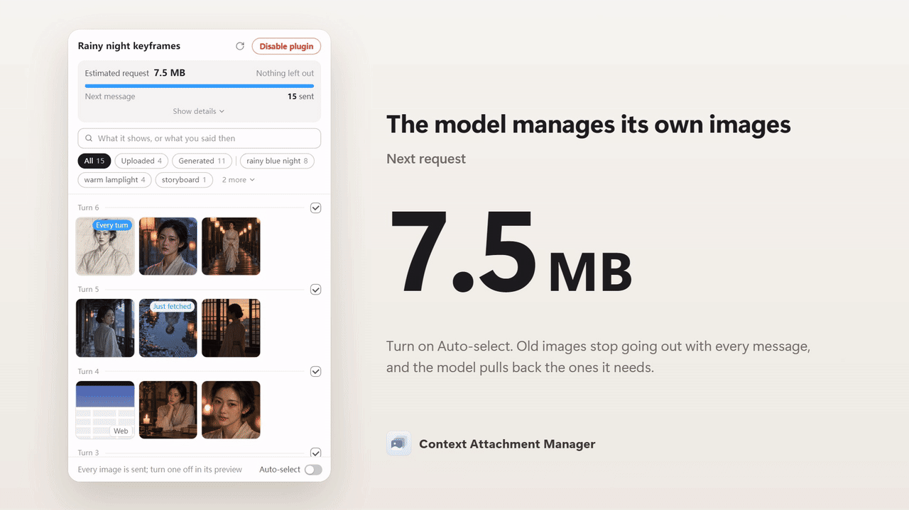
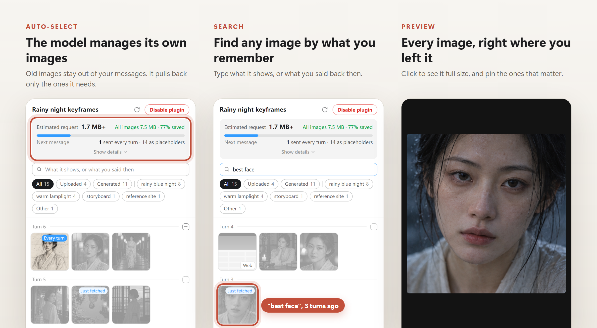
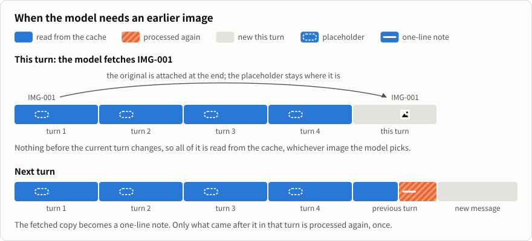

<p align="center">
  
</p>

<h1 align="center">Context Attachment Manager</h1>

<p align="center"><b>Un plugin local pour les discussions riches en images dans Codex, Claude Code et d'autres agents.</b><br>Les images anciennes ne sont plus renvoyées avec chaque message. Le modèle récupère celle dont il a besoin par son identifiant, même après compaction de la discussion.</p>

<p align="center">
  <a href="https://github.com/chipfighter/context-attachment-manager/releases"></a>
  
  <a href="LICENSE"></a>
</p>

<p align="center"><b>English</b> · <a href="README_CN.md">简体中文</a> · <a href="README_JA.md">日本語</a> · <a href="README_KO.md">한국어</a> · <a href="README_ES.md">Español</a> · <a href="README_PT_BR.md">Português (Brasil)</a> · <a href="README_FR.md">Français</a> · <a href="README_DE.md">Deutsch</a></p>

<p align="center">
  
</p>

## Ce que fait ce plugin

Un envoie normalement à nouveau chaque image précédente avec chaque message : une longue discussion avec beaucoup d'images devient lente et peut cesser de passer. Ce plugin numérote chaque image (`IMG-001`, `IMG-002`, …) et envoie les anciennes sous forme de courts espaces réservés :

- **Le modèle récupère ce dont il a besoin** : quand il doit revoir une image ancienne, il récupère l'original par son identifiant.
- **Il peut distinguer les images** : le modèle note une ligne sur le contenu de chaque image, avec vos commentaires. Ces informations restent dans les espaces réservés, même après compaction.
- **Le cache continue de fonctionner** : un espace réservé est écrit une fois puis reste inchangé, donc la conversation précédente est toujours lue depuis le cache de prompt du modèle. Voir [the design](#design-keep-the-cache-working).
- **Rien n'est supprimé** : vos images originales et l'historique de discussion restent tels quels.

Le plugin est activé par défaut ; vous n'avez pas besoin d'ouvrir le panneau. Usages typiques : création d'images et de vidéos, documents scannés, utilisation d'ordinateur et de navigateur.

## Installation

Envoyez ceci à votre agent. Il identifie sa plateforme et installe la configuration adaptée :

```text
Install Context Attachment Manager for me, following https://github.com/chipfighter/context-attachment-manager/blob/main/INSTALL.md
```

Redémarrez ensuite l'agent (dans Claude Desktop, démarrez une nouvelle session Code). Voir [supported agents](#works-with) et [installation, updates and uninstall](INSTALL.md).

## Le panneau, quand vous voulez contrôler

<p align="center">
  
</p>

- **Trouver une image** par un détail ou un commentaire dont vous vous souvenez, comme « nuit pluvieuse » ou « meilleur visage ».
- **Garder une référence visible** : ouvrez une image et cochez **Send every turn**.
- **Choisir les images vous-même** : désactivez **Auto-select** et sélectionnez ce qui accompagnera votre prochain message.

Dans **Codex**, ouvrez **Context Assets** dans le panneau latéral de la tâche. Dans l'**onglet Code de Claude Desktop**, le panneau s'ouvre automatiquement quand il y a des images ; tapez `/cam` pour le réafficher.

## Confidentialité

Le plugin s'exécute localement. Vos images originales et votre historique restent sur votre ordinateur ; les requêtes vont vers le service que votre agent utilise déjà.

## Comment nous avons testé

Dans Codex, une discussion avec neuf images-clés a atteint 42,4 Mo et ne pouvait plus être envoyée après un redémarrage ou une compaction ; avec le plugin, les mêmes requêtes faisaient 0,12 Mo. Voir [Codex comparison](eval/README.md) et [Claude Code long-task comparison](eval/long-task/README.md) pour les résultats et les étapes de reproduction.

## Conception : garder le cache actif

Les services de modèle mettent en cache le début d'une conversation. Quand une requête commence exactement comme la précédente, cette partie est lue depuis le cache, ce qui est plus rapide et bien moins cher. Quand quelque chose au début change, tout ce qui suit la modification est retraité.

Toute méthode pour réduire une longue conversation doit changer quelque chose. Le plugin effectue sa modification le plus tard possible dans la conversation :

<p align="center">
  
</p>

- **L'espace réservé est écrit une fois** : une image devient un espace réservé dès le tour suivant son apparition, donc seul le reste de ce tour est retraité. Ensuite l'espace réservé reste identique de requête en requête.
- **La récupération ne change rien d'antérieur** : l'original est ajouté à la fin du tour courant et son espace réservé reste en place. Quelle que soit l'image choisie par le modèle, et quel que soit le nombre d'images, tout ce qui précède le tour courant reste lu depuis le cache.
- **Le modèle récupère l'original** : pas une copie réduite, ni un résumé.

<p align="center">
  
</p>

Ce n'est pas gratuit. Après un tour avec des images, le reste de ce tour est retraité une fois, et le modèle écrit une courte ligne pour chaque nouvelle image. Modifier une ancienne image dans le panneau (la décocher, la recocher, **Send every turn**) modifie la conversation au niveau de cette image, donc ce qui suit est retraité une fois. Dans notre [comparaison sur une longue tâche dans Claude Code](eval/long-task/README.md), 87 % de l'entrée était lue depuis le cache avec le plugin et 91 % sans lui.

La troisième ligne de la première figure correspond aussi à ce que fait la compaction propre à un agent, ou à l'effacement des anciens résultats d'outils côté API (comme l'édition de contexte d'Anthropic) : le contenu ancien est retiré et ce qui suit est retraité.

## Compatibilité

Codex et Claude Code sont testés ; Codex et Claude Desktop disposent aussi du panneau. Les autres agents ci-dessous sont pris en charge via des adaptateurs écrits à partir de leur code et de leur documentation, mais nous ne les avons pas encore testés en réel. Si vous en utilisez un, merci de [tell us how it went](https://github.com/chipfighter/context-attachment-manager/issues), que cela ait fonctionné ou non.

| Agent | Ce que c'est | Prise en charge |
|---|---|---|
| [Codex](https://github.com/openai/codex) | Agent de programmation d'OpenAI, bureau et CLI | Auto-sélection + panneau, testé |
| [Claude Code](https://github.com/anthropics/claude-code) | Agent de programmation d'Anthropic, bureau et CLI | Auto-sélection + panneau (bureau), testé |
| [WorkBuddy](https://www.workbuddy.cn) | Assistant IA de travail de bureau de Tencent, avec CodeBuddy intégré | Auto-sélection, pas encore testé |
| [OpenCode](https://github.com/anomalyco/opencode) | Agent de programmation terminal open source pour tout fournisseur de modèles | Auto-sélection, pas encore testé |
| [Gemini CLI](https://github.com/google-gemini/gemini-cli) | Agent terminal open source de Google | Auto-sélection, pas encore testé |
| [pi](https://github.com/earendil-works/pi) | Agent de programmation terminal minimal et extensible | Auto-sélection (extension pi), pas encore testé |
| [DeepSeek Harness](https://github.com/deepseek-ai/deepseek-harness) | Harness d'agent DeepSeek où tout est plugin | Auto-sélection (plugin dsh), pas encore testé |
| [Qwen Code](https://github.com/QwenLM/qwen-code) | Agent terminal open source de Qwen | Auto-sélection, pas encore testé |
| [Cline](https://github.com/cline/cline) | Agent de programmation open source pour VS Code, JetBrains et le terminal | Auto-sélection, pas encore testé |
| [Kilo Code](https://github.com/Kilo-Org/kilocode) | Agent de programmation open source pour VS Code, JetBrains et le terminal | Auto-sélection, pas encore testé |
| [goose](https://github.com/aaif-goose/goose) | Agent open source pour bureau et terminal, étendu via MCP | Auto-sélection, pas encore testé |
| [Cherry Studio](https://github.com/CherryHQ/cherry-studio) | Client de discussion open source pour de nombreux modèles | Auto-sélection, pas encore testé |

Configuration de ces agents : [INSTALL.md](INSTALL.md#other-agents). Pour connecter un autre agent, voir [ADAPTERS.md](ADAPTERS.md).

## FAQ

### Pourquoi Codex et Claude Code deviennent-ils lents dans une longue discussion avec beaucoup d'images ?

L'agent renvoie chaque image précédente avec chaque message : une longue discussion avec beaucoup d'images devient lente et peut cesser de passer. Dans Codex, une discussion avec neuf images-clés a atteint 42,4 Mo et ne pouvait plus être envoyée après un redémarrage ou une compaction ; avec Context Attachment Manager, les mêmes requêtes faisaient 0,12 Mo.

### Context Attachment Manager casse-t-il le cache de prompt ?

Un peu seulement. Un espace réservé est écrit une fois puis reste inchangé, et une image récupérée est ajoutée à la fin du tour courant, donc les tours précédents restent lus depuis le cache. Après un tour avec des images, le reste de ce tour est retraité une fois. Dans notre comparaison sur une tâche longue dans Claude Code, 87 % de l'entrée était lue depuis le cache avec le plugin et 91 % sans lui.

### Quelle est la différence avec la compaction ou la réduction des images ?

La compaction et la suppression de l'historique ancien retirent la partie ancienne de la conversation, et la réduction des images la modifie. Dans les deux cas presque toute la conversation est retraitée, et il reste au modèle un résumé ou une copie plus petite. Avec Context Attachment Manager, seul le reste du tour précédent est retraité, et le modèle récupère l'image originale par son identifiant.

### Le modèle peut-il encore voir une image ancienne ?

Oui. Chaque image possède un identifiant tel que `IMG-001`, et le modèle récupère l'original quand il doit la revoir, même après compaction de la discussion.

### Mes images sont-elles supprimées ou envoyées ailleurs ?

Non. Le plugin s'exécute sur votre ordinateur. Vos images originales et votre historique restent tels quels, et les requêtes vont vers le service que votre agent utilise déjà.

### Avec quels agents cela fonctionne-t-il, et est-ce gratuit ?

Codex et Claude Code sont testés. WorkBuddy, OpenCode, Gemini CLI, pi, DeepSeek Harness, Qwen Code, Cline, Kilo Code, goose et Cherry Studio sont pris en charge par des adaptateurs que nous n'avons pas encore testés en réel. C'est gratuit et open source sous licence MIT.

### Comment installer Context Attachment Manager ? Ai-je besoin d'un terminal ?

Non. Envoyez à votre agent la phrase unique de [Install](#installation) ci-dessus : il identifie sa plateforme et effectue l'installation lui-même ; vous ne faites que redémarrer l'agent ensuite (dans Claude Desktop, démarrez une nouvelle session Code). Dans Codex vous pouvez aussi l'installer depuis la page Plugins en quelques clics. Si vous préférez le faire manuellement, cela demande une commande dans Codex et deux commandes `claude` dans Claude Desktop ; voir [INSTALL.md](INSTALL.md).

<p align="center"><sub><a href="CHANGELOG.md">Journal des modifications</a> · <a href="CONTRIBUTING.md">Contribuer</a> · <a href="LICENSE">Licence MIT</a></sub></p>
