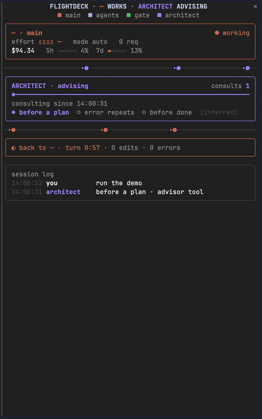

# Flightdeck

[](https://github.com/scasella/claude-flightdeck/releases/latest)
[](LICENSE)
[](https://claude.com/blog/claude-code-mods)
[](https://statuslin.es/mods/flightdeck)

**Un mod Claude Code qui place un tableau de bord d'agents en direct dans votre terminal** : contexte et coût, chronologie des conseils, chaque vérification de permission, et vos sous-agents sous forme de cartes ou de couloirs. Chaque chiffre provient d'un événement réel de la session, et rien ne quitte votre machine.

<p align="center">
  
</p>

<p align="center">
  <a href="#install">Installer</a> · <a href="#what-you-see">Ce que vous voyez</a> · <a href="#what-it-can-reach">Ce qu'il peut atteindre</a> · <a href="#configure">Configurer</a> · <a href="#troubleshooting">Dépannage</a> · <a href="CHANGELOG.md">Nouveautés</a>
</p>

## Installer

Dans Claude Code (2.1.289 ou version ultérieure) :

```
/plugin marketplace add scasella/claude-flightdeck
/plugin install flightdeck@claude-flightdeck
/reload-plugins
/flightdeck
```

<details>
<summary><strong>Depuis le terminal, ou depuis un clone</strong></summary>

```sh
claude plugin marketplace add scasella/claude-flightdeck
claude plugin install flightdeck@claude-flightdeck
```

Ou chargez-le directement depuis un clone, pour une session :

```sh
git clone https://github.com/scasella/claude-flightdeck
claude --plugin-dir ./claude-flightdeck
```

</details>

L'installateur peut indiquer que des options de configuration ne sont pas définies ; les valeurs par défaut conviennent, et [`/config`](#configure) permet de les modifier.

Les mods sont une fonctionnalité Claude Code en accès anticipé et leur API peut changer entre les versions. Si quelque chose cesse de fonctionner, voir [Dépannage](#troubleshooting).

## Ce que vous voyez

https://github.com/user-attachments/assets/9ad0fcc3-c81c-427a-a743-f7b6c49f5885

<p align="center">
  
</p>

| Ancré à côté de la transcription | En ligne au-dessus du prompt |
| --- | --- |
|  | <br><br>Sur l'écran principal, sans plein écran, le volet est un résumé de 8 lignes maximum ; jusqu'à 3 agents s'y ajoutent lorsque la session comporte des sous-agents. |

| Volet | Affiche | Source |
| --- | --- | --- |
| **main** | modèle, effort, mode de permission, nombre de requêtes ; une jauge de contexte avec les compactions (⟲, ou ⟲~ lorsqu'[estimé](#ce-qui-est-déduit,-et-non-mesuré)), mesurée par rapport à la fenêtre de compaction lorsque la session compacte dans une fenêtre plus petite que celle du modèle (`autoCompactWindow`, ou celle de Claude Code) ; le coût et les deux premières fenêtres de limitation de débit lorsque votre forfait les signale, avec le délai avant chaque réinitialisation (↻) à partir de 56 colonnes ; le délai avant le premier jeton de la dernière requête de la boucle principale | `turn.step`, `session.measure`, `session.compact`, `$.session.usage()` (à chaque requête de la boucle principale, et sa répartition locale `summary`, une fois par modèle, pour la fenêtre de compaction) ; le mode de permission depuis `classic.UserPromptSubmit` et `agent.spawn` |
| **architect** | consultations sur une chronologie, si l'une est en cours, la durée de la dernière ; éventuellement l'instant de chaque consultation ; la première ligne du conseil d'un sous-agent architecte | l'apparition d'un agent de type correspondant, ou un outil serveur correspondant dans les lignes de l'assistant |
| **gate** | une cellule par vérification de permission : vert autorisé sans demande, bleu décidé par le classificateur du mode automatique ou par vous puis exécuté, amber en attente, rouge ✗ refusé, estompé si effectuée dans un sous-agent. Totaux, et détail par famille d'outils avec les identifiants masqués | `tool.check`, résolu par le `tool.call` qui l'entoure |
| **agents** | cartes côte à côte tant qu'elles tiennent : la tâche, le type, le contexte et les jetons de sortie en direct, les étapes, une horloge en cours, `max_tokens` en rouge. Au-delà, des couloirs sur un axe temporel unique | `agent.spawn`, `turn.step`, `tool.call`, `turn.complete` |
| **loops** | boucles de modèles qui ne correspondent à aucune carte : agents de workflow, compactions, forks de mémoire | identifiants `turn.step` non revendiqués par une carte |
| **receipt** | le tour en cours, ou le dernier : durée, agents, modifications, erreurs, coût ajouté | `turn.start`, `turn.complete` |
| **log** | prompts, apparitions, achèvements, consultations, modifications, erreurs et refus ; filtré sur un agent lorsque vous consultez sa transcription | tout ce qui précède |

Les connecteurs ne s'animent que lorsque le travail circule : un tour en cours, un agent en cours, ou une consultation ouverte. Les volets sans rien à afficher ne prennent aucune place, donc une session sans sous-agents ne montre que la boîte principale et le journal.

## Utilisation

| Commande | Action |
| --- | --- |
| `/flightdeck` | ouvrir le volet |
| `/flightdeck close` | le fermer |
| `/flightdeck reset` | effacer agents, vérifications, consultations, journal et tour (le coût, les limitations de débit et les compactions restent) |
| `/flightdeck layout auto\|compact\|wide\|mini` | remplacer la disposition pour cette session |

Donnez le focus au volet avec `ctrl+x tab`, puis :

| Touche | Action |
| --- | --- |
| `1`, `2`, … | déplier une carte ou un couloir d'agent : sa tâche complète, ses 3 derniers appels d'outils, le début de sa réponse |
| `f` `s` `o` | ouvrir le détail de la porte : fichiers / shell / autres : les 5 dernières vérifications et leurs décisions |

`/clear` réinitialise le volet en même temps que la conversation.

## Où il s'exécute

- **Terminal en plein écran :** ancré à côté de la transcription ; deux colonnes à partir de 110 colonnes de large.
- **Terminal en écran principal :** en ligne au-dessus du prompt, sous forme de résumé de 8 lignes.
- **Application Desktop, VS Code, mobile :** les mêmes volets, plus les agents dessinés comme un axe temporel SVG. VS Code et mobile ne peuvent pas animer, donc les connecteurs et les horloges y sont statiques. (L'extension VS Code peut ne montrer aucun volet pour l'instant : voir [Dépannage](#troubleshooting).)

Avec `openOnStart`, le volet s'ouvre de lui-même au démarrage d'une session, dans les terminaux d'au moins 144 colonnes ; en dessous, `/flightdeck` l'ouvre. Les couleurs proviennent de votre thème Claude Code, donc les thèmes clair, sombre et daltonien sont tous lisibles.

## Ce qu'il peut atteindre

Flightdeck observe seulement. Chaque hook transmet son événement sans le modifier : il ne refuse, ne réécrit ni ne retarde jamais un appel d'outil, un prompt ou un sous-agent.

| Ce qu'il voit | Via |
| --- | --- |
| le nom et l'entrée de chaque appel d'outil, et s'il a échoué | `tool.call` |
| chaque décision de permission | `tool.check` |
| l'apparition des sous-agents, leurs requêtes de modèle et leur consommation de jetons, et leurs réponses finales | `agent.spawn`, `turn.step`, `turn.complete` |
| les 70 premiers caractères de vos prompts, pour le journal | `turn.start` |
| les lectures de contexte, de coût et de limitation de débit | `session.measure`, `$.session.usage()` |
| la répartition du contexte que montre `/context` (ses catégories, chemins de fichiers mémoire, outils MCP, agents et compétences), estimée localement une fois par modèle ; il n'en conserve que la fenêtre de compaction | `$.session.usage({ breakdown: 'summary' })` |
| les appels d'outils conseillers dans les réponses de l'assistant (leur contenu est chiffré) | `session.append` |

Ce qu'il conserve : de courts résumés (un nom d'outil plus un chemin ou une commande, le début de chaque prompt, la tâche et la réponse d'un agent, le conseil de l'architecte, le tout avec identifiants masqués) dans l'état de session, qui prend fin avec la session. Il n'effectue **aucune** requête réseau, ne lance aucun processus, ne lit ni n'écrit de fichiers, ne stocke rien entre les sessions et n'appelle aucun modèle. `claude plugin validate .` montre exactement ce qu'il intercepte et appelle.

## Ce qui est déduit, et non mesuré

- **Instant des consultations de l'architecte.** « Avant un plan » signifie aucune modification ce tour-ci, « erreur répétée » signifie 2 erreurs ou plus de la boucle principale à la suite, « avant la fin » signifie des modifications ont été faites. Ils sont étiquetés `(inferred)` ; désactivez-les avec `moments: false`.
- **Compactions sous la garde intégrée.** Lorsque la garde de Claude Code empêche Flightdeck de recevoir `session.compact` (voir [Dépannage](#troubleshooting)), le nombre est estimé. Claude Code ne signale aucun remplissage du contexte avant la première réponse après une nouvelle session, un `/clear` ou une compaction. Donc une requête de la boucle principale qui ne trouve aucun remplissage après le retour d'une réponse compte comme une compaction. La boîte principale affiche `⟲~1`, avec `(estimated)` s'il reste de la place, et le journal dit `context compacted (estimated)`. Un retour en arrière vers votre premier prompt se lit de la même façon, donc il compte aussi. Lorsque `session.compact` s'exécute, son compte remplace l'estimation.
- **Le conseil côté serveur est chiffré.** Pour un outil serveur tel que `advisor` de Claude Code, le volet compte et chronomètre la consultation mais ne peut pas montrer ce qui a été dit.
- **Le contexte par agent est l'entrée entière de la dernière requête** (non mise en cache + lecture de cache + écriture de cache). Il est étiqueté `ctx`, et non coût : l'API n'a pas de coût par agent.
- **Les autres boucles** ne peuvent pas distinguer un agent de workflow d'un fork de compaction ; ce sont toutes deux des boucles de modèle non revendiquées par une carte.
- **La première étape d'un agent en arrière-plan** peut arriver avant que sa carte existe, donc sa consommation peut s'afficher avec une étape de retard.
- **Contexte par rapport à la fenêtre de compaction.** Lorsque la session compacte dans une fenêtre plus petite que celle du modèle, la jauge, `tokens/window` et le `ctx N%` de la ligne d'état mesurent par rapport à cette fenêtre, donc ils indiquent un pourcentage plus élevé que celui de la propre ligne d'état de Claude Code (et de claude-hud), qui mesurent par rapport à la fenêtre du modèle. La compaction automatique s'exécute un peu avant 100 %, à son seuil dans cette fenêtre.
- **Délai avant le premier jeton.** `ttft` est chronométré par le propre hook `turn.step` de Flightdeck, donc il inclut tout ce qui est en dessous : les hooks des autres plugins, le moteur, le réseau et toute nouvelle tentative. Lorsque la réflexion du modèle n'est pas diffusée, le premier morceau arrive après elle, donc `ttft` inclut la réflexion. Mesuré, non déduit, mais ce n'est pas la propre valeur de l'API. Il n'y a pas de débit de sortie : les jetons signalés incluent la réflexion, donc un débit calculé sur le flux visible n'est pas une vitesse réelle.

## Configurer

Dans `/config`, ou sous `pluginConfigs[<id>].options` dans votre `settings.json` utilisateur, où `<id>` est la façon dont Claude Code a chargé le plugin : `flightdeck@claude-flightdeck` lors d'une installation depuis le marketplace, `flightdeck` (ou `flightdeck@inline`) avec `--plugin-dir`. Une entrée sous une autre clé, ou dans les réglages du projet (`.claude/settings.json`), est ignorée sans avertissement. Depuis un terminal, `claude plugin configure flightdeck@claude-flightdeck` liste les options et celles qui ne sont pas définies, et les enregistre avec `--values-stdin`.

| Option | Valeur par défaut | Signification |
| --- | --- | --- |
| `architectPattern` | `advisor\|architect` | expression régulière insensible à la casse pour les types d'agents et les outils serveur comptés comme architecte |
| `matchDescriptions` | `false` | correspondre aussi aux descriptions d'agents, pas seulement aux noms de types |
| `architectLabel` | `ARCHITECT` | le nom de l'architecte dans le volet |
| `gateLabel` | `GATE` | le nom du volet de permission |
| `panels` | `main,architect,gate,agents,loops,receipt,log` | quels volets afficher, et dans quel ordre |
| `layout` | `auto` | `mini`, `compact`, `wide`, ou `auto` (mini en ligne, wide ancré à partir de 110 colonnes) |
| `maxCards` | `3` | cartes côte à côte avant les couloirs (1–6) ; moins si le volet est trop étroit |
| `paneColumns` | `66` | colonnes demandées pour le volet ancré, 40 ou plus. Claude Code limite l'ancrage à 45 % du terminal, et une largeur que vous avez redimensionnée, dans cette session ou une précédente, prévaut. La disposition large commence à 110, donc elle demande un terminal d'environ 245 colonnes, ou `layout: wide` |
| `motion` | `while-active` | `off` garde les connecteurs immobiles |
| `moments` | `true` | afficher les instants de consultation déduits |
| `palette` | `theme` | `pastel` utilise des couleurs fixes adaptées aux terminaux sombres |
| `openOnStart` | `true` | demander à ouvrir le volet au démarrage d'une session |
| `statusLine` | `true` | contexte, agents en cours, consultations et refus dans la ligne d'état |

## Dépannage

**Le volet n'apparaît pas.**
- Vérifiez que `claude --version` est 2.1.289 ou ultérieur, puis exécutez `/reload-plugins` et `/flightdeck`. Sur une version plus ancienne, la transcription indique `flightdeck: hooks module did not load: …`.
- En dessous de 144 colonnes, Claude Code n'installe pas un volet que personne n'a demandé ; `/flightdeck` l'ouvre à n'importe quelle largeur.
- Cherchez dans la transcription une ligne estompée commençant par `flightdeck:`. Elle nomme le hook qui a échoué ou la raison du refus du volet. Merci d'[ouvrir un ticket](https://github.com/scasella/claude-flightdeck/issues) avec cette ligne.
- Si le volet affiche seulement `draw failed (…)`, son hook de dessin a levé une erreur ; incluez aussi cette ligne dans le ticket.

**Rien ne s'affiche dans l'extension VS Code.** Selon un signalement, sa version 2.1.296 exécutait les hooks de Flightdeck mais n'affichait aucun volet, et aucun pour un autre mod non plus ([#5](https://github.com/scasella/claude-flightdeck/issues/5)). Exécutez plutôt `claude` dans le terminal intégré de VS Code, puis `/flightdeck` : un terminal intégré est généralement plus étroit que les 144 colonnes nécessaires à l'ouverture automatique du volet.

**Avec une connexion Team ou Enterprise, le mode de permission manque ou est périmé, et les compactions sont estimées.** Sur une machine avec des réglages gérés, ou dans une session avec un `/login` Team ou Enterprise, Claude Code charge une garde intégrée, `cc-plugin-sec-default`, qui n'exécute jamais les hooks d'un plugin installé par l'utilisateur sur les événements `classic.*` ni sur `session.compact` (voir « Know which hooks of a user's mod don't run » dans [Manage mods for your organization](https://code.claude.com/docs/en/plugins/mods/admin)). Aucun autre événement qu'un plugin utilisateur peut intercepter ne porte le mode de permission, sauf le démarrage d'un sous-agent. La boîte principale n'affiche donc aucun mode jusqu'au démarrage d'un sous-agent, puis le mode tel qu'il était à cet instant. D'ici là, en mode automatique, la porte attribue à `you` les appels acceptés par le classificateur. Les compactions sont comptées à partir du contexte que Claude Code signale à chaque requête, donc la boîte principale les marque `⟲~` et le journal dit `context compacted (estimated)` (voir [Ce qui est déduit, et non mesuré](#ce-qui-est-déduit,-et-non-mesuré)). Sur 2.1.299 ou version ultérieure, `/plugin` affiche une note nommant ces deux hooks. Le reste du volet fonctionne. Un administrateur peut autoriser les hooks en installant Flightdeck comme l'un des propres mods de l'organisation ([#23](https://github.com/scasella/claude-flightdeck/issues/23)).

**Les options semblent ignorées.** Vérifiez la clé dans votre `settings.json` utilisateur : `pluginConfigs["flightdeck@claude-flightdeck"]` lors d'une installation, `pluginConfigs["flightdeck"]` avec `--plugin-dir`. Voir [Configurer](#configure).

**Les couleurs semblent erronées.** Définissez `palette` sur `pastel` dans `/config`.

**Il y a trop de mouvement.** Définissez `motion` sur `off`.

**Les compteurs semblent périmés après une mise à jour.** Exécutez `/flightdeck reset`.

## Comment ça marche

| Fichier | Contenu |
| --- | --- |
| [`hooks/register.tsx`](hooks/register.tsx) | les hooks d'événements, l'accès à l'état, et une fonction par volet |
| [`hooks/core.ts`](hooks/core.ts) | tous les réducteurs, formateurs et règles de disposition sous forme de fonctions pures, pour que le comportement soit testable directement |
| [`hooks/rail.tsx`](hooks/rail.tsx), [`hooks/elapsed.tsx`](hooks/elapsed.tsx) | modules de surface : connecteurs animés et horloges en direct qui ne redessinent qu'eux-mêmes, sur l'horloge de trame propre à la surface |
| [`types/index.d.ts`](types/index.d.ts) | le contrat d'état |
| [`tests/`](tests) | 65 tests : comportement pur, plus des dessins montés sur chaque surface à 24–120 colonnes, avec vérification de toutes les largeurs de 24 à 40 pour tout débordement hors de sa boîte |

L'état réside dans des atomes `$.state`. Chaque lecture est fusionnée avec les valeurs par défaut, donc un champ manquant ou plus ancien ne casse jamais le volet ; une mise à jour qui change la forme de l'état peut tout de même réinitialiser ses compteurs une fois. Nouveau venu dans les mods ? Commencez par [Claude Code mods](https://claude.com/blog/claude-code-mods) et [Getting started with Claude Code mods](https://claude.dev/blog/getting-started-with-claude-code-mods/).

## Projets liés

Flightdeck fonctionne aux côtés de ces projets, et leur doit des idées :

- [claude-hud](https://github.com/jarrodwatts/claude-hud) : contexte, limites, outils et agents dans votre ligne d'état. Utilisez les deux : ceci est le volet, cela la ligne d'état.
- [zoetrope](https://github.com/furkankly/zoetrope) : une session Claude Code ou Codex sous forme de graphe de flux en direct.
- [ccusage](https://github.com/ccusage/ccusage) : rapports de coût à partir de vos journaux de session.
- [awesome-claude-code-mods](https://github.com/karanb192/awesome-claude-code-mods) : l'index des mods Claude Code.

## Développement

```sh
claude --plugin-dir .            # chargez-le ; les modifications sont rechargées à chaud
claude plugin validate .
claude plugin test .
npx -p typescript tsc -p .       # après le premier chargement, qui écrit .claude-plugin/types/
```

Voir [CONTRIBUTING.md](CONTRIBUTING.md). Les changements sont listés dans [CHANGELOG.md](CHANGELOG.md).

## Licence

[MIT](LICENSE)
