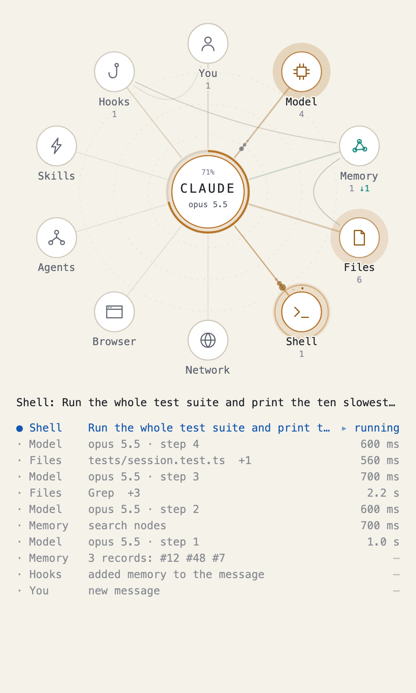
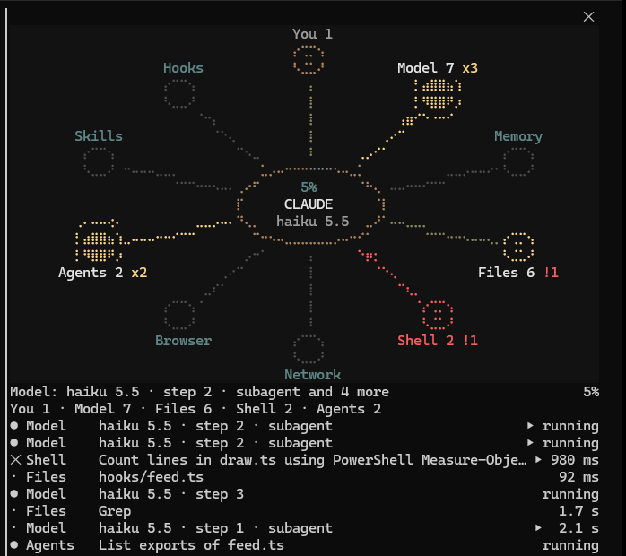
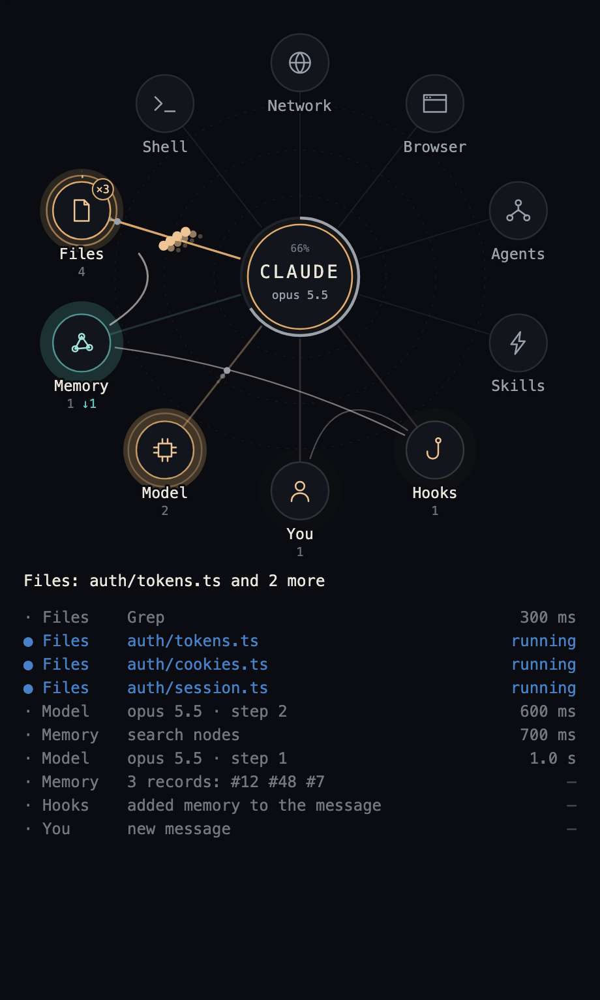

# Lot Map for Claude Code

`lot-map` est un mod pour Claude Code : une carte en direct du travail, dans un volet à côté du chat. Chaque appel d'outil, étape de modèle, hook et compétence envoie une impulsion depuis le centre jusqu'à sa station, pour que vous voyiez la mémoire, les fichiers, le shell, le web et les agents à l'œuvre au lieu de lire une liste de commandes.

Il s'exécute sur votre machine et n'envoie rien nulle part. Local ne veut pas dire aveugle : comme tout mod qui suit les appels d'outils, il reçoit chaque appel en entier, et n'en tire que les noms. [Ce qu'il lit et conserve](PRIVACY.md), et [les contrôles qui l'y astreignent](PRINCIPLES.md).


*Une session fictive rejouée avec le propre code de dessin du mod. [Vidéo (MP4)](docs/demo.mp4). Ou [jouez-la dans votre navigateur](https://alexeyw.github.io/lot-map/), où la page exécute le même code et montre ce que chaque appel transmet au mod et ce que le mod conserve.*

## Installer

À l'invite d'une session terminal :

```
/plugin install lot-map --marketplace alexeyw/lot-map
```

Répondez `y` pour ajouter le marketplace, puis choisissez une portée. Depuis un shell :

```bash
claude plugin install lot-map --marketplace alexeyw/lot-map
```

S'il répond que le plugin n'est trouvé dans aucun marketplace, ajoutez d'abord le marketplace :

```bash
claude plugin marketplace add alexeyw/lot-map
claude plugin install lot-map@lot-map
```

Dans l'application Desktop : cliquez sur **+** à côté de la boîte de prompt, puis sur **Plugins**, **Add marketplace** avec `alexeyw/lot-map`, puis sur **Add plugin**.

Le volet s'ouvre de lui-même au démarrage d'une session ; avec `openAtStart` désactivé, il attend `/lot-map`. Dans un terminal, il lui faut au moins 144 colonnes, sinon tapez `/lot-map`, et il ne dessine que du texte sauf si vous demandez la carte, en image ou en points braille : voir [Dans un terminal](#in-a-terminal). Développé et testé sur Claude Code 2.1.321 sous macOS ; des utilisateurs signalent qu'il fonctionne aussi sur Windows et Linux.

Avec une connexion Team ou Enterprise, la transcription peut recevoir des avis comme `lot-map: its classic.PreToolUse hook was skipped`. Désactivez `guardedHooks` et ils s'arrêtent ; [Options](#ce-quelle-montre-et-ce-quelle-conserve) indique ce que la carte perd alors.

## Mise à jour

Depuis un shell :

```bash
claude plugin marketplace update lot-map
claude plugin update lot-map@lot-map
```

Puis démarrez une nouvelle session. La première commande est nécessaire : sans elle, la seconde indique que la version installée est la plus récente.

Les changements de chaque version sont dans [CHANGELOG.md](CHANGELOG.md).

## Ce qui s'allume

| Station | Quand |
| --- | --- |
| Vous | vos messages, questions et fichiers envoyés, la liste de tâches, le plan et ce qu'on vous demande d'approuver |
| Modèle | chaque requête de modèle, la compaction du contexte |
| Mémoire | le dossier mémoire de Claude Code, plus tout ce que vous nommez dans les options |
| Fichiers | Read, Write, Edit, Grep, Glob, l'intelligence de code d'un serveur de langage, et les commandes shell qui ne travaillent que sur des fichiers : elles lisent, recherchent, déplacent, suppriment ou modifient sur place (`cat`, `grep`, `mv`, `rm`, `sed`, `tee`, `find … -delete`) |
| Shell | toute autre commande shell |
| Réseau | récupération et recherche web, serveurs MCP, travail conservé sur claude.ai (artefacts, projets, designs), et commandes shell connues pour accéder au réseau : `curl`, `gh`, `ssh`, `rsync`, `git push`, `npm install`, `docker pull` et similaires, aussi à l'intérieur de `$(…)` |
| Navigateur | outils de navigateur |
| Agents | sous-agents, workflows, planifications et attente de travail en arrière-plan ; leurs propres appels partent de cette station |
| Compétences | compétences, recherche d'outils, et catalogue de compétences, plugins et connecteurs |
| Hooks | hooks de réglages qui refusent un appel, demandent une permission, ajoutent du contexte ou prennent un instant |

Sous Windows, l'outil PowerShell est lu de la même façon que Bash, avec les noms propres de PowerShell : `Get-Content` et `Select-String` allument Fichiers, `Invoke-WebRequest` allume Réseau. Un programme lancé par son chemin complet est lu par son nom, y compris depuis un chemin entre guillemets contenant un espace, et `CURL.EXE` est `curl`.

Les stations shell se fondent sur le nom de la commande, non sur ce qu'elle fait : un script qui ouvre lui-même une connexion, comme `python -c "…"`, s'affiche comme Shell. Une commande derrière `sudo`, `env`, `timeout`, `nohup`, `xargs` et similaires est lue comme la commande qu'elle exécute, et `find … -exec` comme la commande qu'on lui dit d'exécuter. Idem pour une commande dans une boucle ou une condition (`for … do`, `if … then`, `while`, `!`, `{ … }`), et une ligne transmise à un shell ou à `eval` (`bash -c "…"`). Le texte d'un heredoc n'est pas lu, donc un fichier écrit ainsi s'affiche comme Fichiers quel que soit son contenu. Une ligne est lue jusqu'à ses 8 000 premiers caractères. `npx` compte comme Réseau seulement avec `-y`, car sans lui il exécute surtout ce qui est déjà installé.

Une impulsion part lorsque quelque chose commence et revient lorsqu'elle se termine. Les refus et les erreurs deviennent rouges.

## Lire la carte

- **L'itinéraire.** Une ligne fine relie les dernières stations traversées par la boucle principale, dans l'ordre, et son dernier segment se dessine lui-même. Un segment reste 40 secondes puis s'estompe sur 20, donc une minute après l'arrêt du travail il ne reste que les rayons ; leur épaisseur garde la trace du travail. Les étapes de modèle sont omises, sinon chaque segment passerait par Modèle.
- **Les rayons usés.** Un rayon s'épaissit et s'éclaircit à mesure que sa station est utilisée, donc en fin de session la carte montre où le travail s'est porté.
- **La durée.** Deux aiguilles grandissent autour d'une station pendant un appel : l'intérieure fait un tour en une minute, l'extérieure en dix.
- **Le travail en arrière-plan.** Une commande envoyée en arrière-plan, un moniteur, un sous-agent en arrière-plan ou un workflow reste allumé sur sa station après la fin du tour qui l'a lancé, avec les aiguilles qui grandissent, jusqu'à ce que la tâche signale sa fin. Une tâche en échec laisse le point rouge. Le rapport lui-même n'apparaît pas comme un de vos messages.
- **Plusieurs à la fois.** Les appels qui démarrent ensemble volent côte à côte, et la station porte leur nombre, comme `×3`.
- **Ce qui s'est mal passé.** Un point rouge avec un compteur reste sur une station après une erreur ou un refus, jusqu'à votre prochain message.
- **La mémoire.** Elle a sa propre couleur. Une impulsion pleine est une mémoire demandée par Claude ; une impulsion creuse sur une ligne en pointillé est ce qu'un hook a apporté sans qu'on le demande. Sous la station, le nombre simple compte les premières et `↓` les secondes.
- **La fenêtre de contexte.** L'anneau autour du centre se remplit au fil de la session, avec le pourcentage au-dessus du nom. Il passe à l'ambre à 70 % et au rouge à 90 %.
- **Un changement de modèle.** Le centre et la station Modèle sonnent pendant quelques secondes, et le flux reçoit une ligne comme `opus 5.5 → fable 5.2`. Cela arrive aussi lorsqu'une session démarre avec un modèle différent de la dernière session dans le même dossier.
- **Les sous-agents.** Chacun encore à l'œuvre tourne autour de la station Agents comme un petit point, et ses appels partent de là.
- **La réponse.** Un large anneau quitte le centre lorsque la réponse est prête.

Sous la carte se trouvent une ligne indiquant ce qui s'exécute maintenant, et les 16 dernières lignes (avec `logRows` réglé sur `fill`, autant que le volet Desktop a de place) : `●` en cours, `·` terminé, `✕` échoué ou bloqué, `◆` changement de modèle. Les appels terminés qui se suivent à une même station se replient en une seule ligne, marquée `+2` pour les deux qu'elle représente en plus de celui nommé. Un appel encore en cours n'est jamais chassé de la liste par ce qui vient après : il reste comme dernière ligne jusqu'à sa fin, pour que la liste et la carte disent la même chose. Ces lignes ne prennent au plus que la moitié de la liste ; s'il y en a davantage en cours, la dernière est marquée `+22` pour le reste.

Chaque ligne tient sur une ligne. Ses mots sont coupés au bord du volet ; son heure se tient dans une colonne à droite, avec un tiret pour ce qui n'a pris aucun temps, comme un message qui arrive, et sur la ligne de la réponse la durée de tout le tour. Une ligne au long libellé a un `▸` avant son heure : appuyez dessus pour lire la ligne entière, et de nouveau pour la fermer. Une seule ligne est ouverte à la fois. Dans un terminal, la ligne du maintenant porte aussi le pourcentage de contexte et le modèle à droite, puisqu'aucun dessin ne les montre.

### Ce que chaque appel ajoute au contexte

L'anneau indique à quel point la fenêtre de contexte est pleine, non ce qui l'a remplie. Avec `contextCost` activé, la ligne d'un appel indique approximativement de combien de jetons le contexte a grandi avec sa réponse, après son temps : `85 ms +42k`. Sur la carte, la ligne des comptes de chaque station ajoute la somme de la session : `9 · 180k`. Le chiffre prend la couleur de ce qui l'accompagne, le temps sur la ligne et le compte sur la carte, donc il se lit partout où eux se lisent, sur un thème clair comme sur un thème sombre.

C'est une estimation. Claude Code indique à un mod sur combien de jetons la dernière réponse a été donnée, donc le mod voit de combien le contexte a grandi d'une étape de modèle à la suivante, et l'attribue aux appels dont les réponses allaient avec cette étape. La croissance inclut aussi les paroles du modèle, ce qu'ont ajouté les hooks et, au début d'un tour, votre message.

- **Une étape de retard.** Le chiffre d'un appel s'affiche lorsque l'étape suivante a été répondue, non quand l'appel se termine. Un appel fait dans la dernière étape d'un tour, avant un tour interrompu ou avant une compaction, n'en reçoit jamais, et une compaction, qui rend le contexte plus petit, n'en met nulle part.
- **Partagé.** Deux ou trois appels dans une même étape se partagent également sa croissance, et leurs chiffres sont marqués `~` : `~+14k`. Avec davantage d'appels dans une étape, leurs lignes n'en reçoivent aucun, puisqu'une part égale donnerait le même chiffre à une grosse lecture et à une courte commande ; lorsque tous étaient à la même station, la somme de cette station reçoit quand même le tout. Une ligne repliée additionne les chiffres de ses appels, marquée `~` si certains n'en ont pas.
- **La boucle principale seulement.** Un sous-agent remplit son propre contexte, que Claude Code ne signale pas : ses appels n'ont aucun chiffre. La croissance apportée par sa réponse s'affiche sur l'appel de la boucle principale qui l'a lancé.

Les sommes figurent sur chaque dessin de la carte : celui de l'application Desktop, celui de VS Code et l'image du terminal, qui sont un même dessin, et la carte en braille, qui écrit la somme d'une station après son compte, dans la couleur de son nom et avec le plus des chiffres des lignes : `Files 9 +180k`. Un terminal qui n'affiche que les lignes les a dans sa ligne de comptes, écrites de la même façon.

La carte en braille dessine les sommes pour toutes les stations ou pour aucune. Lorsque sa grille n'a pas la place pour la somme la plus large à côté de chaque nom, dans un volet étroit ou avec des noms longs et de gros comptes, il les omet toutes, garde chaque nom entier, et les lignes conservent leurs chiffres.

| Au travail | Sous-agents | Un hook refuse |
| --- | --- | --- |
|  |  |  |

| Changement de modèle | Après la réponse | Couleurs claires |
| --- | --- | --- |
|  |  |  |

## Dans un terminal

Un terminal n'affiche que les lignes. Avec `terminalView` réglé sur `picture`, un terminal qui affiche des images, comme kitty ou Ghostty, reçoit la carte en image au-dessus des lignes, qui bouge comme dans l'application Desktop. Claude Code doit dessiner en plein écran. Si le volet se tient sous la conversation et non à côté, Claude Code dessine en écran principal, et les lignes restent seules : tapez `/tui fullscreen`, ou démarrez-le avec `CLAUDE_CODE_NO_FLICKER=1 claude`. Dans tmux, définissez `allow-passthrough on` et `focus-events on`. Tout autre terminal n'affiche que les lignes, comme avant, et c'est aussi le cas d'un volet plus étroit que 24 colonnes.

Dans iTerm2, l'image demande iTerm2 3.7.8 ou ultérieur. Une version antérieure garde chaque image reçue jusqu'à la fermeture de son onglet : avec iTerm2 3.7.7, une carte en mouvement prenait environ 2 Mo par image, 17 Go en cinq minutes (#81). L'image y est donc désactivée, et une ligne au-dessus des lignes l'indique ; mettez iTerm2 à jour, ou réglez `terminalView` sur `braille`. Le mod reconnaît iTerm2 par `TERM_PROGRAM`, et par `LC_TERMINAL` sur ssh ou dans tmux, et sa version par `TERM_PROGRAM_VERSION` ou `LC_TERMINAL_VERSION` ; lorsque la version n'est pas indiquée, l'image reste désactivée.

Le mod peint l'image lui-même, depuis le même dessin que celui de l'application Desktop, avec des lettres des polices bitmap misc-fixed de X.Org, qui sont du domaine public ; [FONTS.md](FONTS.md) indique leur provenance. Il peint jusqu'à cinq images par seconde tant que quelque chose bouge sur la carte. Le cœur ne respire dans l'image que lorsque quelque chose s'exécute, en douceur pendant dix minutes après le dernier changement de la carte, puis une image toutes les cinq secondes ; au repos, l'image s'immobilise une fois les traînées estompées.

Avec `theme` sur `auto`, l'image est claire ou sombre selon le `COLORFGBG` du terminal, défini par iTerm2, rxvt et Konsole ; lorsqu rien ne l'indique, elle est sombre, et sur un terminal clair qui ne l'indique pas, réglez `theme` sur `light`. L'image n'a pas de fond propre, donc celui du terminal apparaît à travers elle ; lorsqu'il diffère légèrement du gris du volet, cela laisse un léger cadre autour de la carte. `paneBackground` réglé sur `transparent` retire le gris, donc le terminal apparaît derrière la carte comme derrière les lignes, y compris lorsqu'il est transparent ; réglé sur la couleur du terminal sous la forme `#rrggbb`, il peint le volet avec elle. `colors` avec `background=#rrggbb` donne à l'image son propre fond à la place.

Un terminal ne dit pas non plus quelle est la hauteur de ses cellules. `cellShape` le dit : combien de fois une cellule est plus haute que large, 2,4 par défaut, comme iTerm2 dessine Monaco 12, et environ 2 pour Menlo dans kitty. Si l'image laisse une bande vide en dessous, augmentez cette valeur ; si la bande est à droite, diminuez-la.

### La carte en points braille

Avec `terminalView` réglé sur `braille`, la carte se tient au-dessus des lignes sous forme de cellules de texte : points braille pour les rayons, les stations et le centre, lettres pour les noms. Elle n'a besoin d'aucune image, seulement d'une police comportant le braille, donc elle s'affiche dans Windows Terminal et dans la plupart des terminaux Linux, où `picture` ne montre rien. Ce n'est jamais un repli automatique : un terminal qui ne peut pas afficher l'image garde les lignes seules jusqu'à ce que vous choisissiez `braille` vous-même.



C'est le même plateau, lu de la même façon, avec ce qu'une cellule peut porter :

- **Les stations.** Un anneau vide n'a pas encore été utilisé, un anneau avec un point l'a été, et un anneau plein est en cours d'activité et bat. Une station qui vient de finir reste brillante quelques secondes. Le rouge est une erreur ou un refus, et `!1` après le nom les compte jusqu'à votre prochain message ; `x3` indique combien d'appels y courent en même temps. Avec `contextCost` activé, la somme de la station se tient après son compte, là où la grille a la place pour celle de chaque station : `Files 9 +180k`.
- **Les rayons.** Un rayon prend la couleur de sa station au premier appel et une deuxième ligne à force d'usage. Il s'allume au début d'un appel ; une impulsion vole le long du rayon, et revient quand l'appel se termine. Ce qu'un hook a apporté sans qu'on le demande vole depuis sa station.
- **Le centre.** Son contour est la fenêtre de contexte, qui se remplit dans le sens des aiguilles depuis le haut, ambre à 70 % et rouge à 90 %, avec le pourcentage au-dessus du nom et le modèle en dessous. Le nom du modèle reste brillant quelques secondes après un changement. Un anneau quitte le centre lorsque la réponse est prête.
- **Les sous-agents.** Chacun encore à l'œuvre tourne autour de la station Agents comme un point.

Ce qu'il ne dessine pas, puisqu'une cellule ne porte qu'une couleur et qu'un point est le seul détail possible :

- l'itinéraire entre les stations, et sa traînée qui s'estompe ;
- les aiguilles autour d'une station en cours ;
- les icônes dans les stations, les contours en pointillé et la respiration du centre ;
- les anneaux où une impulsion atterrit et où le modèle change ;
- les impulsions côte à côte : les appels qui démarrent ensemble volent comme un seul, et `x3` indique combien ;
- le deuxième compte de la mémoire, `↓`, pour ce qu'un hook a apporté sans qu'on le demande : un seul nombre compte les deux ;
- l'appel d'un sous-agent partant de la station Agents : tous les appels partent du centre ;
- l'estompage d'une lueur : une station est brillante, puis elle ne l'est plus.

Ses couleurs sont celles propres de la carte, comme dans l'application Desktop. `theme` et `colors` s'appliquent ; sous `auto`, elle est claire ou sombre selon `COLORFGBG`, comme l'image, et sombre lorsqu rien ne l'indique, donc sur un terminal clair qui ne l'indique pas, réglez `theme` sur `light`. `background` a ici le même sens que là-bas :

- `solid`, par défaut : les cellules se tiennent sur le fond de la palette et les mots prennent sa couleur de texte, donc la carte se lit dans n'importe quel volet. Le fond propre du volet vient du thème de Claude Code, que la carte ne peut pas demander ; lorsqu'il diffère de celui du terminal, par exemple un terminal clair sous un thème sombre, c'est une carte claire dans un volet sombre, comme l'image.
- `transparent` : les cellules n'ont pas de fond et les mots prennent la couleur propre du terminal. Choisissez-le lorsque le terminal et le thème de Claude Code concordent : la carte se tient alors dans le volet sans cadre autour. Lorsqu'ils diffèrent, les mots sont à peine lisibles. Avec `paneBackground` aussi sur `transparent`, la carte et le volet montrent tous deux le terminal derrière eux.

`layout` tourne l'anneau. Avec `motion` sur `reduced`, rien ne vole, ne bat ni ne tourne : un appel allume sa station et son rayon, et les sous-agents se tiennent à côté des leurs.

Comme l'image, la carte ne s'affiche que lorsque le volet se tient à côté de la conversation. Sous le rendu par défaut de Claude Code, le volet est sous la conversation et trop court pour la carte, donc les lignes restent seules : tapez `/tui fullscreen`, ou démarrez avec `CLAUDE_CODE_NO_FLICKER=1 claude`. La carte demande un corps de volet d'au moins 50 colonnes et 25 lignes, et en occupe jusqu'à 76 par 21 ; dans un volet plus petit, les lignes restent seules. Elle n'est repeinte que lorsqu'elle sera différente : environ huit fois par seconde pendant qu'une impulsion vole ou qu'un sous-agent tourne, à chaque battement d'une station en cours, et pas du tout au repos. Dix minutes après le dernier changement de la carte, ce qui s'exécute encore reçoit une image toutes les cinq secondes.

## Dans VS Code

Dans l'extension VS Code, le volet est court, et la carte dessinée aussi large que le volet n'y tient pas. Là, et seulement là, trois boutons se tiennent à la fin de la ligne du maintenant. **Zoom out** et **Zoom in** dessinent la carte à l'une de six largeurs, de 160 à 400 pixels, ou aussi large que le volet. **Hide map** replie le volet sur cette seule ligne, et **Show map** ramène la carte. Votre choix est conservé pour la session suivante.

## Options

L'installation les propose sur un écran. Ensuite, utilisez `/config` dans un terminal ou `claude plugin configure`, puis redémarrez la session. Elles se répartissent en quatre groupes ci-dessous. Chacune a une valeur par défaut, et la carte fonctionne sans aucune d'elles.

### Son apparence

Chacune d'elles avec une image de ses valeurs : [Comment les options s'affichent](docs/options.md).

| Option | Valeur par défaut | Signification |
| --- | --- | --- |
| `language` | `en` | `en`, `ru`, `es`, `fr`, `de`, `it` ou `pt` |
| `coreName` | `CLAUDE` | ce que dit le cercle central, jusqu'à dix caractères |
| `theme` | `auto` | les couleurs de la carte : `dark`, `light`, ou `auto`, sombre sur une surface sombre et clair sur une surface claire |
| `background` | `solid` | le fond propre de la carte, ou `transparent`, qui laisse apparaître le volet derrière elle. Le liseré autour des libellés garde la couleur du fond, donc sur une surface d'une autre nuance il se voit comme un léger halo |
| `paneBackground` | `theme` | ce avec quoi le volet lui-même est peint : `theme`, celui de Claude Code ; `transparent`, qui laisse apparaître le terminal derrière lui, papier peint et flou compris ; ou une couleur sous la forme `#rrggbb`, pour s'accorder à un terminal opaque. Une surface qui ne peut pas le faire garde le sien. Voir [Dans un terminal](#in-a-terminal) |
| `colors` | aucune | vos propres couleurs, chacune sous la forme `name=#rrggbb` ; voir [Vos propres couleurs](#colours-of-your-own) |
| `layout` | `you-top` | où vous vous tenez sur la carte : `you-top`, ou `you-bottom`, qui tourne l'anneau d'un demi-tour pour vous placer en bas et le réseau et le navigateur en haut |
| `motion` | `full` | `full`, ou `reduced` : rien ne vole, ne s'étend ni ne tourne. Un appel allume toujours sa station et fait clignoter son rayon, l'itinéraire reçoit toujours son segment, et ces éléments s'estompent seulement ; les aiguilles autour d'une station en cours restent, aussi lentes que celles d'une horloge |
| `textSize` | `footnote` | la taille des lignes sous la carte : `caption`, `footnote` ou `body`. Un terminal n'a qu'une taille et l'ignore |
| `openAtStart` | `true` | si le volet s'ouvre de lui-même au démarrage d'une session. Avec `false`, il reste fermé jusqu'à ce que vous tapiez `/lot-map` ; la carte est tout de même conservée depuis le premier appel de la session, donc elle est entière quand vous l'ouvrez |
| `logRows` | `16` | combien de lignes la liste sous la carte montre : `16`, ou `fill`, autant que le volet a de place sous la carte, jamais moins de 16. Les lignes les plus anciennes qui ne tiennent pas sont coupées en bas, au-dessus des appels encore en cours. Uniquement dans le volet ancré de l'application Desktop ; un terminal, l'éditeur et l'application mobile gardent 16 |

### Ce qu'elle montre

| Option | Valeur par défaut | Signification |
| --- | --- | --- |
| `hookReasons` | `false` | afficher la première ligne du refus d'un hook, jusqu'à 72 caractères ; désactivé, la carte indique seulement quel outil a été arrêté |
| `guardedHooks` | `true` | à désactiver sur une connexion Team ou Enterprise lorsque la transcription reçoit des avis comme `lot-map: its classic.PreToolUse hook was skipped`. La garde d'une organisation éloigne les mods de cinq événements là-bas, et avec ceci désactivé le mod n'ajoute aucun hook sur eux. La carte perd alors la station Hooks, les enregistrements ajoutés par un hook, la ligne d'une commande slash tapée et la marque d'une compaction ; un appel refusé par un hook reçoit quand même son `✕`, comme un appel échoué et non comme un appel bloqué |
| `subagentNames` | `false` | l'étape de modèle d'un sous-agent indique quel sous-agent c'est, par les quelques mots avec lesquels il a été lancé, jusqu'à 40 caractères ; désactivé, elle indique seulement qu'il s'agit d'un sous-agent |
| `contextCost` | `false` | chaque ligne indique approximativement de combien de jetons le contexte a grandi avec la réponse de son appel, et la carte ajoute la somme de chaque station à son compte. Une estimation, affichée avec une étape de retard ; voir [Ce que chaque appel ajoute au contexte](#ce-que-chaque-appel-ajoute-au-contexte) |
| `contextWindow` | `model` | par rapport à quoi l'anneau et son pourcentage mesurent le contexte : `model`, la fenêtre entière du modèle, comme la ligne d'état ; ou `compaction`, la fenêtre de compaction automatique, telle que définie avec `autoCompactWindow`, lorsqu'elle est plus petite que celle du modèle. Sans une telle fenêtre, ou avec la compaction automatique désactivée, `compaction` affiche la même chose que `model`. La fenêtre est lue à la première étape de modèle d'une session, après une compaction et lors d'un changement de modèle ; avec `guardedHooks` désactivé, pas après une compaction |

### Mémoire et serveurs

| Option | Valeur par défaut | Signification |
| --- | --- | --- |
| `memoryServers` | `memory` | serveurs MCP dont les outils allument Mémoire |
| `memoryCommands` | aucune | commandes shell ou scripts qui allument Mémoire ; un nom compte lorsqu'il est la commande elle-même ou qu'il commence par elle suivie de `-`, `_` ou `.`, donc `recall` nomme aussi `recall-sync.py` |
| `memorySubcommands` | aucun | mots après une commande mémoire que la carte peut afficher, comme `add` ou `search` ; sans eux, la commande va par son propre nom |
| `memoryPaths` | aucun | morceaux d'un chemin qui font d'un fichier une mémoire |
| `memoryLabels` | aucun | noms courts pour les outils mémoire, chacun sous la forme `tool=name` |
| `serverStations` | aucune | placer les outils d'un serveur MCP sur une station de votre choix, chacun sous la forme `server=station`, avec `files`, `shell`, `web`, `browser`, `agents`, `skills` ou `you` ; la ligne indique toujours `server: tool`. Votre réglage prévaut sur les routes propres du mod pour les serveurs qu'il connaît. Mémoire conserve `memoryServers`, qui prévaut si un serveur est dans les deux ; une station inconnue est ignorée |
| `hookRecords` | `false` | à activer si l'un de vos hooks ajoute des enregistrements mémoire numérotés comme `[#123]` ; ils apparaissent sur Mémoire par leur numéro seulement. Un tel nombre dans le texte de n'importe quel hook compte, pas seulement dans celui d'un hook mémoire |

### Dans un terminal seulement

| Option | Valeur par défaut | Signification |
| --- | --- | --- |
| `terminalView` | `text` | à quoi ressemble la carte dans un terminal : `text`, les lignes seules ; `picture`, la carte en image au-dessus d'elles dans un terminal qui affiche des images, dans iTerm2 depuis 3.7.8 ; ou `braille`, la carte au-dessus d'elles en points braille, dans tout terminal dont la police comporte le braille. Voir [Dans un terminal](#in-a-terminal) |
| `cellShape` | `2.4` | pour l'image du terminal : combien de fois une cellule de terminal est plus haute que large, de 1,2 à 4, pour que l'image remplisse sa boîte ; voir [Dans un terminal](#in-a-terminal) |

Par exemple, des libellés en russe et votre propre serveur mémoire :

```bash
echo '{"language":"ru","memoryServers":"my-memory"}' | claude plugin configure lot-map@lot-map --values-stdin
```

La carte elle-même dans un terminal qui n'affiche pas d'images :

```bash
echo '{"terminalView":"braille"}' | claude plugin configure lot-map@lot-map --values-stdin
```

Aucun avis sur les hooks ignorés avec une connexion Team ou Enterprise :

```bash
echo '{"guardedHooks":"false"}' | claude plugin configure lot-map@lot-map --values-stdin
```

Chaque valeur s'écrit comme une chaîne, `"false"` et `"2.4"` aussi, et les listes s'écrivent avec des virgules.

| Libellés russes | `layout` réglé sur `you-bottom` |
| --- | --- |
|  |  |

## Vos propres couleurs

`colors` remplace les couleurs de la carte une par une. Définissez-en une, quelques-unes ou les treize ; ce que vous laissez inchangé reste tel quel.

```bash
echo '{"theme":"dark","colors":"accent=#7fb4ff,active=#b8d6ff,text=#e6edf7"}' | claude plugin configure lot-map@lot-map --values-stdin
```

| Nom | Ce qu'il colore |
| --- | --- |
| `background` | le fond de la carte, et le liseré autour des libellés |
| `node` | l'intérieur d'une station et du centre |
| `line`, `spoke` | les contours en pointillé et les rayons au repos |
| `text`, `label`, `faint` | le nom au centre et les libellés allumés, les autres libellés, les comptes |
| `accent`, `active` | la couleur principale, et une station en cours |
| `error` | les erreurs et les refus |
| `memory`, `memoryActive` | la station Mémoire et son rayon |
| `route` | l'itinéraire entre les stations |


- Seuls `#rgb` et `#rrggbb` sont acceptés. Tout autre format, et tout autre nom, compte comme non défini.
- Avec `theme` laissé sur `auto`, une couleur propre s'applique aussi sur une surface claire, et le reste est repeint comme avant. Avec une palette entièrement propre, réglez `theme` sur `dark` ou `light`.
- Avec `background` réglé sur `transparent`, donnez tout de même ici à `background` la couleur de votre volet : le liseré autour des libellés la prend, et le halo disparaît.

## Ce qu'elle montre et ce qu'elle conserve

Le mod n'effectue aucune requête réseau, ne lit aucun fichier, ne lance aucun processus, n'appelle aucun modèle et n'ajoute rien à la conversation. Ses lignes ne vivent que le temps de la session. Le tout sur une page : [Confidentialité](PRIVACY.md).

Comme tout mod qui suit les appels d'outils, il reçoit l'entrée entière de chaque appel, y compris les lignes de commande et le texte écrit dans les fichiers. Il n'en tire que les noms ; le code qui s'en charge est `classify` dans `hooks/classify.ts`. Un marketplace ajouté depuis ce dépôt suit sa branche `main`, donc une mise à jour apporte ce qui s'y trouve : lisez le diff avant de mettre à jour si cela vous importe.

Par défaut, il demande une seule chose à Claude Code : à quel point la fenêtre de contexte est pleine, après chaque étape de modèle. Avec `contextCost` activé, il conserve aussi, depuis la même réponse, combien de jetons cela fait, et met un chiffre sur chaque ligne et chaque station ; il ne lit rien de plus pour cela. Avec `contextWindow` réglé sur `compaction`, il demande aussi comment le contexte se répartit, à la première étape de modèle d'une session et de nouveau après une compaction ou un changement de modèle, et ne tire de la réponse que la taille de la fenêtre de compaction automatique. Entre les sessions, il ne conserve qu'une chose, le nom du dernier modèle utilisé dans chaque dossier, pour pouvoir afficher un changement. Chacun est stocké sous le chemin complet du dossier, dans le propre stockage de Claude Code pour le plugin.

Ce que font ses hooks. Le mod écoute le début de session, les prompts, les tours, les étapes de modèle, les appels d'outils, les compétences, la compaction, avec `subagentNames` le début d'un sous-agent, et trois événements des hooks de réglages : `PreToolUse`, où il voit si un hook a refusé l'appel, demandé une permission ou pris un instant, et `UserPromptSubmit` et `SessionStart`, où il voit le contexte ajouté par un hook. Chacun de ses hooks transmet l'événement tel qu'il est venu et renvoie ce qui est revenu tel quel : il ne change aucune entrée, aucun résultat, aucun contexte et aucune décision de permission, et n'en prend aucune lui-même. Son unique commande, `/lot-map`, ouvre le volet.

Un libellé porte un nom, jamais un contenu :

- un fichier : les deux dernières parties de son chemin ;
- une adresse web : l'hôte seul, sans identifiant, mot de passe, chemin ni requête ; une adresse qui peut se lire de deux façons ne montre que son schéma ;
- une commande shell ou un moniteur : la courte description écrite par Claude, ou le nom de la commande, jamais la ligne de commande. La description est la parole du modèle, et le mod l'affiche telle quelle ;
- une recherche : le nom de l'outil pour `Grep` et `Glob`, les mots `web search` pour une recherche web et `loading tools` pour une recherche d'outils, dans la langue de la carte, jamais le motif ni la requête ;
- un appel mémoire : le nom de l'outil et un numéro d'enregistrement ou un court identifiant, jamais le texte ni la requête ;
- une commande mémoire : son nom, et le mot qui suit seulement si vous avez listé ce mot dans `memorySubcommands` ;
- un sous-agent : la courte description avec laquelle il a été lancé ; avec `subagentNames` activé, ses 40 premiers caractères aussi sur les étapes de modèle de ce sous-agent ;
- le rapport d'une tâche en arrière-plan : que la tâche s'est terminée et si elle a échoué, jamais son résumé ni sa sortie ;
- le refus d'un hook : le nom de l'outil qu'il a arrêté. Sa première ligne ne s'affiche qu'avec `hookReasons` activé, car un refus peut citer ce que le hook a trouvé.

Les caractères de contrôle sont retirés de chaque libellé avant affichage.

Un défaut sur la carte n'atteint jamais un appel d'outil ni un tour de modèle.

## Développement

```bash
claude plugin test .
claude plugin validate .
```

Les mots se trouvent dans `hooks/text.ts` ; une nouvelle langue est une table de plus là-bas et une valeur de plus pour `language` dans `.claude-plugin/plugin.json`.

L'image du terminal est faite par trois fichiers : `hooks/scene.ts` lit le dessin produit par `drawMap`, `hooks/raster.ts` le peint, et `hooks/png.ts` empaquette les pixels pour le terminal. Un test peint chaque type de dessin et échoue sur tout ce que le peintre ne connaît pas, donc un changement du dessin qui demande plus de SVG se voit d'abord là. Un autre, `the terminal picture's font has every letter the map writes, in every language`, nomme les lettres qu'une nouvelle langue doit ajouter à `hooks/font.ts` ; [FONTS.md](FONTS.md) explique comment refaire ce fichier.

La carte en braille est dessinée par `hooks/braille.ts` : un deuxième dessin du même plateau, qui prend ses stations dans `STATIONS` et ses timings dans `hooks/draw.ts`. Les tests dans `hooks/braille.test.tsx` l'astreignent à chaque station sous les deux dispositions, et un test dans `hooks/lot-map.test.tsx` aux noms de chaque langue. Quelque chose de nouveau sur la carte doit soit y être dessiné aussi, soit être ajouté à la liste de ce que le braille omet, dans [Dans un terminal](#the-map-in-braille-dots) : l'`INVENTORY` dans `hooks/braille.test.tsx` a une ligne pour chaque chose que le premier dessin montre, un test astreint les deux dessins à cette liste, et `scripts/check-surface.mjs` astreint cette liste aux mêmes lignes.

Avant d'envoyer une modification, lisez [CONTRIBUTING.md](CONTRIBUTING.md). Ce que le mod respecte, et le contrôle derrière chaque point, est dans [PRINCIPLES.md](PRINCIPLES.md).

## Licence

[MIT](LICENSE)
