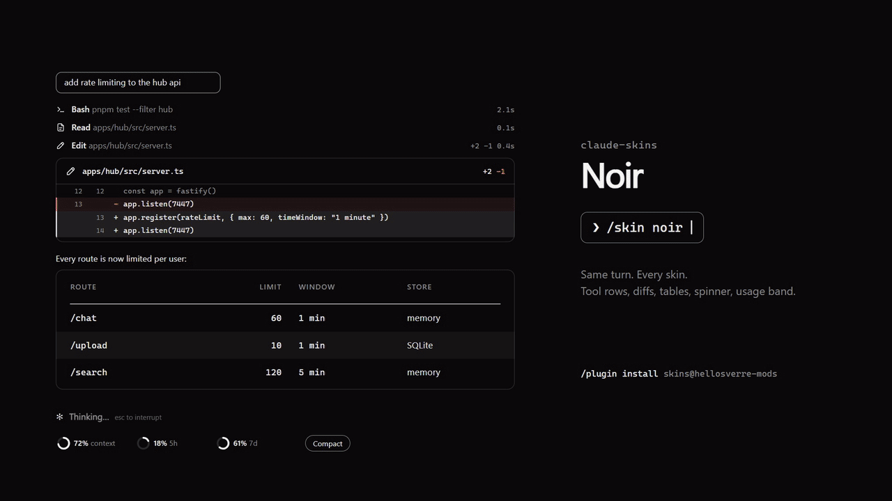

<h1 align="center">
  <picture>
    <source media="(prefers-color-scheme: light)" srcset="docs/brand/banner-light.svg">
    
  </picture>
</h1>

<p align="center">
  <a href="https://github.com/hellosverre/claude-skins/releases/latest"></a>
  <a href="LICENSE"></a>
  
</p>

<p align="center">Appels d'outils avec icônes et durées, modifications en cartes de diff, tableaux, code et graphiques Mermaid en cartes,<br>une bande d'utilisation en direct, et seize habillages que vous pouvez recoller ou faire dessiner par Claude.</p>



## Installer

Nécessite Claude Code **2.1.287** ou version ultérieure, dans un terminal ou l'onglet Code de l'application Desktop. Exécutez ces deux commandes dans Claude Code :

```
/plugin marketplace add hellosverre/claude-skins
```

```
/plugin install skins@hellosverre-mods
```

Redémarrez Claude Code. L'habillage **noir** est actif ; tapez `/skin` pour le changer.

Vous cherchez d'autres mods ? `/plugin install mod-store@hellosverre-mods`, puis `/mods` parcourt et installe environ 2 700 mods depuis un volet, en montrant d'abord ce auquel chacun peut accéder.

## Mettre à jour

skins vérifie une nouvelle publication une fois par jour et affiche une notification si vous êtes en retard. Pour mettre à jour :

```bash
claude plugin marketplace update hellosverre-mods
```

```bash
claude plugin update skins@hellosverre-mods
```

Puis redémarrez Claude Code. Les sessions ouvertes gardent la version avec laquelle elles ont démarré.

## Désinstaller

```bash
claude plugin uninstall skins@hellosverre-mods
```

Pour garder le plugin mais revenir au dessin propre de Claude Code, exécutez `/skin off`.

## Utilisation

`/skin help` liste toutes les commandes dans Claude Code ; `/skin list` montre tous les habillages et réglages.

**Habillages**

| Commande | Action |
|---|---|
| `/skin` | Réglages : choisir un habillage avec aperçu en direct, activer/désactiver des parties, recolier n'importe quelle couleur |
| `/skin <nom>` | Changer d'habillage (noms ci-dessous) |
| `/skin list` | Tous les habillages, y compris les vôtres, et tous les réglages |
| `/skin help` | Toutes les commandes, sous forme de tableau |
| `/skin off` · `on` | Revenir au dessin propre de Claude Code, ou réactiver skins |
| `/skin gallery` | Tous les éléments dessinés par l'habillage, numérotés, pour les désigner |
| `/skin pin` · `unpin` · `share` | Donner à ce dossier son propre aspect, le retirer, ou en faire la valeur par défaut |
| `/skin copy` · `copy code` | Copier la dernière réponse de Claude, ou seulement son dernier bloc de code |
| `/skin calm` · `calm off` | Aucune animation, une ligne par ligne d'outil, sortie en lecture seule repliée, échecs toujours entiers ; `calm off` restaure votre état précédent |

Habillages intégrés : `noir`, `tokyo-night`, `dracula`, `catppuccin`, `rose-pine`, `nord`, `gruvbox`, `kanagawa`, `everforest`, `one-dark`, `solarized`, `night-owl`, `ayu`, `github`, `mono`, `terminal`.

**Options**

| Commande | Action |
|---|---|
| `/skin tables on/text/off` | Tableaux en cartes, en texte sélectionnable sur Desktop, ou au format Claude Code |
| `/skin prompt left/right/plain` | Dans le terminal, de quel côté se trouvent les contours de votre prompt, ou un simple marqueur initial. Le Desktop garde les messages propres de Claude Code, avec copie et retour arrière |
| `/skin words claude/skin` | Les paroles du spinner et du pied de tour : celles de Claude Code ou celles de l'habillage (par défaut) |
| `/skin icons unicode/ascii` | Le jeu d'icônes, et des diagrammes uniquement ASCII dans le terminal |

**Parties**, chacune activée avec `/skin <partie> on` ou `off` :

| Partie | Action |
|---|---|
| `rail` | La rail colorée à côté des lignes d'outils |
| `shimmer` | La bande de lumière sur le mot du spinner |
| `band` | Les jauges d'utilisation au-dessus du prompt |
| `countdown` | Le temps restant à chaque limite dans la bande |
| `compact` | Le bouton Compact dans la bande, avec un rappel à 70 % de contexte (actif par défaut) |
| `clip` | Limiter la sortie shell propre de Claude Code à son début et sa fin |
| `markdown` | Alertes et listes de tâches dessinées |
| `quiet` | Lectures, recherches et commandes en lecture seule repliées en une ligne |
| `charts` | Blocs mermaid en graphiques |
| `math` | Composition mathématique |
| `commands` | Sortie des commandes slash en tableaux et cartes |
| `shell` | Sortie shell en carte |
| `highlight` | Blocs de code colorés avec les couleurs de l'habillage |
| `hints` | Indiquer à Claude que les graphiques sont dessinés ici |
| `links` | URL et chemins comme liens |
| `copy` | Boutons de copie sur les cartes |
| `fold` | Longs blocs repliés derrière `▾ N more` |
| `expand` | Toutes les séries de lectures et recherches ouvertes, au lieu de la ligne `Read 3 · Search 2 ▸` ; désactivé par défaut |

**En concevoir un avec Claude.** Demandez « fais-moi un habillage qui évoque un coucher de soleil ». skins fournit à Claude un outil `design`, pour qu'il construise l'habillage et l'applique sous vos yeux. Recolorer un habillage intégré l'enregistre comme votre `my-<habillage>`. Les choix sont mémorisés entre les sessions.

## Aperçu

Dessiné par le propre code de cartes du mod (`scripts/previews.ts`), pas par des captures d'écran.

<picture>
  <source media="(prefers-color-scheme: light)" srcset="docs/previews/hero-light.svg">
  
</picture>

<picture>
  <source media="(prefers-color-scheme: light)" srcset="docs/previews/spinners-light.svg">
  
</picture>

<picture>
  <source media="(prefers-color-scheme: light)" srcset="docs/previews/terminal-light.svg">
  
</picture>

<picture>
  <source media="(prefers-color-scheme: light)" srcset="docs/previews/code-light.svg">
  
</picture>

<picture>
  <source media="(prefers-color-scheme: light)" srcset="docs/previews/usage-light.svg">
  
</picture>

## Ce qu'il redessine

| Partie | Application Desktop | Terminal |
|---|---|---|
| Appels d'outils | Icône par type, spinner pendant l'exécution, lignes modifiées, durée. `▸` ouvre la ligne : l'entrée complète de l'appel et sa réponse (texte d'une lecture avec numéros de ligne, correspondances d'une recherche, carte shell, diff) ; un appel en échec s'ouvre de lui-même | Un nœud sur la rail du tour, avec le même `▸` |
| Modifications | Carte de diff avec `+N −M` et lignes numérotées | Le diff propre de Claude Code |
| Commandes shell | Carte de terminal avec statut, stderr séparé, longue sortie repliée ; chemins, nombres et mots d'erreur, d'avertissement et de réussite colorés | Carte avec la commande, la sortie colorée de la même façon, `✓` ou `✗ exit N`, stderr en rouge sous sa propre étiquette, chaque flux replié à 8 + 4 lignes (`/skin shell off` pour celui de Claude Code) |
| Sortie silencieuse (désactivée par défaut) | Lectures, recherches et commandes en lecture seule repliées en une ligne ; un échec garde sa ligne d'erreur | Idem |
| Tableaux | Carte avec filet d'en-tête, lignes zébrées, échantillons de couleurs | Grille de cellules avec bande d'en-tête |
| Graphiques | ` ```mermaid ` en carte : flowchart, xy, pie, gantt, timeline, journey, kanban, mindmap, quadrant, radar, sankey, gitGraph, treemap, packet, block, architecture, C4 | Les mêmes dix-sept en cellules, ASCII avec `/skin icons ascii` |
| Mathématiques | `$$…$$`, `\[…\]` et ` ```math ` en carte composée : fractions, racines, sommes et intégrales avec limites, matrices, lignes alignées ; `$…$` en ligne devient Unicode | Fractions et limites empilées en cellules, `$…$` en ligne en Unicode |
| Sortie de commande | `/cost`, `/context` et sortie de plugin : tableaux, code et suites `key: value` en cartes | Idem, en grilles de cellules |
| Alertes et listes de tâches | `> [!NOTE]` en boîte titrée, `- [ ]` avec coches et compte des éléments faits | Idem |
| Blocs de code | Carte avec langue, numéros de ligne, coloration ; les blocs shell gardent le bouton Run | Encadré, la langue sur le cadre, coloré avec les couleurs de l'habillage : TS/JS, JSON, shells, PowerShell, Python, Rust, Go, C/C++, C#, F#, Java, YAML, TOML, HTML/XML, CSS, SQL, diff, Markdown, Lua (`/skin highlight off` pour celui de Claude Code) |
| Spinner | Icône animée par phase | Le mot de l'habillage avec une bande de lumière |
| Au-dessus du prompt | Anneaux de contexte et de limites du forfait, bouton Compact, rappel à 70 % | Jauges en blocs, même bouton |
| Vos prompts | Ceux de Claude Code, pour garder copie, retour arrière et sélection | Contour arrondi, ou simple marqueur |
| Liens et fichiers | Les URL sont les liens propres de l'application ; les lignes d'outils colorent les fichiers créés (`ok`) ou modifiés (`warn`) ce tour | Les URL en prose sont des liens OSC 8 lorsque le terminal les dessine (`FORCE_HYPERLINK=1` ou `0` outrepasse la détection), sinon du texte brut ; chemins avec `:line`, nombres et versions colorés, fichiers du tour en `ok` ou `warn` dans les lignes et la prose |
| Blocs diff | ` ```diff ` en carte de diff, avec Copy et `new only` (le code après modification) | Anciennes et nouvelles lignes numérotées, `+` et `-` aux couleurs de l'habillage et code coloré dans la langue indiquée par son chemin `+++` ou une étiquette ` ```diff-fsharp `, avec les mêmes deux copies |
| Côte à côte | Deux tableaux ou graphiques ou plus sur une même ligne se partagent l'espace à 75 colonnes chacun ; sinon empilés | Tableaux et diagrammes côte à côte tant que leurs largeurs naturelles tiennent ; sinon empilés |
| Longs blocs | Cartes de code au-delà de 24 lignes coupées là, avec `▾ N more` | Code au-delà de 24 lignes, tableaux au-delà de 14 lignes et sortie shell au-delà de 8 + 4 lignes repliés derrière `▾ N more` / `▴ less` |

Chaque carte a un bouton Copy (les tableaux aussi `as text`, le tableau tel qu'il est dessiné ; une réponse à plusieurs blocs se termine par `copy reply`) et s'anime une fois, au premier dessin, en respectant la réduction des animations. Seul le dessin change : la conversation enregistrée et ce que lit le modèle sont intacts. Les agents, le mode plan et l'invite de permission gardent le dessin propre de Claude Code.

**Indices de graphiques.** Tant que les graphiques sont actifs, Claude reçoit une courte note visible seulement par le modèle (environ 130 jetons, estimés depuis ses 458 caractères) disant que les blocs ` ```mermaid ` sont dessinés ici, pour qu'il choisisse un graphique lorsqu'il est plus lisible. Jamais pour les exécutions headless `claude -p`. `/skin hints off` retire la note et garde les graphiques.

**Clair et sombre.** Chaque habillage a les deux et suit le thème de Claude Code. Sur `auto`, il suit votre terminal (`COLORFGBG`) ou le système. Forcez l'un avec `SKINS_THEME=light` ou `SKINS_THEME=dark`.

**Les couleurs de votre terminal.** L'habillage `terminal` peint le terminal avec sa propre palette de 16 couleurs (`ansi256(0)` à `ansi256(15)`), donc il suit le thème du terminal, clair ou sombre. Le texte courant et les bandes de tableau utilisent les couleurs du thème propre de Claude Code ; choisissez un thème ANSI dans `/config` pour qu'elles suivent aussi le terminal. L'application Desktop n'a pas de palette de terminal et le dessine comme `noir`.

## Pour les autres mods

skins ajoute `$.skins.markdown` à `$`. Il dessine le markdown comme skins dessine une réponse, dans l'habillage de la personne. Il renvoie un arbre, ou `undefined` si skins est désactivé ou si le texte ne contient rien à dessiner, et lève une erreur sur un argument mal formé. Il ne dessine aucun contrôle de copie ou de repli, car un appui ne peut pas passer de l'arbre d'un mod à celui d'un autre. Listez `skins` sous `dependencies` dans votre `plugin.json` et Claude Code déposera ses types dans votre `.claude-plugin/types/`.

```tsx
let drawn
try {
  drawn = await $.skins.markdown({ surface: e.surface, text, columns: e.props.bodyColumns })
} catch {}
return drawn ?? <Markdown text={text} />
```

## Compatibilité

Vérifié manuellement sur Windows (terminal et application Desktop, 0.3.0) et exécuté sur Linux (terminal, 0.5.0, Claude Code 2.1.288, 168 tests du moteur). [CI](.github/workflows/ci.yml) exécute les tests, les contrôles de manifeste et la vérification des types sur Linux, Windows et macOS. macOS, VS Code et mobile n'ont pas été examinés manuellement. La matrice surface × système d'exploitation et les temps de rendu par ligne figurent dans [docs/compat.md](docs/compat.md). Pour mesurer sur votre machine :

```bash
scripts/bench.sh
```

## Limites connues

| Quoi | Ce que vous obtenez à la place | Où |
|---|---|---|
| Une ligne ouverte pour la lecture d'une image, d'un PDF ou d'un notebook, une commande en arrière-plan, ou une réponse illisible | La ligne propre de Claude Code, dessinée dans la ligne ouverte | `bodyOf` dans [`hooks/detail.ts`](hooks/detail.ts) ; test « an opened image Read is Claude Code's own drawing… » |
| Agents, mode plan, todos, invite de permission | Les lignes et boîtes de dialogue propres de Claude Code | `kindOf` dans [`hooks/tools.ts`](hooks/tools.ts) ; test « tools a skin cannot redraw faithfully keep their own row » |
| Modifications sur le terminal, modifications en échec partout | Le diff propre de Claude Code | [`hooks/register.tsx`](hooks/register.tsx) `ToolResult` ; test « on the desktop an edit is a diff card… » |
| Blocs de code sur le terminal dans une langue inconnue du colorateur | Le markdown propre de Claude Code | `languageOf` dans [`hooks/highlight.ts`](hooks/highlight.ts) ; test « a fence in a language it does not know keeps Claude Code's markdown » |
| Blocs shell (` ```bash `) sur le Desktop | Le bloc propre de l'application, pour garder son bouton Run | test « on the desktop a shell fence keeps the app's own block » |
| Diagrammes de séquence, d'état, de classe et ER sur le Desktop | Une carte de code : seul le layout intégré du terminal les dessine | `artKind` dans [`hooks/mermaid-art.ts`](hooks/mermaid-art.ts), `parseMermaid` dans [`hooks/mermaid.ts`](hooks/mermaid.ts) |
| Coréen, chinois, japonais ou autres caractères larges dans l'identifiant de nœud ou le nom d'état d'un diagramme terminal (`A[開始] --> 請求`) | Le code : le layout intégré écarte ces nœuds. Les libellés larges sont dessinés comme art | `drawsWide` dans [`hooks/mermaid-art.ts`](hooks/mermaid-art.ts) ; test « a diagram the renderer cannot lay out with wide characters falls back to code » |
| Un diagramme trop large ou trop long (plus de 80 lignes ou 8 000 caractères sur le terminal) | Lignes pour flowchart, xy et pie, sinon le code | test « a diagram too wide for the terminal falls back to rows… » |
| Un bloc de réponse de plus de 9 000 caractères, un prompt de plus de 4 000 | Le dessin propre de Claude Code pour tout le message | `MAX_MARKDOWN`, `MAX_PROMPT` dans [`hooks/register.tsx`](hooks/register.tsx) |
| Cartes de code au-delà de 80 lignes | Les 80 premières et une note `N more lines` ; Copy prend tout | `MAX_LINES` dans [`hooks/svg-code.ts`](hooks/svg-code.ts) |
| Commandes TeX inconnues du analyseur | Dessinées telles quelles, `
ame` | [`hooks/math.ts`](hooks/math.ts) |
| Sortie shell sur le terminal vs sur le Desktop | La carte du terminal nomme la commande et replie chaque flux à 8 + 4 lignes ; la carte Desktop indique `Output` et replie les deux flux ensemble à 6 + 6 | [`hooks/shell-rows.tsx`](hooks/shell-rows.tsx), [`hooks/svg-terminal.ts`](hooks/svg-terminal.ts) |
| Un appel shell en échec qui renvoie du texte d'erreur au lieu de son enregistrement | stdout et stderr arrivent fusionnés, donc tout le texte est dessiné comme stderr | `shellResultOf` dans [`hooks/shell.ts`](hooks/shell.ts) |
| Une commande envoyée en arrière-plan, ou une sortie qui est une image | La ligne propre de Claude Code, qui indique où elle est allée ou dessine l'image | `keepsOwnRow` dans [`hooks/shell.ts`](hooks/shell.ts) ; test « /skin shell off gives shell output back… » |
| Cartes shell et durées d'outils après `/resume` | Aucune commande dans l'en-tête et aucune durée : les deux sont enregistrés pendant l'appel | `commandAtom`, `durationAtom` dans [`hooks/register.tsx`](hooks/register.tsx) |
| Erreurs de commandes slash et sortie propre de `/skin` | La ligne propre de Claude Code | test « slash-command output with key: value lines is a table, prose keeps its row » |
| `/skin calm` et le spinner de Claude Code | Calm rend le spinner à Claude Code, dont le propre spinner continue de bouger | `Spinner` dans [`hooks/register.tsx`](hooks/register.tsx) |
| Le volet de réglages sur mobile | Une ligne indiquant d'utiliser le terminal ou l'application Desktop | `Pane` dans [`hooks/register.tsx`](hooks/register.tsx) |
| Chemins de fichiers comme liens | Colorés, pas cliquables : le `Link` du moteur n'accepte que `https:` et `http://localhost` | `safeHref` dans [`hooks/links.ts`](hooks/links.ts) |
| Repli sur le Desktop | Les cartes de code se replient ; les cartes de tableau et la carte shell gardent leur hauteur entière ou leur propre repli 6 + 6 | [`hooks/fold.tsx`](hooks/fold.tsx) |
| Icônes et rail | Icônes sur le Desktop seulement (le terminal ne dessine pas de `Svg`) ; rail sur le terminal seulement | `lookOf` dans [`hooks/register.tsx`](hooks/register.tsx) |

## Comparé avec

D'autres mods qui changent l'apparence de la transcription, d'après leurs README du 10 octobre 2026. Une case vide signifie que le README ne le précise pas.

| | skins | [Prismantis](https://github.com/NahumLitvin/prismantis) | [glint](https://github.com/manikosto/glint) | [tweakcc](https://github.com/Piebald-AI/tweakcc) | [claude-gfm-render](https://github.com/briangtn/claude-gfm-render) | [ccstatusline](https://github.com/sirmalloc/ccstatusline) |
|---|---|---|---|---|---|---|
| Méthode | Plugin à hooks de fonction | Plugin à hooks de fonction | Plugin à hooks de fonction, fork de Prismantis | Patch le JavaScript de Claude Code ; à reappliquer après chaque mise à jour | Mod à hooks de fonction | Commande de ligne d'état |
| Claude Code | 2.1.287+ | 2.1.287+ | 2.1.289+ | Vérifié sur 2.1.162 | 2.1.286+ | |
| Plateformes citées | Windows manuellement, Linux par les tests ; CI sur Linux, Windows, macOS ([compat](docs/compat.md)) | Terminal macOS manuellement ; CI sur macOS, Linux, Windows | | Windows, macOS, Linux | Terminal et application Desktop | Guide Windows dans ses docs |
| Thèmes | 16, recolorier n'importe quelle couleur, ou en faire dessiner un par Claude | 15 et `mono`, 20 emplacements de couleur | 15 | Les vôtres, pour toute l'interface Claude Code | | Thèmes Powerline |
| Recolorie l'interface propre de Claude Code | Non | Non | Non | **Oui** | Non | Non |
| Lignes d'outils | Icônes, durées, rail ; **ouvrables sur l'entrée et la réponse** | 4 styles | | | Non | Non |
| Sortie en lecture seule masquée | `/skin quiet` | `toolOutput: quiet` | | | Non | Non |
| Diff des modifications | Carte sur le Desktop ; diff du moteur dans une ligne ouverte sur le terminal | Celui de Claude Code | | | Non | Non |
| Blocs ` ```diff ` | Carte de diff ou lignes numérotées, copie `new only` | | Numérotées, `⧉ new only` | | | Non |
| Sortie shell | Carte sur les deux surfaces, avec couleurs pour chemins, nombres et erreurs | Encadrée dans des groupes dépliés | | | Non | Non |
| Coloration du code sur le terminal | 20 familles de langues aux couleurs de l'habillage | Prism, deux douzaines de langues | 20+ langues | | | Non |
| Tableaux | Carte ou grille de cellules, côte à côte avec les diagrammes | 4 styles, côte à côte avec les diagrammes | | 4 formats | Non | Non |
| Mermaid | 17 types ; séquence, état, classe, ER sur le terminal seulement | Flowchart, séquence, état, classe, ER, xy ; pas de pie | Flowchart, séquence, xy | | Flowchart, séquence, état, classe, ER, xy ; SVG sur le Desktop | Non |
| Mathématiques | Carte sur le Desktop, cellules empilées sur le terminal | Image composée dans kitty et Ghostty via RaTeX, texte ailleurs | | | Non traité | Non |
| Liens | URL en liens OSC 8 ; fichiers du tour colorés | Liens et URL nues cliquables | **URL et chemins de fichiers cliquables** ; fichiers modifiés colorés ; bande de liens | | | Non |
| Longs blocs repliés | Code, tableaux, sortie shell (`/skin fold`) | | Code, listes, tableaux | | | Non |
| Texte de droite à gauche | Non | **Hébreu et arabe** | Hébreu et arabe | | | Non |
| Jauges d'utilisation | Contexte et limites du forfait au-dessus du prompt | | | | Non | **De nombreux widgets**, Powerline |
| Mots du spinner | Ceux de l'habillage, avec scintillement | | | **Vos propres verbes et animations** | Non | Non |
| Copie | Cartes, tableaux en markdown ou tels que dessinés, `copy reply`, `/skin copy` | Boutons, `/prismantis copy`, tableaux HTML | Code, tableaux, diagrammes, listes, citations | | | Non |
| API pour autres mods | `$.skins.markdown` | `$.prismantis.markdown` | | | | Non |

Leurs points forts : **tweakcc** recolorie tout Claude Code, pas seulement ce qu'un hook peut redessiner, au prix d'un patch du binaire. **Prismantis** gère le texte de droite à gauche, copie les tableaux en HTML et compose les mathématiques en images. **glint** rend les chemins de fichiers cliquables et garde une bande des liens de la dernière réponse. **ccstatusline** a une ligne d'état bien plus riche. **claude-gfm-render** dessine les diagrammes de séquence et autres en SVG sur le Desktop, là où skins revient à une carte de code. La feuille de route de skins est dans [ROADMAP.md](ROADMAP.md).

## Confidentialité

skins dessine et mémorise, rien de plus. Il lit le dossier de session, votre contexte et l'utilisation du forfait, le réglage de thème et `SKINS_THEME` / `COLORFGBG`, et garde ses réglages dans le stockage du mod. Son unique appel réseau est la vérification quotidienne de version : un GET du [`plugin.json`](.claude-plugin/plugin.json) de ce dépôt sur `raw.githubusercontent.com`, sans rien envoyer. Sur `auto`, il demande au système d'exploitation le mode clair ou sombre (`defaults` sur macOS, `gsettings` sur GNOME). Il ne compacte ni ne copie qu'au moment où vous appuyez sur le bouton. Vérifiez par vous-même avec `claude plugin validate .`.

## Code intégré

Les diagrammes du terminal sont disposés par [beautiful-mermaid](https://github.com/lukilabs/beautiful-mermaid) (MIT), regroupé dans `hooks/vendor/mermaid-ascii.js` avec sa licence en en-tête. Pour le reconstruire :

```bash
cd scripts/vendor && npm install && npm run build
```

## Développement

```bash
git clone https://github.com/hellosverre/claude-skins && cd claude-skins
```

```bash
claude --plugin-dir .
```

Enregistrer un fichier recharge le mod dans la session en cours. Tests : `claude plugin test .`. Aperçus : `npx tsx scripts/previews.ts`. Un nouvel habillage intégré tient en un fichier : copiez `hooks/themes/nord.ts`, modifiez couleurs et mots, ajoutez une ligne à `hooks/themes/index.ts`.

## Plus de mods

- [redgreen](https://github.com/hellosverre/redgreen) : résultats de tests dans un volet à côté du chat
- [smart-compact](https://github.com/hellosverre/smart-compact) : compacte après un commit, des tests verts, avant l'expiration du cache de prompt, ou quand Claude le demande
- [mod-store](https://github.com/hellosverre/mod-store) : parcourir, rechercher et installer 2 700 mods depuis un volet

## Licence

MIT
