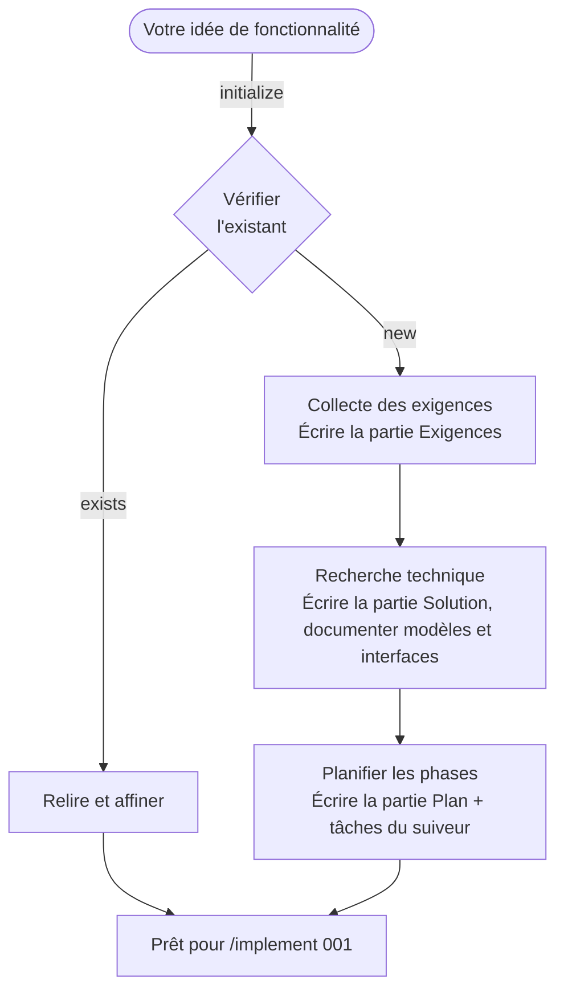
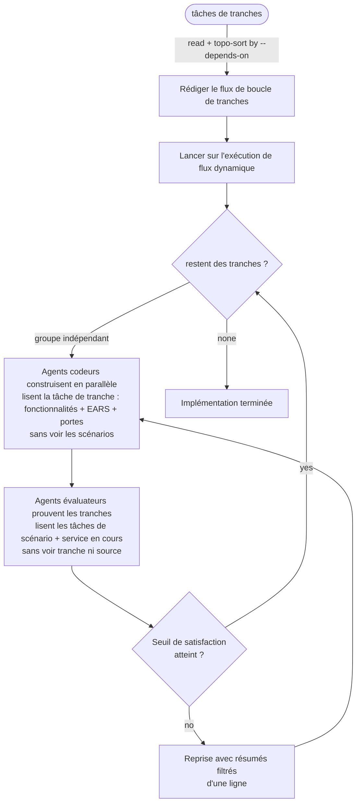
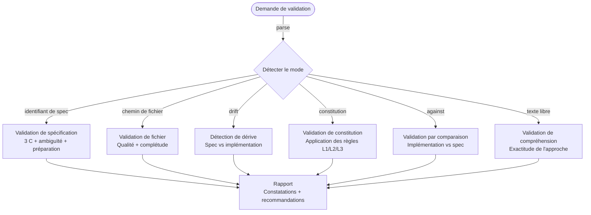
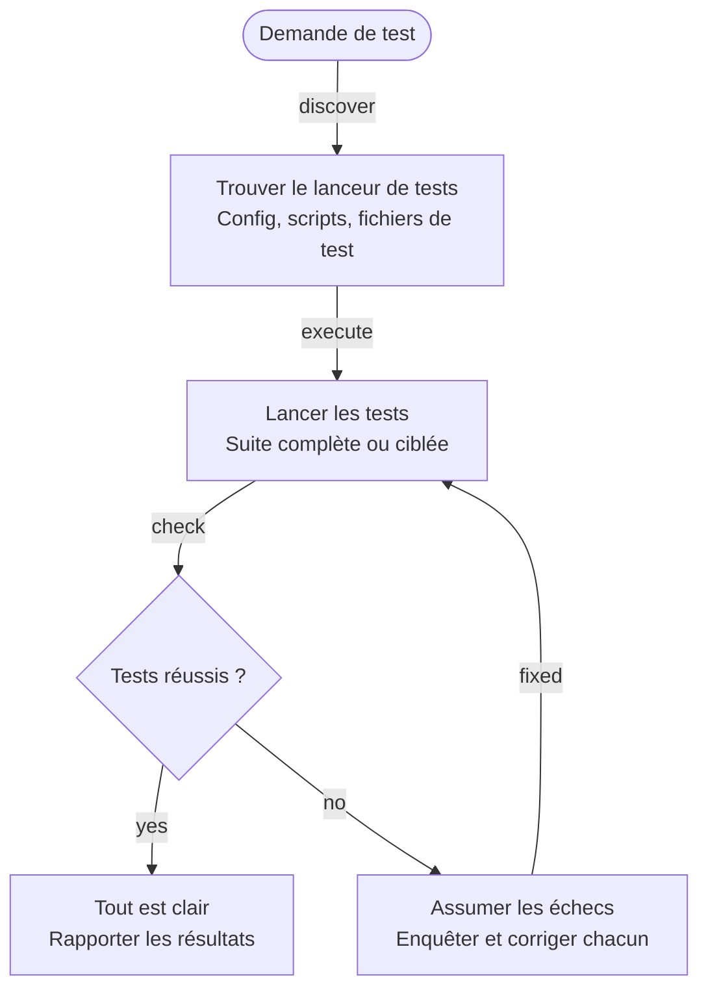
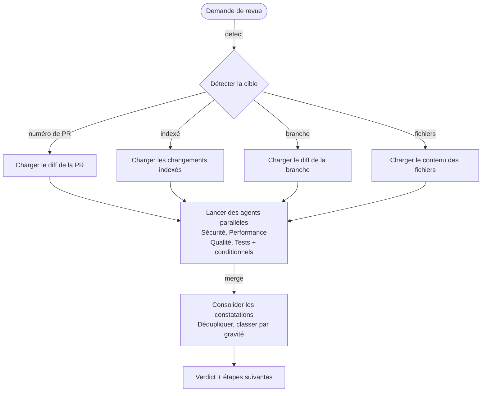
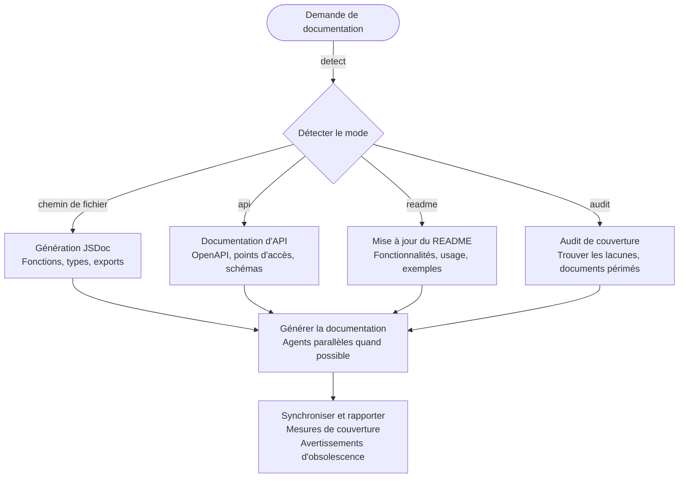
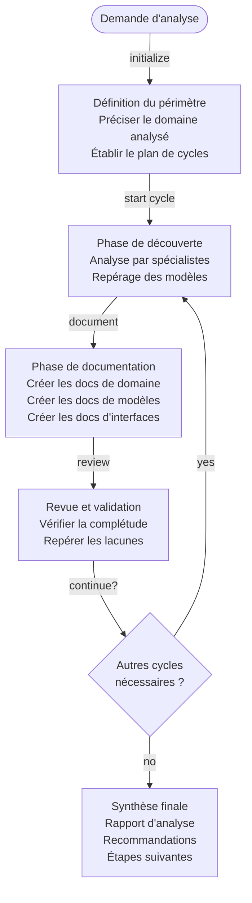
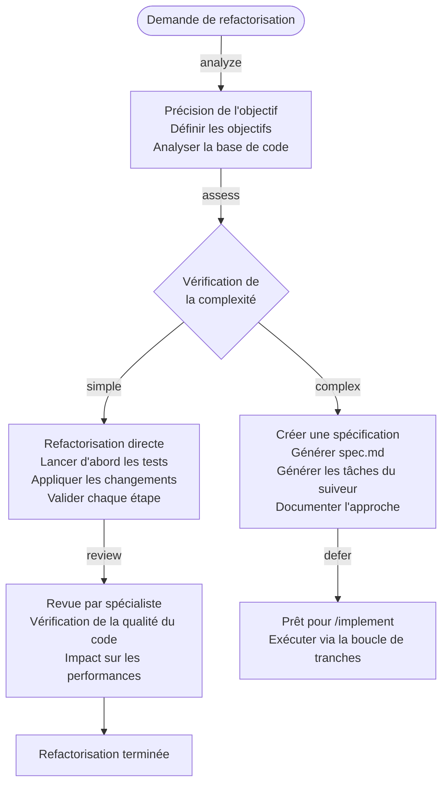
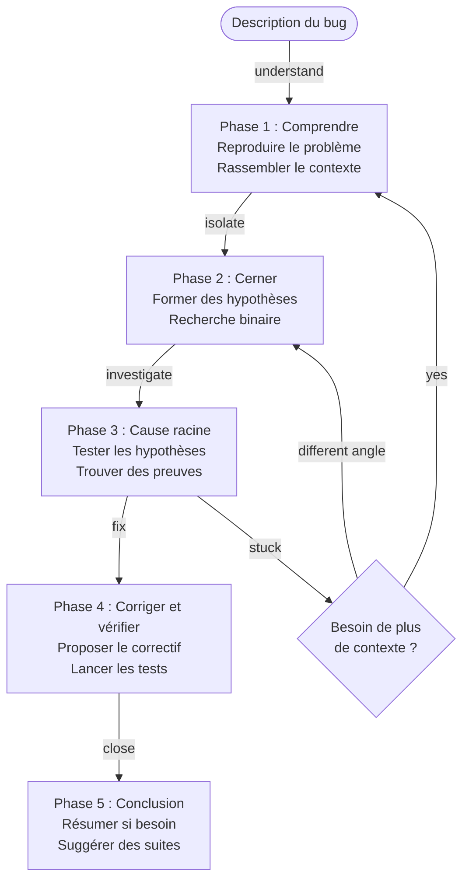
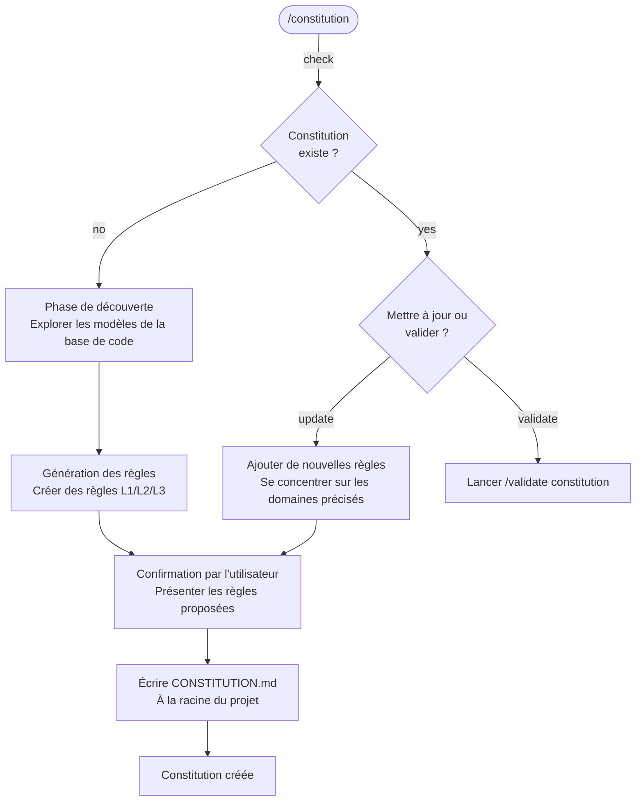

# Start Plugin - The Agentic Startup

**Plugin d'orchestration de flux de travail pour le développement piloté par spécifications dans Claude Code.**

Le plugin `start` fournit dix compétences de flux de travail invocables par l'utilisateur, cinq compétences autonomes et trois styles de sortie pour transformer votre façon de construire des logiciels avec Claude Code.

**Pour un démarrage rapide, un guide de flux de travail et le choix des compétences, voir le [README principal](../../README.md).**

---

## Table des matières

- [Compétences invocables par l'utilisateur](#compétences-invocables-par-lutilisateur) — specify, implement, validate, test, review, document, analyze, refactor, debug, constitution
- [Compétences autonomes](#compétences-autonomes) — 5 compétences activées par le contexte
- [Structure de la documentation](#structure-de-la-documentation) — specs, domain, patterns, interfaces
- [Styles de sortie](#styles-de-sortie) — The Garage, The Startup, The ScaleUp
- [Flux de développement typique](#flux-de-développement-typique) — flux principal et de maintenance
- [Compétences en action](#compétences-en-action) — exemples concrets
- [Modèles](#modèles) — PRD, SDD, Plan, Scenario
- [Philosophie](#philosophie) — principes du développement piloté par spécifications

---

## Compétences invocables par l'utilisateur

Ces compétences sont invoquées par l'utilisateur via des commandes slash (par exemple `/specify`). Contrairement aux compétences autonomes qui s'activent automatiquement selon le contexte, elles attendent une invocation explicite.

### `/specify <description>`

Crée des spécifications complètes à partir de brèves descriptions, grâce à une recherche approfondie et à la coordination d'agents spécialistes, en produisant un plan narratif ainsi que les tâches de tranches exécutées par `/implement`.

**Objectif :** transformer des idées en spécifications prêtes à implémenter, avec exigences produit, conception de la solution et plan — un `spec.md` plus les tâches d'implémentation dans le suiveur

**Usage :**
```bash
/specify Build a real-time notification system with WebSocket support
/specify 001  # Reprendre un travail de spécification existant
```

**Fonctionnalités clés :**
- **Identifiants de spec incrémentés automatiquement** - crée des dossiers numérotés (001, 002, etc.)
- **Reprise** - peut reprendre le travail sur des spécifications existantes par identifiant
- **Plan découpé en tranches** - divise le travail en tâches de tranches autonomes, chacune corrélant fonctionnalités (CA), comportement EARS et portes de qualité, avec les scénarios de réserve comme tâches enfants séparées
- **Ordonné par dépendances** - les tranches déclarent `--depends-on` les unes envers les autres ; ce graphe est le contrat de parallélisation utilisé par `/implement`
- **Documentation des modèles** - documente automatiquement les modèles découverts dans `docs/patterns/`
- **Documentation des interfaces** - capture les contrats de services externes dans `docs/interfaces/`
- **Documentation du domaine** - enregistre les règles métier dans `docs/domain/`
- **Portes de qualité** - exige l'approbation de l'utilisateur entre les grandes phases

**Le brief de code de chaque tranche corrèle trois facettes :**

| Facette | Source | Rôle |
| ------- | ------ | ---- |
| **Fonctionnalités** (critères d'acceptation) | Partie Exigences | ce que la tranche livre |
| **Comportement** (EARS) | Partie Solution | comment elle doit se comporter |
| **Portes de qualité** | dérivée | conditions vérifiables |

Ses **scénarios d'acceptation** sont des tâches enfants séparées (preuve de réserve) — comment on prouve que cela fonctionne.

<details>
<summary><strong>Voir les détails</strong></summary>

**Ce que vous obtenez :** un document, `.start/specs/[NNN]-[nom]/spec.md`, en trois parties, chacune close par sa propre porte d'approbation :

- **Exigences** - récits utilisateurs, spécifications fonctionnelles, critères de succès, exigences non fonctionnelles
- **Solution** - architecture technique, composants du système, modèles de données, pile technologique
- **Plan** - l'état cible et les phases avec leurs résultats ; les tâches d'implémentation (phases → tranches → tâches enfants de scénario) vivent dans **.tracker/**

Sa partie Registre contient les questions ouvertes, les hypothèses, le journal des décisions et les compromis de revue acceptés.



</details>

---

### `/implement <spec-id>`

Exécute une spécification en lançant ses tâches de tranches sur l'exécution de flux de travail dynamique de Claude Code.

**Objectif :** transformer des spécifications validées en code fonctionnel avec une seule boucle — chaque tranche construite par un agent codeur et prouvée par un agent évaluateur, avec une barrière d'information entre eux et des reprises jusqu'à un seuil de satisfaction.

**Usage :**
```bash
/implement 001
/implement path/to/custom/spec/
```

**Comment cela fonctionne :**

`/implement` lit les tâches de tranches de la spécification dans le suiveur et les trie topologiquement par `--depends-on`. Il rédige ensuite et exécute un flux de travail dynamique :

| Étape | Ce qui se passe |
| ----- | --------------- |
| **Lecture** | Lire les tâches de tranches (`task.js graph`) ; chacune contient un brief de code (fonctionnalités + EARS + portes) avec ses scénarios de réserve comme tâches enfants |
| **Lancement** | Écrire le script de flux de travail d'après le contrat de boucle de la compétence et l'exécuter via l'outil Workflow ; les tranches indépendantes tournent en parallèle |
| **Boucle** | Par phase : les agents codeurs construisent leurs tranches — un agent pour une phase dont les tranches dépendent en chaîne, un par tranche pour celles qui peuvent tourner en parallèle (ils lisent les tâches de tranche, sans voir les scénarios) → un agent évaluateur prouve la phase avec un script de réserve gardé hors du projet (il lit les tâches de scénario, sans voir les tranches ni la source) → reprises avec résumés filtrés jusqu'au seuil ou au nombre maximal d'itérations |

**Fonctionnalités clés :**
- **Une seule boucle, montée en charge émergente** - un plan d'une tranche est une courte boucle ; un plan de 40 tranches se déploie largement. Aucun niveau ni stratégie à choisir
- **Barrière d'information structurelle** - la barrière est la tâche que chaque agent lit : agent codeur → tâche de tranche ; agent évaluateur → tâches enfants de scénario
- **Reprise** - l'exécution du flux dynamique reprend les agents terminés depuis le cache dans une session
- **Détection de dérive** - lance les vérifications de dérive de `Skill(start:validate)`
- **Application de la constitution** - les violations L1/L2 bloquent l'achèvement
- **Mises à jour en temps réel** - `/workflows` montre la progression par tranche en direct

<details>
<summary><strong>Voir les détails — la boucle de tranches</strong></summary>

Lit les tâches de tranches de la spécification dans le suiveur et les trie topologiquement par `--depends-on`. Exécute un flux de travail dynamique écrit d'après le contrat de boucle de la compétence. Chaque phase passe par une boucle codeur → évaluateur avec barrière : les agents codeurs construisent leurs tranches (en lisant les fonctionnalités, EARS et portes des tâches de tranche ainsi que AGENTS.md, mais jamais leurs tâches enfants de scénario), un agent évaluateur prouve la phase contre ces tâches de scénario avec un script de réserve qu'il garde hors du projet (accédant au service en cours d'exécution et, pour les scénarios d'interface, à un vrai navigateur, mais jamais aux tranches ni à la source), et des résumés d'échec filtrés d'une ligne alimentent la reprise suivante jusqu'au seuil de satisfaction ou au nombre maximal d'itérations. Une phase dont les tranches forment une chaîne de dépendances est construite par un seul agent codeur ; les tranches pouvant tourner en parallèle ont chacune un agent, simultanément.



</details>

---

### `/validate <target>`

Valide des spécifications, des implémentations ou la compréhension grâce à une détection intelligente du contexte et au cadre des 3 C (Complétude, Cohérence, Correctitude).

**Objectif :** porte de qualité utilisable à toute étape du cycle de vie - pendant la spécification, avant l'implémentation ou après achèvement

**Usage :**
```bash
/validate 001                                          # Valider une spec par identifiant
/validate .start/specs/001/spec.md                      # Valider un fichier précis
/validate Check the auth implementation against SDD    # Comparer l'implémentation à la spec
/validate drift                                        # Vérifier la dérive spec-implémentation
/validate constitution                                 # Valider la conformité à la constitution
/validate Is my caching approach correct?              # Valider la compréhension
```

**Fonctionnalités clés :**
- **Détection intelligente du mode** - détermine automatiquement le type de validation à partir de l'entrée
- **Le cadre des 3 C** - vérifie Complétude, Cohérence et Correctitude
- **Détection d'ambiguïté** - repère les formulations vagues (« devrait », « divers », « etc. »)
- **Traçabilité inter-documents** - vérifie l'alignement exigences → solution → manifeste
- **Détection de dérive** - vérifie l'alignement spec-implémentation
- **Application de la constitution** - valide les règles de gouvernance L1/L2/L3
- **Purement consultatif** - fournit des recommandations sans bloquer
- **Validation par comparaison** - compare les implémentations aux spécifications

<details>
<summary><strong>Voir les détails</strong></summary>

**Six modes de validation** détectés automatiquement à partir de l'entrée :

| Type d'entrée | Mode | Ce qui est validé |
| ------------- | ---- | ----------------- |
| Identifiant de spec (`005`) | Spécification | Qualité et préparation complètes de la spec |
| Chemin de fichier (`src/auth.ts`) | Fichier | Qualité d'un fichier précis |
| `drift` ou `check drift` | Détection de dérive | Alignement spec-implémentation |
| `constitution` | Constitution | Conformité aux règles de gouvernance |
| « Check X against Y » | Comparaison | Implémentation par rapport à la spécification |
| Texte libre | Compréhension | Exactitude de l'approche |

**Le cadre des 3 C :**

1. **Complétude** - toutes les sections remplies, aucun marqueur `[NEEDS CLARIFICATION]`, listes de contrôle complètes
2. **Cohérence** - traçabilité inter-documents, terminologie alignée, aucune contradiction
3. **Correctitude** - ADR confirmés, dépendances valides, critères d'acceptation testables



</details>

---

### `/test [target]`

Lance les tests avec une application stricte de la responsabilité du code — aucune excuse du type « échecs préexistants » n'est acceptée.

**Objectif :** découvrir et exécuter les tests, laisser la base de code dans un état où ils passent, et assumer la responsabilité de tout échec rencontré

**Usage :**
```bash
/test                            # Lancer toute la suite de tests
/test all                        # Lancer toute la suite de tests (explicite)
/test src/auth/                  # Lancer les tests d'un chemin précis
/test baseline                   # Enregistrer l'état actuel des tests
```

**Fonctionnalités clés :**
- **Découverte des tests** - trouve automatiquement le lanceur, la configuration et les fichiers de test
- **Responsabilité du code** - si les tests échouent, vous assumez le correctif — pas de blame sur des problèmes préexistants
- **Enregistrement de référence** - note l'état actuel réussi/échoué avant les changements
- **Parallélisme multi-agents** - peut répartir les suites entre agents parallèles
- **Exécution ciblée** - lance des fichiers, dossiers ou la suite entière

<details>
<summary><strong>Voir les détails</strong></summary>

**Le mandat de responsabilité :**

Quand les tests échouent, la compétence impose une responsabilité stricte :
- Pas de « ces échecs étaient déjà là »
- Pas de « ce n'est pas causé par mes changements »
- Ne pas laisser de tests en échec à l'utilisateur

**Modes de test :**

| Entrée | Mode | Ce qui se passe |
| ------ | ---- | --------------- |
| (vide) ou `all` | Suite complète | Découvre et lance tous les tests |
| Chemin de fichier/dossier | Ciblé | Lance les tests du périmètre précis |
| `baseline` | Enregistrement | Enregistre l'état actuel des tests pour comparaison |



</details>

---

### `/review [target]`

Revue de code multi-agents avec des points de vue spécialisés qui tournent en parallèle.

**Objectif :** revue de code complète avant fusion, avec des agents spécialistes examinant simultanément différents sujets

**Usage :**
```bash
/review                          # Relire les changements indexés
/review 123                      # Relire le numéro de PR
/review feature/auth             # Relire les changements de la branche
/review src/auth/ src/users/     # Relire des fichiers/dossiers précis
/review staged                   # Relire explicitement les changements indexés
```

**Fonctionnalités clés :**
- **Spécialistes parallèles** - les agents Sécurité, Performance, Qualité et Tests relisent en même temps
- **Points de vue conditionnels** - Concurrence, Dépendances, Compatibilité, Accessibilité s'activent quand c'est pertinent
- **Détection automatique de la cible** - détecte numéro de PR, changements indexés, chemin de fichier ou diff de branche
- **Score de confiance** - chaque constatation indique son niveau de confiance (ÉLEVÉ/MOYEN/FAIBLE)
- **Classification de gravité** - constatations CRITIQUE, ÉLEVÉE, MOYENNE, FAIBLE
- **Mode standard ou équipe** - sous-agents « tirez et oubliez » ou coéquipiers persistants avec coordination

<details>
<summary><strong>Voir les détails</strong></summary>

**Points de vue de revue centraux (toujours actifs) :**

| Point de vue | Domaines examinés |
| ------------ | ----------------- |
| **Sécurité** | Injection SQL, XSS, secrets codés en dur, contournements d'authentification, validation des entrées |
| **Performance** | Requêtes N+1, index manquants, fuites mémoire, algorithmes inefficaces |
| **Qualité** | Complexité du code, nommage, principes SOLID, gestion des erreurs, duplication |
| **Tests** | Lacunes de couverture, cas limites manquants, qualité des tests, exhaustivité des assertions |

**Points de vue conditionnels (activés quand pertinents) :**

| Point de vue | Déclencheur |
| ------------ | ----------- |
| **Concurrence** | async/await, Promise, threading détectés |
| **Dépendances** | Changements de fichiers de dépendances |
| **Compatibilité** | Changements d'API publique ou de schéma |
| **Accessibilité** | Changements de composants frontend |
| **Constitution** | CONSTITUTION.md existe dans le projet |



</details>

---

### `/document [target]`

Génère et synchronise la documentation, y compris la documentation d'API, les README, les commentaires JSDoc et les audits de documentation.

**Objectif :** garder la documentation à jour avec le code, générer les documents manquants et repérer ce qui est périmé

**Usage :**
```bash
/document src/api/               # Générer la documentation d'API
/document readme                 # Mettre à jour le README du projet
/document src/utils/             # Ajouter des commentaires JSDoc au code
/document audit                  # Auditer la couverture de la documentation
```

**Fonctionnalités clés :**
- **Plusieurs modes de documentation** - Code, API, README, Audit, Module
- **Détection de documents périmés** - repère la documentation obsolète
- **Mesures de couverture** - indique le pourcentage d'exhaustivité de la documentation
- **Génération OpenAPI** - crée des spécifications OpenAPI/Swagger depuis le code d'API
- **Parallélisme multi-agents** - plusieurs agents de documentation travaillent en même temps

<details>
<summary><strong>Voir les détails</strong></summary>

**Modes de documentation :**

| Entrée | Mode | Sortie |
| ------ | ---- | ------ |
| Chemin de fichier/dossier | Code | Commentaires JSDoc/TSDoc |
| `api` | API | Spécification OpenAPI, documentation des points d'accès |
| `readme` | README | Mises à jour de README.md |
| `audit` | Audit | Rapport de couverture |

**Détection de documents périmés :**

La compétence détecte automatiquement quand la documentation est obsolète en :
- comparant les horodatages des documents aux changements de code
- vérifiant que les API documentées correspondent toujours à l'implémentation
- identifiant les nouvelles exportations non documentées



</details>

---

### `/analyze <area>`

Découvre et documente les règles métier, les modèles techniques et les interfaces système grâce à une exploration itérative.

**Objectif :** extraire les connaissances organisationnelles de la base de code existante et créer une documentation réutilisable

**Usage :**
```bash
/analyze security patterns in authentication
/analyze business rules for user permissions
/analyze technical patterns in our microservices architecture
```

<details>
<summary><strong>Voir les détails</strong></summary>

Utilise un cycle répété découverte → documentation → revue pour extraire les connaissances organisationnelles. Des agents spécialistes explorent la base de code pour repérer les modèles, règles et interfaces dans les domaines métier, technique, sécurité, performance, intégration, données, test et déploiement. La documentation est automatiquement organisée dans `docs/domain/`, `docs/patterns/` et `docs/interfaces/`.



</details>

---

### `/refactor <description>`

Améliore la qualité du code tout en préservant strictement tout comportement existant grâce à des changements incrémentaux validés par les tests.

**Objectif :** refactorisation sûre et systématique, avec annulation automatique en cas d'échec des tests

**Usage :**
```bash
/refactor Simplify the authentication middleware for better testability
/refactor Improve the WebSocket connection manager
```

<details>
<summary><strong>Voir les détails</strong></summary>

Préserve strictement le comportement grâce à des changements incrémentaux validés par les tests. Tous les tests doivent passer avant de commencer la refactorisation et après chaque changement. Annulation automatique en cas d'échec. Pour les refactorisations simples, applique directement les changements avec validation continue. Pour les complexes, crée des documents de spécification et confie l'exécution planifiée à `/implement`.



</details>

---

### `/debug <description>`

Diagnostique et résout les bugs par une investigation conversationnelle avec analyse systématique des causes racines.

**Objectif :** partenaire de débogage en langage naturel qui aide à repérer et corriger les problèmes par le dialogue, sans procédures rigides

**Usage :**
```bash
/debug The API returns 500 errors when uploading large files
/debug Tests are failing intermittently on CI but pass locally
/debug Users report slow page loads after the latest deployment
```

**Fonctionnalités clés :**
- **Flux conversationnel** - dialogue naturel, pas listes de contrôle ou procédures rigides
- **Révélation progressive** - commence par un résumé, révèle les détails à la demande
- **Actions observables uniquement** - rapporte seulement ce qui a réellement été vérifié et trouvé
- **Guidé par l'utilisateur** - propose les étapes suivantes, laisse l'utilisateur orienter la direction
- **Suivi des hypothèses** - forme et teste des hypothèses classées de façon systématique
- **Fondé sur les preuves** - n'invente jamais de raisonnement ; toutes les conclusions sont étayées

<details>
<summary><strong>Voir les détails</strong></summary>

Adopte une approche conversationnelle en cinq phases naturelles : comprendre le problème, le cerner, trouver la cause racine, corriger et vérifier, conclure. Le débogueur ne rapporte que des actions observables (« j'ai vérifié X et trouvé Y ») et n'invente jamais de raisonnement. Les utilisateurs peuvent demander « qu'as-tu vérifié ? » à tout moment et obtenir des réponses honnêtes et vérifiables.



**Les quatre commandements :**
1. **Conversationnel, pas procédural** - c'est un dialogue, pas une checklist
2. **Observable uniquement** - « j'ai regardé X et trouvé Y », pas « c'est probablement... »
3. **Révélation progressive** - commencez bref, développez à la demande
4. **L'utilisateur garde la main** - « voulez-vous que je... ? », pas « je vais maintenant... »

</details>

---

### `/constitution [focus-areas]`

Crée ou met à jour une constitution de projet avec des règles de gouvernance par analyse des modèles existants.

**Objectif :** établir des règles de projet vérifiables, appliquées pendant l'implémentation, la revue et la validation

**Usage :**
```bash
/constitution                                    # Créer une nouvelle constitution par découverte dans la base de code
/constitution security and testing               # Se concentrer sur des domaines précis
/constitution Add API patterns                   # Mettre à jour une constitution existante
```

**Fonctionnalités clés :**
- **Règles fondées sur la découverte** - analyse les modèles réels de la base de code, ne suppose jamais de frameworks
- **Système de niveaux L1/L2/L3** - L1 (bloquant + correction auto), L2 (bloquant, manuel), L3 (consultatif)
- **Application sur trois couches** - vérifié pendant specify (SDD), implement et review
- **Règles de motif + de contrôle** - prend en charge les regex et les contrôles sémantiques interprétés par le LLM
- **Dégradation gracieuse** - le système fonctionne normalement sans constitution

<details>
<summary><strong>Voir les détails</strong></summary>

Crée `CONSTITUTION.md` à la racine du projet (comme README, LICENSE, CODE_OF_CONDUCT). La constitution définit des garde-fous vérifiables qui détectent les violations pendant le développement.

**Distinction clé :**
- **CLAUDE.md** = description du projet, conseils pour l'IA (« Utilisez React avec TypeScript »)
- **CONSTITUTION.md** = règles vérifiables qui détectent les violations (« Pas d'exports barillet »)

**Définitions des niveaux :**

| Niveau | Nom | Bloquant | Correction auto | Cas d'usage |
| ------ | --- | -------- | --------------- | ----------- |
| **L1** | Doit | Oui | L'IA corrige automatiquement | Sécurité, exactitude, architecture critique |
| **L2** | Devrait | Oui | Non | Règles importantes demandant un jugement humain |
| **L3** | Peut | Non | Non | Préférences de style, suggestions |

**Exemple de format de règle :**

```markdown
### No Hardcoded Secrets

\```yaml
level: L1
pattern: "(api_key|secret|password)\\s*[:=]\\s*['\"][^'\"]{8,}['\"]"
scope: "**/*.{ts,js}"
exclude: "**/*.test.*, .env.example"
message: Hardcoded secret detected. Use environment variables.
\```

Les secrets ne doivent jamais être commités dans le dépôt.
```

**Application sur trois couches :**

| Phase | Commande | Application |
| ----- | -------- | ----------- |
| **Planification** | `/specify` (SDD) | Le SDD ne doit pas violer les principes constitutionnels |
| **Tâches** | `/implement` | L'ordre des tâches respecte les priorités constitutionnelles |
| **Implémentation** | `/implement` | Le code généré est vérifié ; les violations L1/L2 bloquent l'achèvement |



</details>

---

### Installation

Installez le framework The Agentic Startup avec le programme d'installation interactif :

```bash
npx the-startup
```

**Ce qu'il fait :**
- Prend en charge les installations depuis le marketplace Claude et les installations par fichiers pour d'autres harnais
- Demande quels plugins installer (sélection multiple)
- Demande le harnais et le chemin d'installation en mode fichiers
- Copie les fichiers d'installation depuis le dépôt GitHub distant

**Options :**
- `--help` - Affiche l'aide

**Note :** les styles de sortie se sélectionnent via `/config` — voir [Styles de sortie](#styles-de-sortie).

---

## Compétences autonomes

Le plugin `start` comprend cinq compétences autonomes qui s'activent automatiquement selon le contexte. Vous n'avez jamais besoin de les invoquer explicitement — elles agissent quand c'est nécessaire.

### Compétences de spécification

| Compétence | Rôle |
| ---------- | ---- |
| `specify-meta` | Création du dossier de spec, suivi du README, transitions de phase |
| `specify-requirements` | Modèle d'exigences produit, validation, collecte des exigences |
| `specify-solution` | Modèle de conception de solution, architecture, gestion des ADR |
| `specify-plan` | Rédige le plan narratif et les tâches de tranches et de scénarios dans le suiveur |

### Compétences d'implémentation

| Compétence | Rôle |
| ---------- | ---- |
| `implement` | Exécute la boucle de tranches comme flux de travail dynamique — code → évaluation avec reprises par tranche et barrière entre les agents |

---

## Structure de la documentation

Le plugin encourage une gestion structurée des connaissances :

```
.start/
└── specs/
    └── [3-digit-number]-[feature-name]/
        ├── spec.md                          # Parties Exigences, Solution, Plan + Registre
        ├── review.md                        # Rapport de revue de la solution
        ├── events.jsonl                     # Journal d'événements rejoué par le tableau de bord
        └── .tracker/                        # Tâches d'implémentation (phase → tranches → scénarios)

docs/
├── domain/                                  # Règles métier
│   ├── user-permissions.md
│   ├── order-workflow.md
│   └── pricing-rules.md
│
├── patterns/                                # Modèles techniques
│   ├── authentication-flow.md
│   ├── caching-strategy.md
│   └── error-handling.md
│
└── interfaces/                              # Intégrations externes
    ├── stripe-payments.md
    ├── sendgrid-webhooks.md
    └── oauth-providers.md
```

### Auto-documentation

Le point de vue Capture de la compétence `document` crée automatiquement les fichiers au bon emplacement quand des modèles, interfaces ou règles métier sont découverts pendant :
- la création de spécifications (`/specify`)
- l'implémentation (`/implement`)
- l'analyse (`/analyze`)

### Déduplication

Le flux de capture vérifie toujours la documentation existante avant de créer de nouveaux fichiers, pour éviter les doublons.

---

## Styles de sortie

Le plugin `start` fournit trois styles de sortie — un registre par étape de l'entreprise. Un style change la façon dont Claude communique et la quantité de processus appliquée, pas ce qu'il sait. Les trois conservent les instructions d'ingénierie intégrées de Claude Code (`keep-coding-instructions: true`), et un style ne façonne que la conversation principale — les sous-agents et les flux de travail du plugin ne sont pas affectés.

Choisissez le registre qui correspond à qui le travail est destiné :

| Style | Registre | Quand l'utiliser |
| ----- | -------- | ---------------- |
| **The Garage** | Pré-startup — construire la plus petite chose qui fonctionne, en dire le moins possible | Prototypes et explorations ; rien n'est encore structurant, vous cherchez à savoir si la chose fonctionne |
| **The Startup** | Solo — un ingénieur, un agent, sans cérémonie | Vous êtes seul ; pas de délégation, pas de théâtre de plan à approuver, pas de statut pour des tiers |
| **The ScaleUp** | Coordonné — un travail qui passe par d'autres personnes | Quelqu'un qui n'était pas dans la conversation lira ce que vous écrivez et touchera ce que vous changez ; déléguez et laissez une trace |

### Activer un style

La commande `/output-style` a été supprimée dans Claude Code v2.1.91. Moyens actuels de sélection :

- **Interactif :** `/config` → Output style.
- **Direct :** `/config outputStyle=The Startup` (Claude Code v2.1.181+).
- **Épinglé pour un projet** (partagé avec l'équipe via git) dans `.claude/settings.json` :

  ```json
  { "outputStyle": "The Garage" }
  ```

  Utilisez `.claude/settings.local.json` pour un choix personnel par projet, ou `~/.claude/settings.json` pour tous les projets. Priorité : local > projet > utilisateur. Un changement prend effet à la session suivante (ou après `/clear`).

Ce plugin ne force **délibérément pas** de style (`force-for-plugin` n'est défini sur aucun des trois) : le stade vous appartient, et un style forcé remplacerait aussi bien votre sélection `/config` que tout réglage épinglé tant que le plugin est activé.

---

## Flux de développement typique

### Configuration (facultatif)

```
/constitution ──> Créer les règles de gouvernance du projet
                  Règles L1/L2/L3 appliquées automatiquement dans le flux BUILD
                  CONSTITUTION.md à la racine du projet
```

### Flux principal : Specify > Validate > Implement > Review

```
/specify ──> /validate ──> /implement ──> /review
   |              |              |              |
Créer des specs  Vérifier la    boucle de       Revue de code
PRD+SDD+Plan     qualité 3 C    tranches        Sécurité+Perf
   |              |       code↔éval      |
Constitution  Constitution   Constitution   Constitution
vérifiée sur  mode dispo +   appliquée      conformité
le SDD        dérive         sur le code    imposée

Facultatif : /document après l'implémentation pour synchroniser la documentation
```

*Si `CONSTITUTION.md` existe, les règles sont vérifiées automatiquement à chaque étape.*

**1. Créer la spécification**

```bash
/specify Add real-time notification system with WebSocket support
```

**Ce qui se passe :**
- Crée `.start/specs/001-notification-system/`
- Génère spec.md et les tâches du suiveur
- Documente les modèles/interfaces découverts
- Facultatif : crée la branche git `spec/001-notification-system`

**2. Valider avant l'implémentation (recommandé)**

```bash
/validate 001
```

**Ce qui se passe :**
- Vérifie complétude, cohérence, exactitude (les 3 C)
- Détecte les ambiguïtés et formulations vagues
- Analyse de sécurité pour les vulnérabilités courantes
- Vérifie la traçabilité entre documents

**3. Exécuter l'implémentation**

```bash
/implement 001
```

**Ce qui se passe :**
- Facultatif : crée la branche git `feature/001-notification-system`
- Exécute la boucle de tranches comme flux de travail dynamique
- Par tranche : un agent codeur la construit, un agent évaluateur la prouve avec des tâches de scénario de réserve
- Reprises avec résumés d'échec filtrés jusqu'à atteindre le seuil de satisfaction
- Facultatif : crée une PR à la fin

**4. Relire avant fusion**

```bash
/review
```

**Ce qui se passe :**
- Revue parallèle par des spécialistes (Sécurité, Performance, Qualité, Tests + conditionnels)
- Génère un rapport consolidé avec classement par gravité

**5. Générer la documentation (facultatif)**

```bash
/document src/notifications/
```

**Ce qui se passe :**
- Ajoute des commentaires JSDoc/TSDoc
- Met à jour le README si nécessaire
- Rapporte la couverture de la documentation

---

### Flux de maintenance

**Comprendre le code existant**

```bash
/analyze security patterns in authentication
```

Consigne les découvertes dans `docs/patterns/`, `docs/domain/`, `docs/interfaces/`

**Refactorisation**

```bash
/refactor Restructure the authentication module for better testability
```

Pour les changements architecturaux - crée des spécifications, planifie la migration, gère les changements cassants.

**Corriger les bugs**

```bash
/debug The notification system stops working after 100 concurrent users
```

Investigation conversationnelle avec des preuves observables et une direction guidée par l'utilisateur.

**Auditer la documentation**

```bash
/document audit
```

Rapporte la couverture de la documentation et repère les documents périmés ou manquants.

---

## Compétences en action

### Exemple : capturer des connaissances avec la compétence document

**Scénario :** pendant l'implémentation, un agent découvre un modèle

```
Agent output: "I implemented a retry mechanism with exponential backoff for API calls"
```

**Ce qui se passe automatiquement :**
1. Le point de vue Capture de la compétence document s'active
2. Vérifie `docs/patterns/` pour un modèle de nouvelle tentative existant
3. Rien trouvé — crée `docs/patterns/api-retry-strategy.md`
4. Utilise le modèle de document
5. Rapporte : « Created docs/patterns/api-retry-strategy.md »

**Vous n'avez pas eu à :** demander la documentation manuellement ni préciser le chemin

---

## Modèles

Des modèles riches pour une documentation structurée, placés à côté de leurs compétences :

```
plugins/start/skills/
├── specify-meta/template.md             # Structure de spec.md : Exigences, Solution, Plan, Registre
├── specify-plan/templates/scenario.md   # Modèle du corps d'une tâche de scénario de réserve
└── document/templates/                  # Modèles de capture de connaissances
    ├── domain-template.md               # Règles métier
    ├── pattern-template.md              # Modèles techniques
    └── interface-template.md            # Intégrations externes
```

**Usage :** utilisés automatiquement par `/specify` et `/document` lors de la création de documentation

---

## Philosophie

### Développement piloté par spécifications

**Le problème :** des fonctionnalités construites sans exigences claires mènent à la dette technique, au retravail et à l'incohérence.

**Notre approche :**

1. **Spécifier d'abord** - des spécifications complètes avant le code
2. **Relire et affiner** - valider avec les parties prenantes
3. **Implémenter avec confiance** - exécuter des plans validés
4. **Documenter et apprendre** - capturer les modèles pour les réutiliser

### Principes fondamentaux

- **Mesurez deux fois, coupez une fois** - une planification en amont fait gagner du temps
- **La documentation comme code** - les specs évoluent avec votre base de code
- **Exécution parallèle** - plusieurs spécialistes, des frontières claires
- **Portes de qualité** - DOR/DOD imposent les standards
- **Révélation progressive** - chargez les détails seulement quand nécessaire

---

## Pour aller plus loin

- **[README principal](../../README.md)** - présentation du projet et installation
